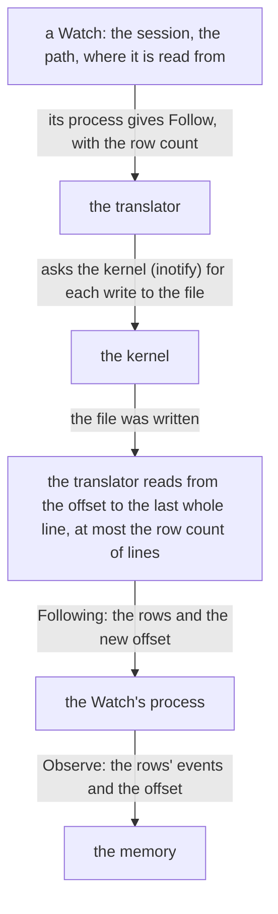

# The Claude Harness Nexus

The Claude Harness Nexus is the Harness Nexus of Claude Code. It watches Claude Code sessions and tells, as Changed, what each session is doing; `vision:harness-nexus:0` says how a Harness Nexus behaves, and this module says what the Claude one is. It is the repository `claude-harness-nexus`, stated here as built at main, revision `391e844`, version 0.8.0 of its `claude-harness-process` crate. Claude Code's own words, the payloads of its hook and the rows of its transcript, are read by the Nexus's translator, the one place that holds them; the Nexus itself holds the harness library's types.

## The repository

Four crates form one workspace on build-base.

- `claude-harness-process` holds the Signal, the meta Signal, the Emission, the Library and the Memory, the five roots generated from `ethos/` by ethos-zero 31.1.0 into `claude-harness-process/src/generated/`, and `processes.rs`, written by hand in the shape ethos-zero generates, and the bodies of the processes. It is built with no operating system under it (`no_std`, with `datom` as an optional feature for the text side).
- `claude-harness-nexus` is the Nexus program: the process manager, the signal process that holds the sockets, the memory process that holds the disk, and the connections to the translator.
- `claude-harness-translator` holds the translator library and its programs: the translator, the hook client, the CLIs and the trace reader.
- `transport` holds the place, the names of the sockets and files, and the framing of Signal on a stream.

```sh
ethos-zero 'Generate.{ [ «ethos/signal.ethos» «ethos/meta.ethos» «ethos/emission.ethos» «ethos/library.ethos» «ethos/memory.ethos» ] «claude-harness-process/src/generated» }'
```

`process.ethos` is the sixth root and is read as the model of `processes.rs`: ethos-zero resolves no import across crates, and `Subscribe`, `Subscribed` and `Changed` belong to signal-harness, `Prepare` and `Prepared` to signal-claude-prepare, so the file is written by hand with those two contracts held as the processes hold them.

The Nexus is built on these pins at revision `391e844`: process-library `63bca61`, harness-nexus-library `ae7e008` (the events, the states, `Observable`, `Transitionable` and `Identifiable`), flow-ethos `062ef9e1` (the `FlowId`), signal-harness `f302b30` (branch `next`) and signal-claude-prepare `3776141`.

## Where it runs

Each program is started with one datom, its place: `{ PlaceName Runtime State }`. The Runtime directory holds the sockets and the settings file; the State directory holds the memory and the trace. Both are created at start. The Nexus and its translator are started with the same place.

```sh
claude-harness-nexus '{ main /example/run/nexus/main /example/state/nexus/main }'
claude-harness-translator '{ main /example/run/nexus/main /example/state/nexus/main }'
```

A client, a CLI or the hook client, finds the place from its configuration: `$XDG_CONFIG_HOME/nexus/claude-harness-nexus.datom` (`$HOME/.config` when the variable is unset), holding the place's name.

```datom
{ main }
```

The client's Runtime is `$XDG_RUNTIME_DIR/nexus/<name>` and its State `$XDG_STATE_HOME/nexus/<name>` (`$HOME/.local/state` when unset), so a Nexus started on that Runtime and State is the one its clients reach. A place that cannot be read is written to standard error as `Usage`, `Unreadable` or `Invalid`, the last two with their reason, and the program exits 2; a translator that is down is written as `TranslatorDown`, and the CLI exits 1.

The Nexus binds four sockets and the translator six, each named for what it is, in the Runtime directory.

```text
Nexus
claude-harness.sock                          Signal: Report, Listening
claude-harness-meta.sock                     the meta Signal: Configure
claude-harness-subscription.sock             signal-harness: Subscribe
claude-harness-prepare.sock                  signal-claude-prepare: Prepare

Translator
claude-harness-translator.sock               the datom of Signal, in and out
claude-harness-meta-translator.sock          the datom of the meta Signal
claude-harness-subscription-translator.sock  the datom of signal-harness
claude-harness-prepare-translator.sock       the datom of signal-claude-prepare
claude-harness-hook.sock                     the payloads of Claude Code's hook
claude-harness-emission.sock                 the Nexus's emissions

Files
claude-harness-settings.json                 Runtime: the settings a session is started with
claude-harness-memory-<version>.signal       State: the memory, named for the crate's version
claude-harness-trace-<version>.signal        State: the trace, named for the crate's version
```

A Signal value on a stream is its length as four little-endian bytes, then its rkyv archive. A text socket takes one datom, read until the client shuts its writing side, and answers one datom a line for each output until the exchange ends. Each CLI is one program written once: `claude-harness '<datom>'` for the Signal, `claude-harness-meta '<datom>'` for the meta Signal, `claude-harness-subscription '<datom>'` for signal-harness and `claude-harness-prepare '<datom>'` for signal-claude-prepare. `claude-harness-trace '<place>'` reads the trace and writes one datom line for each birth, gift, taking and end.

When its sockets listen, the translator sends the Nexus `Listening`, and the Nexus answers `Acknowledged`; the Nexus gives each Watch kept in its memory a process of its own at that moment and at its own start, so either program may start first. A memory file that exists and cannot be read stops the Nexus from starting, and the file is left as it is.

## The hook

Claude Code runs the hook client at each hook event, with one JSON object on its input. The client reads its input whole, writes it as it came to the hook socket of the place named by its configuration, waits until the translator ends the connection, and ends with 0 whatever happened, so a session goes on as if no hook were there.

The translator takes the hook socket's connections one at a time, in order. It reads the payload into a Hook, calls the Nexus with the Signal input `Report` of that Hook, under the hook's process as caller, read from the connection's peer credentials, and waits for `Reported`.

An event is told by `hook_event_name`, and these are the fields read for each.

```text
SessionStart        session_id, transcript_path, source, context_tokens (when source is resume)
UserPromptSubmit    session_id
PermissionRequest   session_id
PostToolUse         session_id
Stop                session_id, last_assistant_message, background_tasks
SessionEnd          session_id, reason
```

```ethos
Signal
[ harness:[ SessionId FilePath Response BackgroundWork EndReason Tokens ] ]
[ Report.Hook
  Listening ]
[ Reported
  Acknowledged ]
[ Source.[ Startup
           Resume.Option<Tokens>
           Compact ]
  Hook.[ SessionStart.{ SessionId FilePath Source }
         UserPromptSubmit.SessionId
         PermissionRequest.SessionId
         PostToolUse.SessionId
         Stop.{ SessionId Option<Response> Vector<BackgroundWork> }
         SessionEnd.{ SessionId EndReason } ] ]
```

The translator reads the payload by these rules.

- `source` of `resume` is `Resume`, carrying `context_tokens` as `Tokens` when it is present; `compact` is `Compact`; any other value or none is `Startup`.
- `last_assistant_message` is the `Response` of a Stop when it is present.
- Each item of `background_tasks` is a `BackgroundWork` of the item's `id`, its `type` (`shell`, `subagent`, `monitor` or `workflow`) and its `description`, empty when absent; an item of another type is left out and the rest of the Stop is read.
- `reason` of `clear` is `Cleared`; any other reason is `Exited`.
- A payload that is not JSON is `Unreadable`, an event not in the table is `UnknownEvent`, and a field the event needs and lacks is `MissingField`; each is written to standard error and the report is not made.

```rust
pub enum Untranslated {
    Unreadable,
    UnknownEvent(String),
    MissingField(&'static str),
}

pub trait Translatable: Sized {
    fn translate(text: &str) -> Result<Self, Untranslated>;
}
```

`Hook` and `Row` bear `Translatable`, their bodies written by hand in the translator crate.

## The transcript

Each line of a session's transcript is one JSON object, a row. The translator reads a row into the Emission's `Row` and tells a row by its `type`, and only rows of the main thread are read: a row whose `isSidechain` is true is `Other`. The rows below are those of Claude Code 2.1.325.

```text
assistant   message.usage: input_tokens, cache_creation_input_tokens, cache_read_input_tokens
user        turnPosition, where the row carries one that is not null
user        a text item of message.content that opens with [Request interrupted by user
system      subtype stop_hook_summary, preventedContinuation false
system      subtype compact_boundary, compactMetadata: trigger, preTokens
```

```rust
impl Translatable for Row {
    fn translate(line: &str) -> Result<Row, Untranslated> {
        let value: Value = serde_json::from_str(line).map_err(|_| Untranslated::Unreadable)?;
        let main_thread = value.get("isSidechain").and_then(Value::as_bool) != Some(true);
        let usage = value.get("message").and_then(|message| message.get("usage"));
        let subtype = value.get("subtype").and_then(Value::as_str);
        let summary = subtype == Some("stop_hook_summary") && value.get("preventedContinuation").and_then(Value::as_bool) == Some(false);
        Ok(match (value.get("type").and_then(Value::as_str), main_thread, usage) {
            (Some("user"), true, _) if interrupts(&value) => Row::Interrupted,
            (Some("user"), true, _) if value.get("turnPosition").is_some_and(|position| !position.is_null()) => Row::TurnStarted,
            (Some("system"), true, _) if summary => Row::TurnEnded,
            (Some("system"), true, _) if subtype == Some("compact_boundary") => compaction(&value).map_or(Row::Other, Row::Compacted),
            (Some("assistant"), true, Some(usage)) => {
                let tokens = ["input_tokens", "cache_creation_input_tokens", "cache_read_input_tokens"]
                    .iter()
                    .filter_map(|field| usage.get(field).and_then(Value::as_i64))
                    .sum();
                Row::Assistant(Tokens(tokens))
            }
            _ => Row::Other,
        })
    }
}
```

- The `Tokens` of an assistant row is the sum of its three input counts: everything the model was given at that call.
- A turn is started by the user row that carries `turnPosition`, and ended by the `stop_hook_summary` row that did not prevent the continuation; Claude Code writes that row once its Stop hooks have run, wherever Stop is among the hooks configured.
- An interrupt is the user row whose text opens with `[Request interrupted by user`, which Claude Code writes when the user interrupts a turn, with or without `for tool use]` after it; it is the interrupt's one witness.
- A compaction is the `compact_boundary` row. Its `Compaction` is its `trigger`, `manual` as `Manual` and `auto` as `Automatic`, and the context's size before it, `preTokens`, as the optional `Tokens`; a boundary of another trigger is `Other`.
- A line that is not JSON is `Other`, and so is every row not named above.

```ethos
Emission
[ harness:[ FilePath Tokens Compaction ]
  claude_harness:[ Offset ReadFrom RowCount ]
  claude_harness:meta:[ Hooks HookClient ] ]
[ Follow.{ FilePath ReadFrom RowCount }
  Install.{ HookClient Hooks } ]
[ Following.{ Vector<Row> Offset }
  Installation.[ Installed.FilePath
                 Uninstalled.Integer ] ]
[ Row.[ Assistant.Tokens
        TurnStarted
        TurnEnded
        Interrupted
        Compacted.Compaction
        Other ] ]
```

```ethos
Library
[]
[ Offset.Integer
  ReadFrom.[ FileEnd
             Offset ]
  RowCount.Integer ]
[]
[]
```

## Events and state

Each source bears `Observable`, and its events are applied to the session's `Observed` in order by the harness library's `after`.

```rust
impl Observable for Hook {
    fn events(&self) -> Vec<Event> {
        match self {
            Hook::SessionStart(start) => match &start.source {
                Source::Startup => vec![Event::Started],
                Source::Resume(tokens) => core::iter::once(Event::Resumed).chain(tokens.iter().copied().map(Event::ContextSize)).collect(),
                Source::Compact => vec![],
            },
            Hook::UserPromptSubmit(_) => vec![Event::PromptSubmitted],
            Hook::PermissionRequest(_) => vec![Event::PermissionAsked],
            Hook::PostToolUse(_) => vec![Event::ToolUsed],
            Hook::Stop(stop) => {
                let mut events: Vec<Event> = stop.response_option.iter().cloned().map(Event::Responded).collect();
                events.push(Event::InFlight(stop.background_work_vector.clone()));
                events.push(Event::TurnEnded);
                events
            }
            Hook::SessionEnd(end) => vec![Event::Ended(end.end_reason.clone())],
        }
    }
}

impl Observable for Row {
    fn events(&self) -> Vec<Event> {
        match self {
            Row::Assistant(tokens) => vec![Event::ContextSize(*tokens)],
            Row::TurnStarted => vec![Event::PromptSubmitted],
            Row::TurnEnded => vec![Event::TurnEnded],
            Row::Interrupted => vec![Event::Interrupted],
            Row::Compacted(compaction) => vec![Event::Compacted(compaction.clone())],
            Row::Other => vec![],
        }
    }
}
```

- A Stop says what the turn answered and what it left in flight, so a turn that ends with work in flight is Waiting from the hook alone; when that work ends, Claude Code submits its result as a prompt and the session is Working again.
- A resumed session is `Resumed`, which the harness library applies as Rested with nothing in flight, followed by its context size when the payload carried one. Claude Code runs SessionStart again on a compaction, and the compaction is told by the transcript's `compact_boundary` row.
- A prompt and a turn's end each have two witnesses, the hook and the transcript row. The Nexus drops a `PromptSubmitted` or a `TurnEnded` that leaves the session's state as it was before the event, so the second witness to arrive is applied and told once.
- The context's size is in the transcript only: each assistant row gives `ContextSize`.
- A session first seen is recorded as `Dry` with `Tokens(0)` and no work in flight.
- A session that has ended, by an `Ended` event, is forgotten, its `Observed` and its Watch, once the `Changed` of that event is given.

## The Memory

The memory process holds the records and keeps them whole in one file before each answer; a change that cannot be kept is answered `Unremembered`.

```ethos sketch
Memory
[ harness:[ Event FilePath Observed ]
  flow:[ FlowId ]
  claude_harness:[ Offset ReadFrom ]
  claude_harness:processes:[ Changed ]
  claude_harness:meta:[ Set ] ]
[ Watch.{ FlowId FilePath ReadFrom }
  Observed
  Keep.Set ]
[ Observe.{ FlowId Vector<Event> Option<Offset> }
  Recall.{} ]
[ Observation.Vector<Changed>
  Recollection.Vector<Observed> ]
[]
```

```rust
struct Records {
    observed_vector: Vec<Observed>,
    watch_vector: Vec<Watch>,
    hooks: Hooks,
    hook_client_option: Option<HookClient>,
    row_count_option: Option<RowCount>,
}
```

The records are archived with rkyv into the memory file in the State directory, written whole to a file of the same name ending `.next` and moved into place. They are each session's `Observed`, each `Watch`, and the three values that `Keep` sets: the hooks, the hook client and the row count.

- `Watch` is kept as it is, with the offset read so far, when a Watch of the same session and file is held; a Watch of another file replaces the session's Watch.
- `Observe` applies its events, in order, to the session's `Observed`, and answers the `Changed` of each event that was not dropped; it also keeps the offset it carries as the session's Watch's `ReadFrom`. An `Observe` that carries an offset and finds no Watch for its session is applied to nothing.
- `Recall` answers every `Observed` as it is now.
- `Keep` sets one of the four values of the meta Signal.

## The processes

Each call on a socket is born as a process of the Nexus's process manager, under an identity the Nexus draws, and the manager traces every birth, gift, taking and end. Five processes exist.

```ethos sketch
Process
[ claude_harness:signal:[ Report Reported ]
  signal_harness:[ Subscribe Subscribed Changed ]
  signal_claude_prepare:[ Prepare Prepared ]
  claude_harness:meta:[ Configure Configured Hooks HookClient ]
  claude_harness:memory:[ Watch Observe Recall Keep ]
  claude_harness:[ RowCount ]
  claude_harness:emission:[ Follow Install ] ]
[ Report.{ []
           [ Reported Watch Observe Changed ]
           Reporting }
  Watch.{ [ RowCount ]
          [ Follow Observe Changed ]
          Watching }
  Subscribe.{ []
              [ Recall Subscribed ] }
  Configure.{ []
              [ Keep Configured ]
              Configuring }
  Prepare.{ [ Option<HookClient> Hooks ]
            [ Install Prepared ]
            Preparing } ]
[ Reporting.[ Observed Unremembered ]
  Watching.[ Forgotten Unfollowed ]
  Configuring.[ Configured Unremembered ]
  Preparing.[ Installed Uninstalled Unobserved Unconfigured ] ]
```

- Report gives `Reported` at once. A SessionStart then gives a `Watch`, read from its first row, `Offset.0`, when the source is `Startup`, and from the file's end, `FileEnd`, when it is `Resume` or `Compact`. Every Report gives an `Observe` of the hook's events with no offset, then gives each `Changed` the observation answers, and ends `Observed`.
- Watch is born once a `RowCount` is configured, for each Watch the memory holds that has no living process, at the Nexus's start, on `Listening`, and whenever a Watch or the configuration is kept. It gives `Follow`, and for each `Following` it gives an `Observe` of its rows' events with the new offset, then each `Changed` the observation answers. It ends `Unfollowed` when its connection to the translator ends, and `Forgotten` when its Watch has left the memory.
- Subscribe gives `Recall`, then `Subscribed` with the recollection, and rests while its connection is open.
- Configure gives `Keep`, then `Configured` with the set it kept, and ends `Configured`.
- Prepare is born of a Prepare call, holding the hook client and the hooks as configured at that moment.

## Watching a transcript

`Follow` is a lasting emission: the Nexus opens a connection of its own to the emission socket for each Watch, writes `Follow.{ FilePath ReadFrom RowCount }`, and reads a `Following` each time rows were written, until it closes the connection.



- `ReadFrom.FileEnd` is the length of the file when the following begins; every `Following` after the first holds `ReadFrom.Offset` of the offset read so far.
- A `Following` carries whole lines only, at most `RowCount` rows; a line cut off at the end of the file is read when its newline is written. When a read fills the row count the next read follows at once.
- A transcript not yet written is waited for: the translator watches the nearest existing directory above it for the file's creation, then follows the file. A path with no existing directory above it ends the connection.
- The connection's closing by the Nexus ends the following.

## Subscription

The subscription is signal-harness, one contract for every Harness Nexus, served here at `claude-harness-subscription.sock`.

```ethos
Signal
[ harness:[ Event State Observed ]
  flow:[ FlowId ] ]
[ Subscribe ]
[ Subscribed.Vector<Observed>
  Changed ]
[ Changed.{ FlowId Event State } ]
```

```sh
claude-harness-subscription 'Subscribe'
```

A subscriber is answered `Subscribed`, every session as it is observed then, and each `Changed` that follows. From the moment its recollection is taken a subscriber misses nothing: a `Changed` that arrives before its `Subscribed` is written is held and written after it. Every `Changed` goes to every subscriber, and a subscriber's process ends when its connection closes. The session is named by its flow id, and the state is written with its head. The ids and sizes below are plainly examples.

```datom
Subscribe
Subscribed.[ { 15c0ce Flowing.Working 181204 [] } ]
Changed.{ 15c0ce ContextSize.183950 Flowing.Working }
Changed.{ 15c0ce Responded.«Reviewed; green.» Flowing.Working }
Changed.{ 15c0ce TurnEnded Flowing.Rested }
```

## How it names a session

The Nexus names a session by a `FlowId`. The harness library's `Identifiable` gives it: the first six characters of the harness's `SessionId`. Every Watch, Observe, Subscribed and Changed carries that `FlowId`, and a Report reads it from its hook.

```rust
impl Identifiable for SessionId {
    fn identify(&self) -> flow::FlowId {
        flow::FlowId(self.0.chars().take(6).collect())
    }
}

impl Identifiable for Hook {
    fn identify(&self) -> FlowId {
        match self {
            Hook::SessionStart(start) => start.session_id.identify(),
            Hook::UserPromptSubmit(session) | Hook::PermissionRequest(session) | Hook::PostToolUse(session) => session.identify(),
            Hook::Stop(stop) => stop.session_id.identify(),
            Hook::SessionEnd(end) => end.session_id.identify(),
        }
    }
}
```

## Configuration

The Nexus keeps four values, set through the meta Signal at `claude-harness-meta.sock`, and each is a change of the Memory; a value set is kept across restarts.

```ethos
Signal
[ claude_harness:[ RowCount ] ]
[ Configure.Set ]
[ Configured.Set ]
[ HookName.String
  Hooks.Vector<HookName>
  HookClient.String
  Set.[ Hooks
        RemoveHook.HookName
        HookClient
        RowCount ] ]
```

- `Hooks` is the names of the hooks a session is started with, empty until set; `RemoveHook` takes one name out of it.
- `HookClient` is the path of the program Claude Code runs at each hook, the hook client of this repository.
- `RowCount` is the most rows one `Following` carries; Watches are given their processes once it is set.

The path and the count below are plainly examples.

```sh
claude-harness-meta 'Configure.Hooks.[ SessionStart UserPromptSubmit PermissionRequest PostToolUse Stop SessionEnd ]'
claude-harness-meta 'Configure.HookClient./example/bin/claude-harness-hook'
claude-harness-meta 'Configure.RowCount.256'
```

## The settings a session is started with

The settings file is written when a session is about to be started, from the hooks and the hook client as configured then. signal-claude-prepare is the contract, served at `claude-harness-prepare.sock`.

```ethos
Signal
[ harness:[ FilePath ] ]
[ Prepare ]
[ Prepared.Option<FilePath> ]
[]
```

```sh
claude-harness-prepare 'Prepare'
```

A Prepare is born with the hook client and the hooks that the memory holds. It gives `Install.{ HookClient Hooks }` to the translator, which writes the file and answers `Installation`; the Nexus answers `Prepared.Some.<path>` for `Installed` and `Prepared.None` for `Uninstalled` and for an installation that was not observed. With no hook client configured, `Prepared.None` is answered at once and the process ends `Unconfigured`. The process ends `Installed`, `Uninstalled`, `Unobserved` or `Unconfigured`.

The translator writes `claude-harness-settings.json` in the Runtime directory: one entry for each hook name, running the hook client as a command, written whole to a file ending `.next` and moved into place. `Uninstalled` carries the operating system's error number. The path below is plainly an example.

```json
{ "hooks": { "SessionStart": [ { "hooks": [ { "type": "command", "command": "/example/bin/claude-harness-hook" } ] } ] } }
```

A session is started with `--settings` naming that file, so that Claude Code runs the hook client at each hook of the file.
