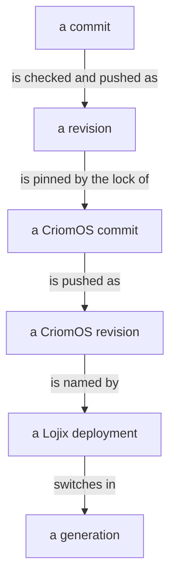
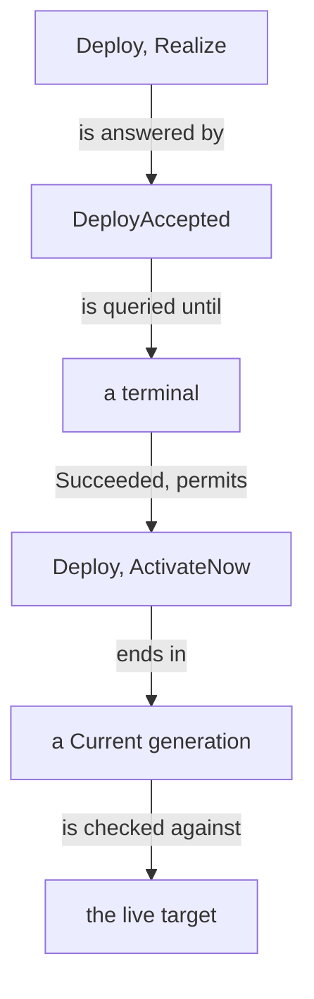
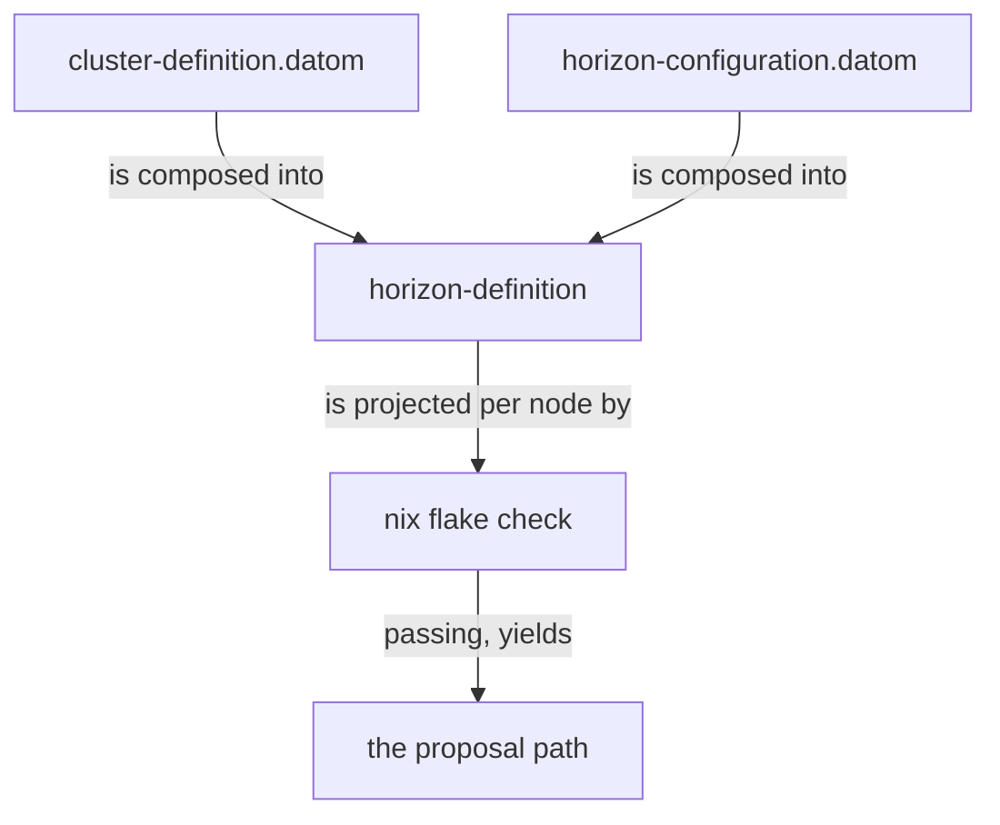

## From commit to generation switch



The owning repository is CriomOS for a host, CriomOS-home for the user environment, the cluster's own repository for the cluster data. The consumer pins a producer with `nix flake update <input>`; the URL stays bare. Nothing is installed, linked, started or edited on a machine by hand.

```datom
; a Realize of the CriomOS revision R
; P: the proposal, S: the secrets, R: the revision
; U: example-user@example-node.example-cluster.example
Deploy.UserEnvironment.{
   example-cluster example-node example-user
   P
   SecretsDirectory.S
   github:example-owner/CriomOS?rev=R
   { ssh-ng://U U }
   Horizon
   { homeConfigurations.example-user.activationPackage }
   HomeManagerNixProfileV1
   Realize            ; then ActivateNow
   RequireImmutable
   Some.@/etc/nix/machines
   [] }
```

`P` is the absolute `horizon-definition.datom` the cluster data check yields, `S` the cluster's secrets directory, `R` a pushed 40-hex CriomOS revision.

## A Lojix deployment



```ethos
; meta-signal-lojix: the owner's request
DeploySubmission.[
   UserEnvironment.UserEnvironmentDeployment
   Host.HostDeployment ]
UserEnvironmentDeployment.{
   ClusterName
   NodeName
   UserName
   ProposalSource      ; horizon-definition
   SecretsInput
   FlakeReference      ; CriomOS?rev=<hex>
   DeploymentTransport ; user-scoped
   DeploymentInputMode
   DeploymentOutputSelector
   ActivationBackend
   UserEnvironmentAction
   SourceRevisionPolicy
   Option<NixBuilderSpec>
   Vector<ExtraSubstituter> }
HostDeployment.{
   ClusterName
   NodeName
   HostComposition     ; in place of the user
   ProposalSource
   SecretsInput
   FlakeReference
   DeploymentTransport ; root-scoped
   DeploymentInputMode
   DeploymentOutputSelector
   ActivationBackend
   HostDeployAction
   SourceRevisionPolicy
   Option<NixBuilderSpec>
   Vector<ExtraSubstituter> }
; signal-lojix: the parts
SecretsInput.[ NoSecrets
               SecretsDirectory.String ]
DeploymentTransport.{ NixStoreUri
                      SshDestination }
DeploymentInputMode.[ Horizon Direct ]
DeploymentOutputSelector.{ FlakeAttribute }
ActivationBackend.[ HomeManagerNixProfileV1
                    NixosSystemdBootV1 ]
UserEnvironmentAction.[ Realize
                        SetProfile
                        ActivateNow ]
HostComposition.[ CompleteHost BaseHost ]
SourceRevisionPolicy.[ RequireImmutable
                       ResolveAndRecord ]
; signal-lojix: the answers
DeployHandle.{ DeploymentIdentifier
               DatabaseMarker } ; admission only
DeploymentRecord.{
   DeploymentIdentifier
   GenerationIdentifier
   DeploymentRequestIdentity
   Option<AdmissionMarker>
   DeploymentLifecycle
   Option<TerminalMarker>
   Option<DeploymentTerminal> } ; done when Some
DeploymentTerminal.[
   Succeeded
   Failed.DeploymentFailure  ; stderr only
   Rejected.DeploymentTerminalReason ]
ActivationEffect.[ ProfileOnly LiveActivation
                   BootProfile BootOnceProfile
                   TestActivation ]
GenerationSlot.[ Current BootPending Recent
                 Pinned Rollback ]
```

```datom
; a Realize, then an ActivateNow, as Lojix answers
DeployAccepted.{ 13 { 500 500 } }
Queried.{ [] [ { 13 13
   { UserEnvironment.example-user example-cluster example-node
     UserEnvironment
     UserEnvironment.Realize ProfileOnly
     RequireImmutable Some.R }
   Some.{ 500 500 } Completed
   Some.{ 516 516 } Some.Succeeded } ] … }
DeployAccepted.{ 14 { 521 521 } }
Queried.{ [ { 14 14 example-cluster example-node
     UserEnvironment LiveActivation Current
     Some.G Some.R } ]
   [ { 14 14 … UserEnvironment.ActivateNow
     LiveActivation … Completed
     Some.{ 554 554 } Some.Succeeded } ] … }
```

`G` is the Home Manager generation's store path. `Current` is what Lojix recorded, not what runs. After an `ActivateNow` the target is read: the Home Manager profile resolving to `G`, `~/.nix-profile` holding `G`'s home-path alone, every Home file linking into `G`'s home-files, and each unit the change touched in the state it was meant to reach. `ActivateNow` sets the profile before it activates, so the profile, the links and the units are each read apart. A file or a profile package placed by hand fails the activation: a file in a declared file's place stops it at the link check, and a hand-installed package that collides with the declared home-path stops it after the old home-path has left the profile. Past the record, a diagnosis is a separately authorized command as the user; never a root shell, a hand move, a forced overwrite or an unapproved retry.

A host takes the same chart with `Deploy.Host`, the root pair `{ ssh-ng://root@<host> root@<host> }` and the output `nixosConfigurations.target.config.system.build.toplevel`; `SetBootProfile` leaves the generation `BootPending`, and the living reboots.

## A cluster data check



`horizon-compose` in the cluster's repository composes its `cluster-definition.datom` with `criomos-horizon-config/horizon-configuration.datom`; a definition that does not compose fails the build. `nix flake check` projects each node through `horizon-cli` and asserts its builder, network and capability facts. A passing check yields the proposal `P` above.
