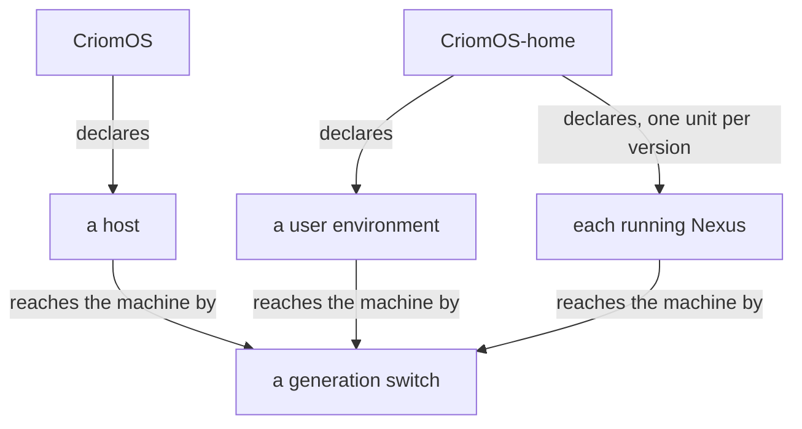
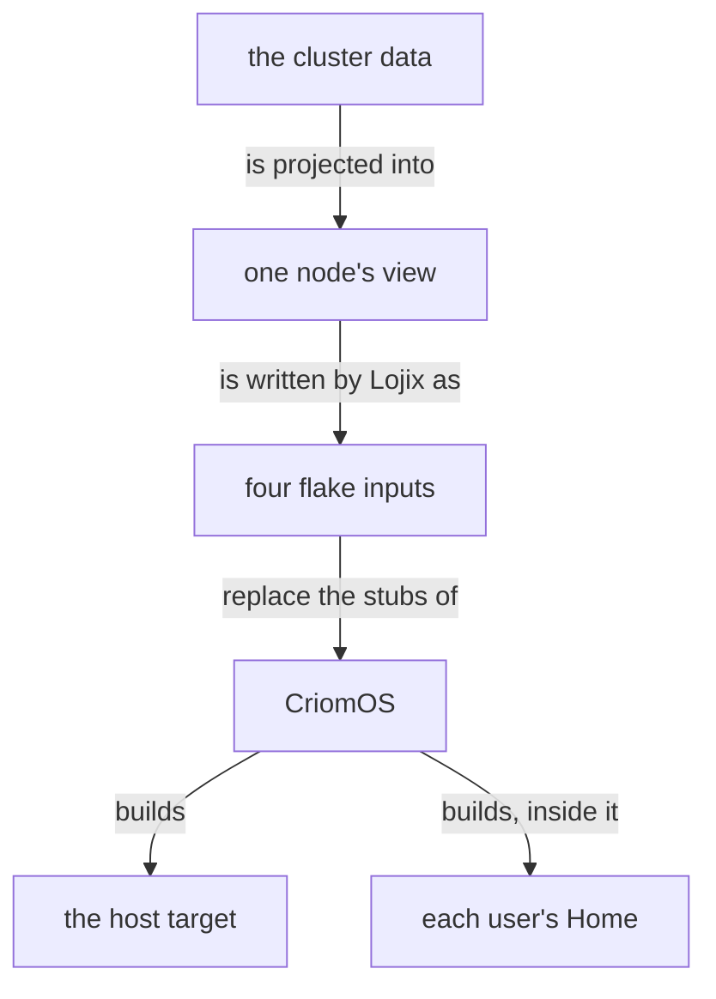
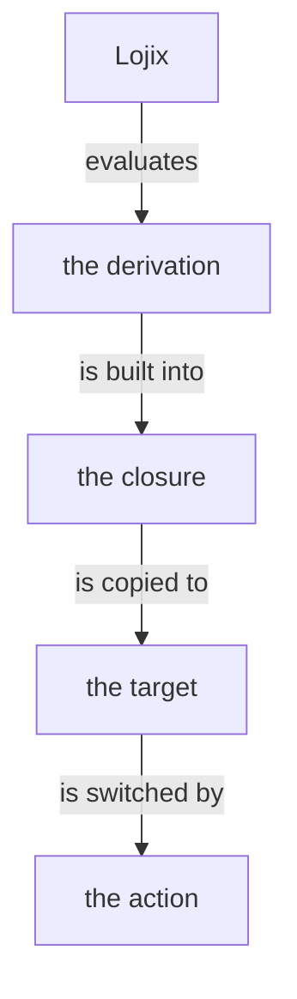

Everything that runs is declared, always: packages, units, drop-ins, timers, links. Several versions of a Nexus run side by side, each its own declared unit. A thing placed by hand is a defect, replaced by its declaration.

A Horizon role or capability field decides what is enabled; CriomOS holds no cluster or node name (`CriomOS/AGENTS.md`). `modules/nixos/userHomes.nix` still decides by node and user names; that awaits a ruling.

## From declaration to host

```ethos
; horizon-rs lib/ethos/horizon.ethos
HorizonDefinition.{ HorizonConfiguration
                    ClusterDefinition }
ClusterDefinition.{ ClusterName   ; example-cluster
                    ClusterNodes
                    GenericNodeNames
                    Users
                    Domains
                    ClusterTrust }
NodeDefinition.{ NodeName
                 NodeVariant
                 Magnitude
                 Magnitude
                 MachineDefinition
                 NodeEnvironment
                 NodeNetwork
                 NodeKeys
                 Option<Boolean>
                 Capabilities   ; decides a module
                 Option<FixedLocation> }
MachineDefinition.[
   Metal.{ Architecture Hardware }
   VirtualMachine.{ VirtualMachineHost
                    Hardware
                    Option<Integer> } ]
Capabilities.Vector<NodeCapability>
; abridged: 22 variants
NodeCapability.[ Center Edge LargeAi Router
                 NixBuilder.Option<Integer>
                 NixCache TailnetController
                 VmHost … ]
```

```datom
; example-node, in a cluster definition, abridged
{ example-node … Large Max
  Metal.{ X86_64
          { 12 Some.ExampleModel
            None Some.12 Some.32 None } }
  …
  [ Edge.{} LowPower.{} NextGeneration.{}
    HardwareVideo.{} … ]
  … }
```



The four inputs are `horizon`, `system`, `deployment` and `secrets`. The host target is `nixosConfigurations.target`; a Home is `homeConfigurations.<user>.activationPackage`, built only through CriomOS.

CriomOS-home is the input `criomos-home`, a bare URL; CriomOS's `flake.lock` holds its revision.

## Where a fix lands

A fix lands in the repository that owns the thing, and is deployed.

- A kernel parameter for one machine model or role: `boot.kernelParams = lib.concatLists [...]` in `modules/nixos/metal/default.nix`, with `optionals behavesAs.center [...]` blocks inside it; the whole module applies under `mkIf behavesAs.bareMetal`.
- A new machine model: one row in `modelFactsIndex` in the same file. An unset or unlisted model throws at evaluation.
- A system package: `environment.systemPackages` in the module that owns it. A new module is added to the `imports` of `modules/nixos/criomos.nix`.
- A unit: `systemd.services.<name>` in a module, gated by `mkIf` on a Horizon field; a user unit: `systemd.user.services.<name>` in CriomOS-home.
- A fact that differs per cluster: the cluster's own data repository, not the `horizon-rs` implementation.
- A user program or a Nexus version: CriomOS-home.

## Lojix: build, deploy, ask



`nix eval`, then `nix build` on the named builder, then `nix copy --to <store-uri>`.

```ethos
; signal-lojix
HostDeployAction.[
   Evaluate          ; activates nothing
   Realize           ; builds; activates nothing
   SetBootProfile    ; profile set; boot
   ActivateNow       ; profile set; switch
   TestActivation    ; test alone
   ScheduleBootOnce ] ; boots it once
```

Lojix has no rollback. Going back is a new deployment of an earlier CriomOS revision.

## Criome

Criome is a BLS12-381 signature authentication and attestation daemon: it holds a master key, an identity registry and delegation grants; verifies signatures; and signs attestations (`criome/ARCHITECTURE.md`). It serves a working socket for clients and an owner-only meta socket. CriomOS runs it as a systemd service when `services.criome.enable` is set; the option is off by default and the module is imported for every node (`modules/nixos/criome.nix`). Its master key is generated on first start and kept in the daemon's state directory.

`criome/ARCHITECTURE.md` states that `lojix-daemon` submits a request digest to the local criome and acts after a grant. Lojix source contains no reference to criome, so this participation is a documented design, unverified in code.

## What CriomOS does not use

The CriomOS guide records that hosts carry no `/etc/nixos` flake, so `microvm -l` reports empty; guests are read with `systemctl list-units 'microvm@*'` (`CriomOS/AGENTS.md:42`).
