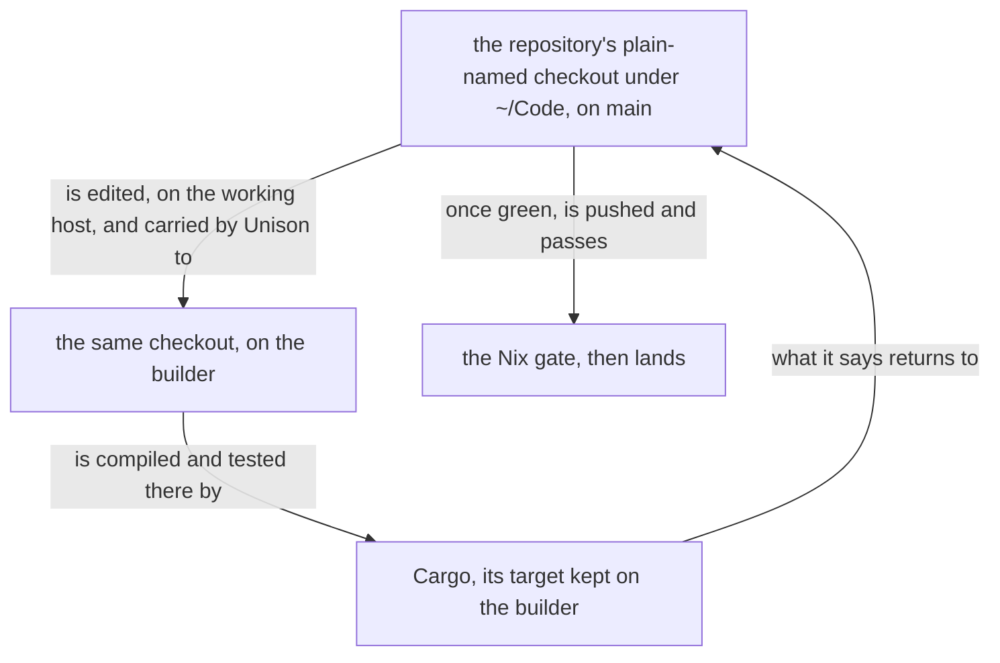

A change being worked on is edited on the host he works at and compiled and tested on the builder by Cargo. Unison keeps `~/Code` the same on both hosts, both ways, within seconds, and leaves out `target`, `result`, `result-*` and `.direnv`. Nix builds what is kept: the gate a revision passes before it lands, and what is deployed (knowledge:nix-rust-builds:0).



## The plain checkout

A repository has one development checkout at `~/Code/<repo>`, on `main`. The checkout is claimed with Orchestrate before its first edit and has one writer. Git is written on the working host alone; the builder reads its synchronized replica without taking its locks.

## Compiled and tested on the builder

An edit reaches the builder within about half a second to eight seconds, and a commit's objects arrive apart from its files. A run first checks that the builder holds what it tests: an uncommitted edit by the digest of its file, a commit by its HEAD and a clean tree.

```sh
ssh <builder> 'cd ~/Code/<repo> && test "$(git rev-parse HEAD)" = <commit> && test -z "$(GIT_OPTIONAL_LOCKS=0 git status --porcelain)" && nix develop -c sh -ec "cargo build --locked && cargo test --locked"'
```

Cargo is the toolchain of the repository's development shell, from build-base; Nix only supplies it. A repository with no development shell takes the toolchain of the build-base its lock pins.

```sh
ssh <builder> 'cd ~/Code/<repo> && nix shell github:<owner>/build-base/<rev>#toolchain -c cargo test --locked'
```

The builder's plain `cargo` refuses to compile until the host's iteration Cargo is deployed; the shell's Cargo is used.

`target` stays on the builder, where a warm build takes hundredths of a second. A development shell whose hook writes into its working directory is entered from a scratch directory on the builder, with `CARGO_TARGET_DIR` there, so nothing it writes enters the synchronized tree.

## What lands

A green Cargo run is the work's own check. A change lands when its pushed revision passes the gate on the builder, a Nix build (knowledge:nix-rust-builds:0, Where a build runs).
