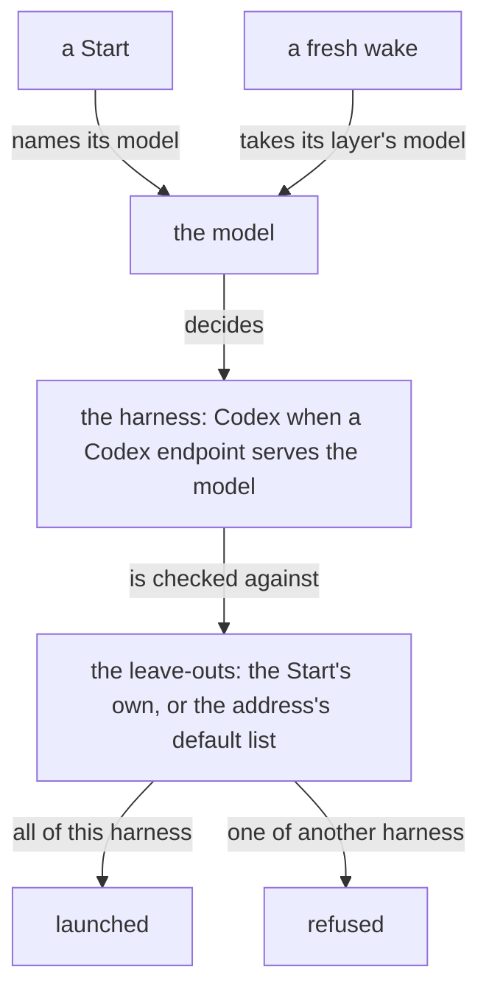

Read on 2026-10-17 in Flow `67b80b3` (0.35.11, installed and running);
the configuration was read from the running Nexus with
`flow-meta 'Configuration'` at 12:55 -06:00.

## How a launch is configured

A Start names its own model. A fresh wake has none to name, so it takes
the one model Flow keeps for its layer. The model then decides the
harness: Codex when a configured Codex endpoint serves it, Claude
otherwise. A Start that names no leave-outs takes its address's
default list, and a list naming another harness's leave-out is
refused.



## One model per layer

The models are keyed by layer alone. The running Nexus holds four, all
Claude:

```sh
flow-meta 'Configuration'
# -> Configuration.{ { … }
#      [ { Primary claude-fable-5-1 }
#        { Quaternary claude-haiku-5-5 }
#        { Secondary claude-opus-5-5 }
#        { Tertiary claude-sonnet-5-5 } ] [] [ … ] }
```

A fresh wake looks up its layer's model
(`crates/flow-nexus/src/waking.rs`, `start_fresh`):

```rust
let Some(model) = snapshot
    .models
    .iter()
    .find(|model| model.layer == address.layer)
else {
    return Err(Failed_Data::CompositionRefused);
};
```

and the harness follows the model (`crates/flow-nexus/src/codex.rs`):

```rust
fn harness_for<N: crate::generated::starter::Textual>(&self, input: N) -> HarnessKind {
    match self.adapter_for(&input.text()) {
        Ok(_) => HarnessKind::Codex,
        Err(_) => HarnessKind::Claude,
    }
}
```

A Codex flow is never resumed, only woken fresh: the wake plan resumes
a Claude flow alone. So, read from the code and not witnessed, a fresh
wake of any Mind, Field or Codex Psyche metaflow starts on the Claude
model of its layer; for `{ Psyche flow Secondary }`, now Astra, that
is `claude-opus-5-5`.

No branch gives a metaflow its own model. Flow 0.35.12, branch
`da2038-model-identity` at `437aa3d` (pushed, not merged, not
installed), refuses a model name that is not exact for its harness; it
keeps one model per layer.

## Default leave-outs per address

The defaults are one list per address, whatever the harness. The running
Nexus holds Claude-only lists for every Psyche address it names and
for the Field illustrator and publisher, and Codex-only lists for
Field core Primary and the Mind core and prototyping addresses:

```sh
flow-meta 'Configuration'
# -> … { { Psyche flow Secondary }
#        [ ClaudeAiConnectors ExplorePlanAgents
#          WorkflowTool SkillTool BundledSkills
#          ScheduleWakeupTool ReportFindingsTool
#          ListAgentsTool CronTools DeferredTools
#          ClaudeMd GitInstructions ] } …
```

A Start that names none takes that list
(`crates/flow-nexus/src/composition.rs`):

```rust
let leave_outs = self
    .launch_profile
    .leave_outs_option
    .clone()
    .unwrap_or_else(|| input.leave_outs());
```

and each leave-out must belong to the launch's harness
(`crates/flow-nexus/src/lean.rs`):

```rust
if leave_out.harness() != self.harness_kind {
    return Some(LeaveOutRefusal::NotForHarness(leave_out.clone()));
}
```

So a Codex Start at a Psyche address, naming no leave-outs, is refused.
The second attempt to start 17c364 on Astra was:

```sh
# /home/li/primary/flows/d68c82/launch/
#   flow-ethos-2026-10-17/flow-start-02.out
# -> StartRejected.LeaveOutRefused.NotForHarness
#      .ClaudeAiConnectors
```

The third attempt named the six Codex leave-outs itself and started.

Flow 0.35.13, branch `flow-da2038-leaveout-harness` at `0a65ff1`
(pushed, not merged, not installed), keeps one default list per
address and harness, and a Start naming none takes the list for its
own harness, or none.
