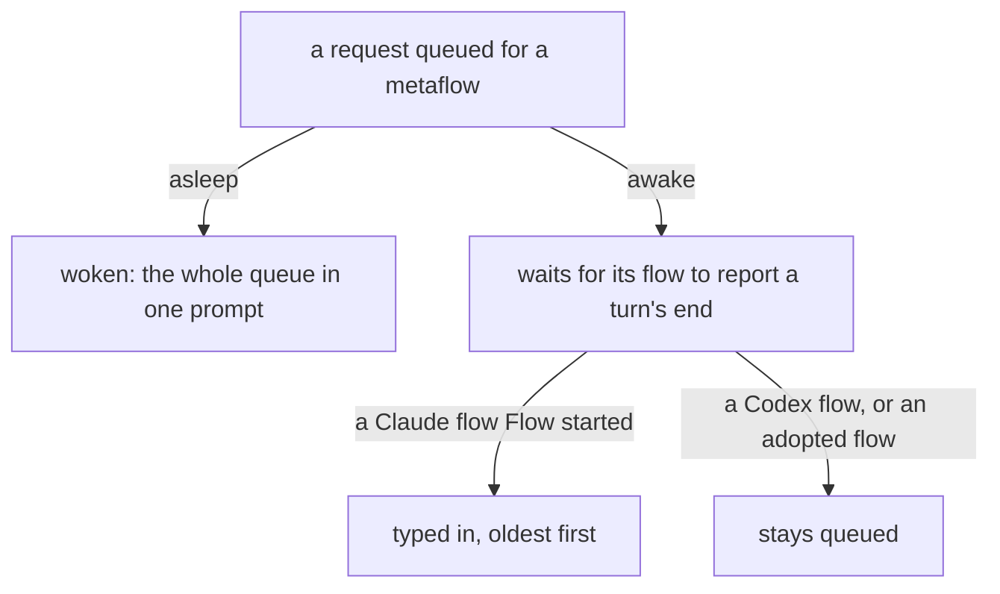

Read on 2026-10-17 in Flow `67b80b3` (0.35.11, installed and running);
the queues were observed through the running Nexus at 12:55 -06:00.

## How a queued request reaches its flow

Every request is queued first. An asleep metaflow is woken by a work
request and gets its whole queue in its first prompt. An awake
metaflow's queue waits for its flow to report the end of a turn
(`Stopped`); Flow then types the oldest request into its pane. Only a
Claude flow that Flow started carries the hook that reports `Stopped`.
A Codex flow, which runs no hook, and an adopted flow, started without
Flow's hook, never report it, so their queue stays.



A Primary is the exception: it is never woken and never put to sleep,
so what is queued for an asleep Primary waits.

## The code

The request kinds and which of them wake, in
`crates/flow-ethos/ethos/library.ethos` (quoted whole at Flow `67b80b3`;
`Request` and `QueuedRequest` are in it) and
`crates/flow-nexus/src/waking.rs`:

```ethos
; Flow's shared types live in this leaf package. Signal and Meta-Signal
; import them here and re-export their original Rust paths. Aspect is one
; nominal type shared by addresses, launch profiles and meta configuration.

Library
[]
[ FlowId.String
  ; ethos-zero 16 cannot express Topic:Name yet; check camelCase at input.
  Topic.String
  ; The design type is Blake3.Bytes<32>; 16.0 uses a 64-hex-character string.
  Blake3.String
  Layer.[ Primary Secondary Tertiary Quaternary ]
  Subaspect.[ Vision Intent Knowledge Operation Trial Compensation ]
  ; Define the component types once. Source refers to these declarations;
  ; inlining Path.String inside Source would redeclare Path globally.
  Repository.String
  Hash.Blake3
  Path.String
  Reason.String
  Source.{ Repository Hash Path }
  Key.{ Subaspect Topic }
  Said.{ Context.String Verbatim.String }
  Request.[ Order.String
            Question.String
            Psyche.Said
            Psyches.Vector<Said>
            Result.String
            Notice.String ]
  Aspect.[ Psyche Mind Field ]
  Address.{ Aspect Topic Layer }
  Recipient.[ Address Up ]
  ; Who a queued request is from: the Address Flow resolved for its sender
  ; (the Lock's Sender of a Deliver, the thread's metaflow of a send-tool
  ; call), or Unknown for a request queued before Flow kept senders.
  SentBy.[ Sender Unknown ]
  QueuedRequest.{ SentBy Request }
  Metaflow.{ Address
             State.[ Awake.FlowId Asleep Ended ]
             Past.Vector<FlowId>
             Queue.Vector<QueuedRequest> }
  Lock.{ Sender Address Until.Integer }
  Process.{ Pid.Integer Started.Integer }
  Sender.Address
  OrdinarySocketPath.String
  MetaSocketPath.String
  StorePath.String
  Start.{ OrdinarySocketPath MetaSocketPath StorePath }
  ; Startup refusal is distinct from the ordinary/meta socket Refusal.Store.String.
  StoreRefusal.{ Path Reason }
  StartRefusal.[ Store.StoreRefusal ]
  SourceRoot.String
  ClientPath.String
  Home.String
  ControlSocketPath.String
  ModelName.String
  CodexEndpoint.{ ClientPath Home ControlSocketPath Vector<ModelName> }
  StableCodex.CodexEndpoint
  NextCodex.CodexEndpoint
  HarnessKind.[ Codex Claude ]
  KeyName.String
  CommandSigil.String
  InterruptKeys.Vector<KeyName>
  SubmitKeys.Vector<KeyName>
  HarnessProfile.{ HarnessKind Vector<CommandSigil> InterruptKeys SubmitKeys }
  HarnessProfiles.Vector<HarnessProfile>
  MetaAspects.Vector<Aspect>
  MessageNexusPath.String
  MessageNexusBinary.String
  Nexus.{ SourceRoot
          StableCodex
          NextCodex
          HarnessProfiles
          MetaAspects
          MessageNexusPath
          MessageNexusBinary
          Lease.Integer } ] ; Lease seconds; 60 before any Nexus payload.
[]
[]
```

```rust
/// Work and the living's words wake a seat; a Result or a Notice waits
/// queued for its next wake.
fn wakes_for(request: &Request) -> bool {
    matches!(
        request,
        Request::Order(_) | Request::Question(_) | Request::Psyche(_) | Request::Psyches(_)
    )
}

/// A Primary is never woken automatically: what is queued for it waits.
fn wakes_layer(layer: &Layer) -> bool {
    *layer != Layer::Primary
}
```

A wake is due only for an asleep metaflow:

```rust
fn wake_is_due(&self, metaflow: &Metaflow) -> bool {
    metaflow.state == flow_ethos::State::Asleep
        && Self::wakes_layer(&metaflow.address.layer)
        && (metaflow
            .queue
            .iter()
            .any(|queued| Self::wakes_for(&queued.request))
            || metaflow.past.last().is_some_and(|flow_id| {
                matches!(
                    self.store.flow_node(flow_id),
                    Ok(Some(node)) if node.flow_lifecycle.is_live()
                )
            }))
}
```

An awake flow's queue is typed in by `settle_stopped`, which runs when a
`Report` of `Stopped` arrives. The report comes from `flow-hook`, which
Flow puts in the settings of each Claude flow it launches
(`crates/flow-nexus/src/herdr/launch.rs`):

```rust
let mut settings = serde_json::json!({
    "permissions": { "defaultMode": "bypassPermissions" },
    "hooks": {
        "SessionStart": hook,
        "PostToolUse": every_tool,
        "Stop": hook,
    }
});
```

## What the queues held

At 12:55 -06:00, `flow 'Metaflows'` showed two awake metaflows with
work waiting:

| Metaflow | Flow | Waiting |
|---|---|---|
| Psyche flow Secondary | 17c364, Codex, its pane idle | two Orders from Psyche ethos Secondary |
| Psyche core Secondary | d68c82, adopted Claude | one Notice from Psyche flow Secondary |

Earlier that day Field delivered 17c364's queued requests by hand: it
sent Flow a `Report` of `Stopped` after each turn 17c364 had really
finished, and Flow typed the oldest request. That is recorded in
`/home/li/primary/flows/42265e/log.md` and
`/home/li/private-repos/flow-evidence/42265e/direct-starter-retry-20261017/idle-drain-17c364/`.

## The repair, not deployed

Flow 0.35.14, branch `flow-da2038-codex-drain` at `10ced18` (pushed,
not merged to main, not installed), reads each Codex thread's
`turn/started`, `turn/completed` and `thread/status/changed` events
from its app-server, and settles a resting Codex flow the way a
`Stopped` report settles a Claude flow
(`crates/flow-nexus/src/codex_turns.rs`):

```rust
pub enum ThreadTurn {
    /// No event has shown the thread in a turn or at rest.
    Unknown,
    /// In a turn: the one named, or one whose id no event has given.
    Running(Option<String>),
    /// Flow typed work into the seat and no turn has started since.
    Delivered,
    /// Its last turn ended and no other has started.
    Resting,
}
```

Its commit message names Codex flows only; it says nothing of an adopted
Claude flow without `flow-hook`.
