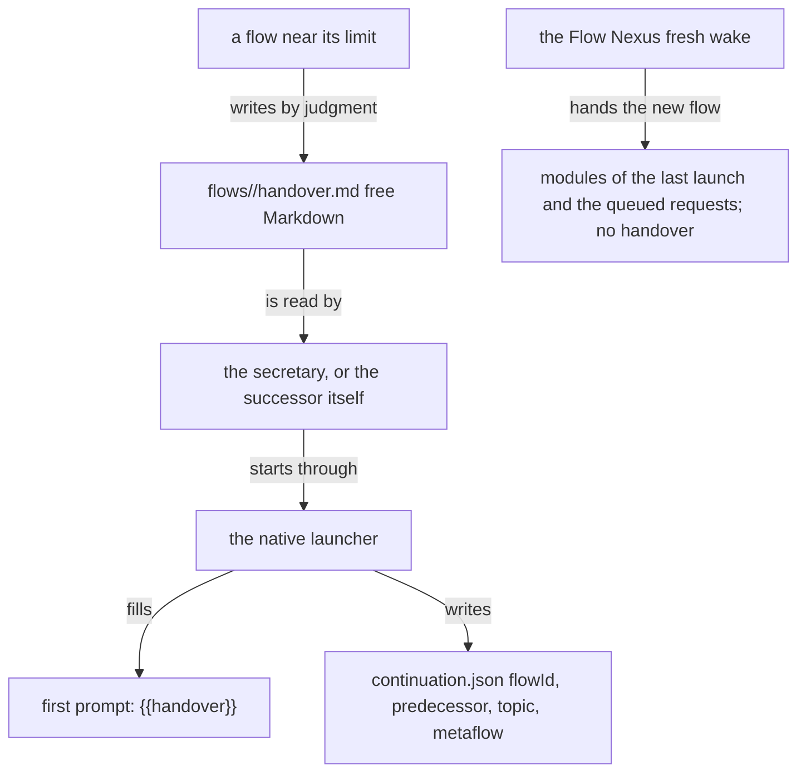

A handover today is a Markdown file a flow writes by its own judgment,
`flows/<flow-id>/handover.md` in Primary. Nothing types it, nothing
generates it, and the Flow Nexus neither asks for one nor delivers one.
A successor started by Primary's native launcher receives text in the
`{{handover}}` slot of its first prompt; a successor woken fresh by the
Flow Nexus receives its modules and the queued requests.

Verified on 2026-10-17 against Primary `bda70b5`, Flow `67b80b3`
(0.35.11), meta-signal-flow `a918b7d` and field-belief `95121c6`.

## How it flows



## The file

Primary holds 33 `flows/*/handover.md` files on 2026-10-17. Their
sections are chosen by each writer and differ from file to file: among
them the seat, open decisions waiting on the living, judgments to carry,
next bounded work and references. No ethos type and no checker covers
them.

## The first prompt

Configuration is Flow's datom, read with `flow-meta 'Configuration'`. The first
prompt carries the handover, the modules and the raw psyche records.

## In the Flow Nexus

`hand_over` in `crates/flow-nexus/src/waking.rs` types queued work into a
live pane; it carries no handover. A fresh wake composes the last
launch's system and user modules again and hands over the queue. The
`Handover` number of `ConfigureThreshold` is read nowhere
(knowledge-refresh).

## The request for a handover

The only program that asks for a handover is
`tools/context-refresh-hook.mjs`, which has not run (knowledge-refresh).
Its body, sent as JSON:

```js
{ kind: 'ContextRefreshHandover',
  instruction: 'The refresh procedure has started. … Write a judgment-only handover of decisions and unresolved reasons, name the context topics to split to existing or new topic flows, and include no facts that tools can look up. …',
  observedTokens, thresholdTokens, measurementQuality, action: 'refresh-started',
  decisions: [], unresolvedReasons: […], contextSplit: {…}, windowTokens }
```
