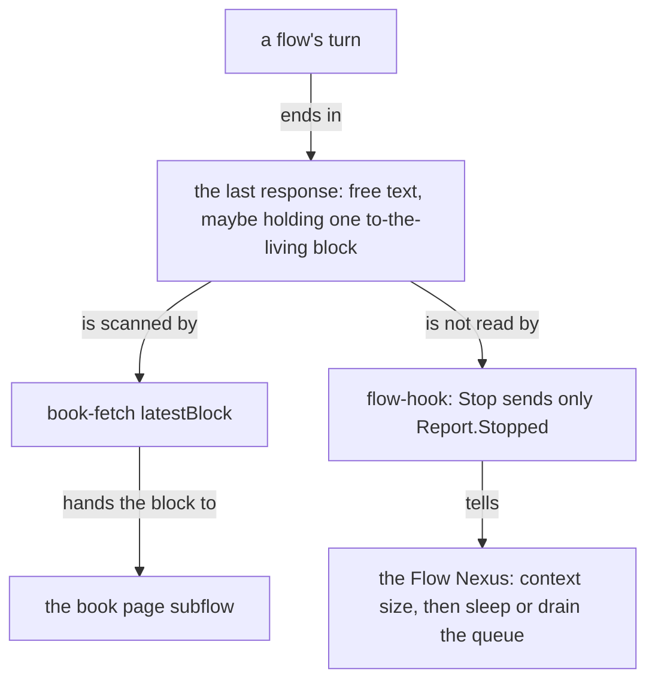

A flow's last response is the assistant text its harness records at the
end of a turn. It has no type. The book page tooling reads one marked
block inside it. When a turn ends, the Flow Nexus is told only that the
turn stopped.

Verified on 2026-10-17 against Flow `67b80b3` (0.35.11, the version
installed and running), Primary `bda70b5`, and field-belief
`compensation/main-flow.md` at `95121c6`.

## How it flows



## The marked block

A presentation meant to become a book sits between two marker lines, and
its first line inside is one datom naming the book (field-belief
`compensation/main-flow.md`, line 42):

```markdown
<!-- to-the-living:start -->
Presentation.{ «The last response as a datom object» }

# The last response as a datom object
...
<!-- to-the-living:end -->
```

`Presentation.{ «title» }` is the only datom in it. No ethos type
declares `Presentation`; the title is matched as text. Everything outside
the markers is machine output in prose.

Primary's `tools/book-fetch.mjs` finds the last complete block of the
main thread:

```js
export function latestBlock(records) {
  let latest = null;
  for (const [line, record] of records) {
    if (record.isSidechain || record.type !== "assistant" || !Array.isArray(record.message?.content)) continue;
    for (const block of record.message.content) {
      if (block.type !== "text" || typeof block.text !== "string") continue;
      const start = block.text.lastIndexOf(BLOCK_START);
      if (start < 0) continue;
      const end = block.text.indexOf(BLOCK_END, start);
      if (end < 0) continue;
      latest = { line, text: block.text.slice(start, end + BLOCK_END.length) };
    }
  }
  return latest;
}
```

Usage, from inside the flow whose transcript is read:

```sh
node tools/book-fetch.mjs --block
# stdout: <!-- to-the-living:start --> ... <!-- to-the-living:end -->
```

It reads Claude transcripts only: the session comes from
`CLAUDE_CODE_SESSION_ID` or `--session`, the file from
`~/.claude/projects/<project>/<session>.jsonl`.

## What the Flow Nexus learns at the end of a turn

The Flow Nexus writes `flow-hook` into every Claude flow it launches. On `Stop` it
reads `hook_event_name` and `FLOW_ID` and sends one datom; it reads
nothing of the response (`crates/flow/src/hook.rs`):

```rust
let event = match self.event_name().as_str() {
    "SessionStart" => "Started".to_owned(),
    "PostToolUse" => match self.input.get("tool_name").and_then(serde_json::Value::as_str) {
        Some(tool_name) => format!("ToolUsed.{}", tool_name.quoted()),
        None => return HookCall::Nothing("PostToolUse without a tool_name"),
    },
    "Stop" => "Stopped".to_owned(),
    _ => return HookCall::Nothing("no Report for this event"),
};
HookCall::Report(format!("Report.{{ {} {event} }}", flow_id.quoted()))
```

```sh
flow 'Report.{ «d68c82» Stopped }'
```

On `Stopped` the Nexus reads the context size from the Claude transcript
(see knowledge-refresh), then types the oldest queued request into the
flow or puts it to sleep (`crates/flow-nexus/src/waking.rs`). No path in
The Flow Nexus reads, stores or forwards the response text.

## Codex

A Codex rollout records the answer of a completed turn as
`payload.last_agent_message` of its `task_complete` row, and the final
text as a `response_item` with phase `final_answer` (knowledge-codex-rollout).
No Primary tool and no Flow Nexus path reads either of them as a response
object.
