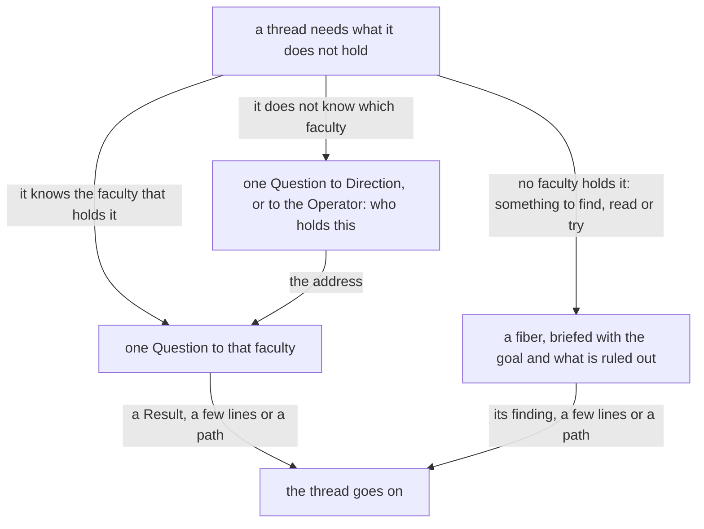

# Asking

A thread works from what it holds. What it does not hold, another faculty already does, and has paid for: the cheapest way to it is one Question to that faculty, answered in a few lines.

A thread does not study a subject another faculty holds. Reading a module, a code base or a transcript to learn what a running faculty could say in three lines spends the reader's context on what is already paid for.

A Question says what is wanted and what the asker already holds, so the answer carries only the rest. The asker goes on with other work while it waits, and takes its best reading if no answer comes.

A fiber is for work, not for knowledge a faculty holds: a search, a reading across files, a check, a draft. It is briefed with the goal, what is known, and the form of what comes back.

What a thread learns this way and will need again, it asks the faculty that keeps that subject's module to write down.
