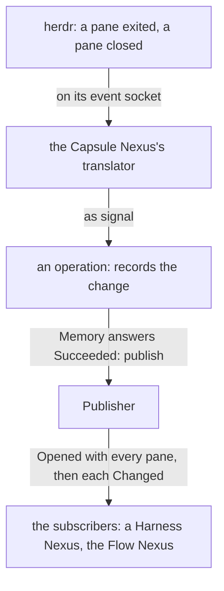

# The Capsule Nexus tells what herdr announces

The Capsule Nexus is the one Nexus that wraps herdr. It learns of a pane's change from herdr itself: its translator subscribes to herdr's event socket, and each event herdr publishes, a pane exited or a pane closed among them, becomes an operation that records the change and publishes it. The Capsule Nexus asks herdr for its list once, when it starts, to have the state it opens with; after that every change arrives as an event.



Its Subscribe is a subscription as notion:subscription:0 has it: the stream opens with every pane as it stands and then carries each change, with the pane and state types the Capsule Nexus's vision already declares.

```rust
impl Subscribable for Panes {
    type State = Vec<Pane>;
    type Change = Changed;
    fn state(&self) -> Vec<Pane> { self.pane_vector.clone() }
}
```
