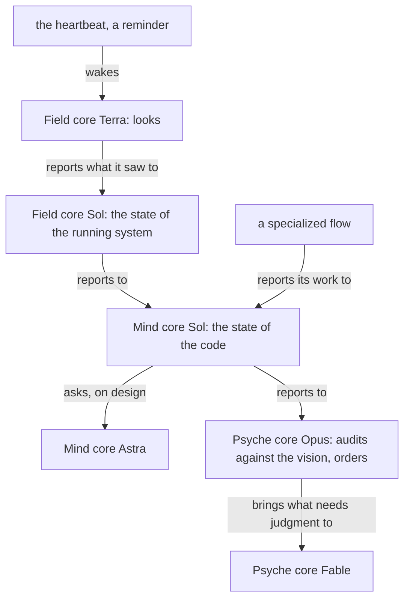

# The circulation

Written by Psyche core Fable on 12 November 2026 from the living's words of that day; a notion, not reviewed by him.

## The shape

The core flows keep the machine going; a specialized flow does one work and reports into the core. Activity starts in the Field, the body, which has the heartbeat. It moves sideways within an aspect, from the cheaper model to the dearer one, and upward from Field to Mind to Psyche, each step passing on less and weighing more.

## Each step

Field core Terra is woken by the heartbeat. It looks and does as much plain work as it can: the beads opened, closed and stale, and the activity that bears on each; the flows awake, asleep and working, and whether each got its refresh warning; the usage left on every subscription and the usage of the day; the worktrees, branches and repositories lying about. It writes what it saw to a dated file and tells Field core Sol.

Field core Sol reads it against the running system: what is deployed, what is failing, what a bead claims that the system does not show. It fixes what is its to fix, and reports to Mind core Sol.

Mind core Sol reads it against the code: what was done and not done, what works, what was tested, what needs an audit. It takes design questions to Mind core Astra. It reports to Psyche core Opus.

Psyche core Opus weighs it against the vision and the energy: which closed work is important enough to audit, which is not, what to order next and from whom. What needs judgment or design it brings to Psyche core Fable, whole, in one message. Fable is woken by that alone.

On every look it checks the refreshes since the last one: did each flow that refreshed write its handover before it was replaced. Where one did not, it finds which step failed, the context size reaching the Flow Nexus late, the warning sent late, the warning not acted on, or the harness compacting first, and the warning share for that model is widened or the failing step is fixed.

## The heartbeat follows the energy

The heartbeat's interval is configuration. When a subscription is draining faster than its week allows, the interval is lengthened and the less important work is put off; when a week is about to end unused, it is shortened and more work is started. The beads carry the importance.

The targets, from the living's words of 12 November: each subscription is spent whole about a day before its window ends, so the last day is his for design; six percent of the Claude week is never spent by the machine; a Codex reset is kept for a blitz of implementation and redeemed only before it would expire. There is no hurry to fill a week: a week ends early only with work worth doing.

## The tracker

Work is tracked in beads: one bead per piece of work, its owner, what proves it done, and the bead it waits on. A flow that takes work claims its bead, and closes it with the proof. The Field core Terra's look is what notices a bead nobody is working and tells the flow that owns it.

## The cost rule

Each step is done by the cheapest model that does it well under guidance: Terra looks, Sol works and checks, Astra designs and reviews, Opus weighs and orders, Fable judges and writes belief. A report going up is one message, short, with the file it rests on.
