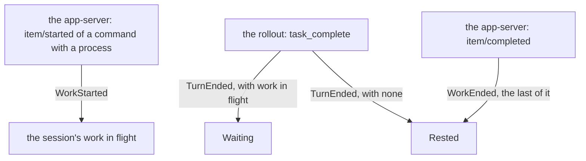
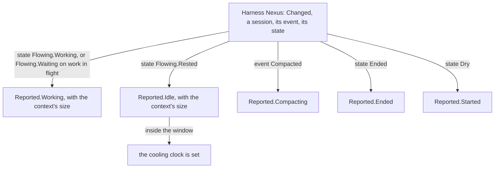

# The Codex Harness Nexus

While Flow relies on the makeshift watcher for Codex context readings, launches follow knowledge:codex-flow-start:0.

## The rollout

Each row is one JSON object; a row is told by payload.type, and only these fields are read.

```text
task_started
token_count     payload.info.last_token_usage.input_tokens, or info null
task_complete   payload.last_agent_message, or null
turn_aborted
```

```ethos
Library
[ harness:[ Tokens Response ] ]
[ Row.[ TaskStarted
        TokenCount.Option<Tokens>
        TaskComplete.Option<Response>
        TurnAborted
        Other ] ]
[]
[]
```

```rust
impl Observable for Row {
    fn events(&self) -> Vec<Event> {
        match self {
            Row::TaskStarted => vec![Event::PromptSubmitted],
            Row::TokenCount(Some(tokens)) => vec![Event::ContextSize(tokens.clone())],
            Row::TaskComplete(Some(response)) => vec![Event::Responded(response.clone()), Event::TurnEnded],
            Row::TaskComplete(None) => vec![Event::TurnEnded],
            Row::TurnAborted => vec![Event::Interrupted],
            Row::TokenCount(None) | Row::Other => vec![],
        }
    }
}
```

## The hook

```ethos
Signal
[ harness:[ Session FilePath Trigger ] ]
[ Report.Hook ]
[ Reported ]
[ Hook.[ SessionStart.{ Session Option<FilePath> }
         PermissionRequest.Session
         PostToolUse.Session
         PostCompact.{ Session Trigger } ] ]
```

```rust
impl Observable for Hook {
    fn events(&self) -> Vec<Event> {
        match self {
            Hook::SessionStart(_) => vec![Event::Started],
            Hook::PermissionRequest(_) => vec![Event::PermissionAsked],
            Hook::PostToolUse(_) => vec![Event::ToolUsed],
            Hook::PostCompact(compact) => vec![Event::Compacted(Compaction { trigger: compact.trigger.clone(), tokens_option: None })],
        }
    }
}
```

Codex's own session end also fires on a thread idle for thirty minutes, so it is not read as the session's end.

## The rollout's path

The hook may name no path; then the path is read from Codex's own record of its threads.

```ethos
Emission
[ harness:[ Session FilePath ] ]
[ FindRollout.Session ]
[ RolloutFinding.[ Found.FilePath Unfound ] ]
[]
```

## The app-server, tentative

```ethos
Library
[ harness:[ Session BackgroundWork WorkId Failure ] ]
[ Notification.[ ItemStarted.{ Session BackgroundWork }
                 ItemCompleted.{ Session WorkId }
                 TurnFailed.{ Session Failure } ] ]
[]
[]
```

```rust
impl Observable for Notification {
    fn events(&self) -> Vec<Event> {
        match self {
            Notification::ItemStarted(item) => vec![Event::WorkStarted(item.background_work.clone())],
            Notification::ItemCompleted(item) => vec![Event::WorkEnded(item.work_id.clone())],
            Notification::TurnFailed(turn) => vec![Event::Failed(turn.failure.clone())],
        }
    }
}
```



# What the Flow Nexus takes from it

This section extends vision flow-nexus 0-1 and holds where the two differ.

## A flow is a thought flow

A flow is a thought flow of a thinking machine, run in one session of a harness. A permaflow is the series of flows under one address, and the thought continues through the series: each flow ends in a crystallization and the next starts from it. A flow with a goal unachieved is acting; a flow with none is resting.

A session is what a harness sets up to run a flow: dry until its first prompt is submitted, and flowing from then.

## The efficient window

```datom
EfficientWindow.{ Sol 150000 30 5 }
CrystallizationGuide.{ { Mind flowNexus Sol } knowledge:crystallization-implementer:0 }
Investigator.{ Psyche core Opus }
```

## A flow's state is a record of events

The Flow Nexus holds a flow's state as the last of its transitions, each recorded with the event that caused it, for every harness alike. The harness's Nexus tells it, by subscription, each event of a session and the state it leaves; the Flow Nexus's own clock and the requests it delivers are causes as well.


