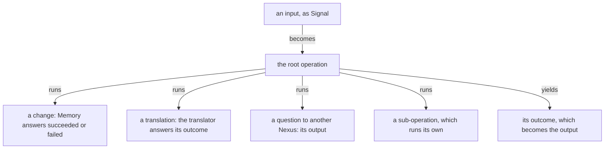
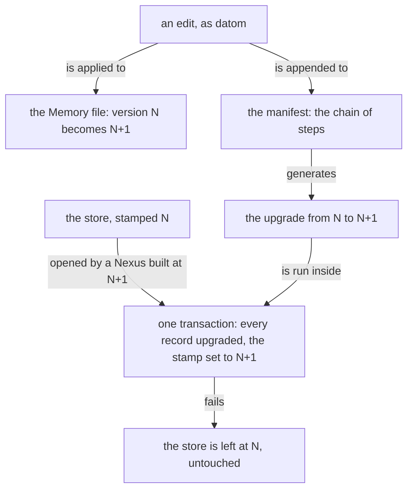

# Experiment operation 1: operations as objects, memory beneath them, the trace between

Pass 1 of 3, by Psyche Fable, 19 November 2026. A design to be tried, not vision. Every name is tentative. Written from what is wanted, without reading the code as it stands.

## The one idea

Everything a Nexus does is an object that is run and yields an outcome. The body of an operation does its work by running other objects: a change to memory, a translation into the world, a question to another Nexus, a smaller operation of its own. There is one verb, run, and it is the one checkpoint: the object that goes in and the outcome that comes out are both typed values declared in Ethos, so both can be traced.



## What the author writes

The Ethos, for a small Nexus that keeps counters. It is the trial's subject and exists for nothing else.

```ethos sketch
Operation
[ ledger:[ Name Amount ] ]
[ Deposit.{ Name Amount }
  Transfer.{ From.Name To.Name Amount } ]
[ Deposited.Balance
  Transferred
  Refused.[ UnknownAccount.Name Insufficient.Balance ] ]
[ Balance.Integer ]
```

```ethos sketch
Memory
[ ledger:[ Name Amount ] ]
[ Account.{ Name Balance.Integer } ]
```

The Rust written by hand, and nothing else: one body per operation.

```rust
impl Operable for Transfer {
    type Outcome = TransferOutcome;
    async fn operate(self, scope: &Scope) -> TransferOutcome {
        let Some(from) = scope.run(Recall::<Account>(self.from.clone())).await else {
            return Refused(UnknownAccount(self.from));
        };
        if from.balance < self.amount { return Refused(Insufficient(from.balance)); }
        scope.run(Withdraw { name: self.from, amount: self.amount }).await;
        scope.run(Deposit { name: self.to, amount: self.amount }).await;
        Transferred
    }
}
```

No rkyv, no socket, no actor library, no runtime, no channel appears in it. Scope is the only thing the body is handed.

## The traits

```ethos sketch
Traits
[ Operable.{ [] [ Outcome ] [] [ operate.{ [ Scope ] [ Outcome ] } ] }
  Runnable.[ run.{ [ Operable ] [ Outcome ] } ] ]
```

Scope bears Runnable. What is Operable, each with its body written once in the library:

- an operation of the Operation file: body by hand;
- Recall, Remember, Forget, over any Memorizable record: body in the library, carried out by the one owner of the store;
- several changes as one, Atomic: all succeed or none;
- a translation of the Translation file: carried to the translator, its Outcome returned;
- Ask, over any Answerable input of another Nexus's contract: carried on a connection.

## Who runs it

To be found by the trial, in two variants behind the same Scope, so the bodies above compile unchanged on both:

- A, plain tasks: each root operation is a Tokio task; the store has one owning task and a channel; nothing else.
- B, actors: the store, each connection and each long-lived holder of state is a Kameo actor; Scope.run sends the object as a message to the actor that handles its kind.

What the trial reports for each: lines of library, what a body can and cannot express, what happens when a sub-operation fails or the Nexus stops mid-operation, and the cost of one run.

## Memory

A record at rest is the same binary form as on the wire: a Signal, in the store, under its identity. The author declares the record in the Memory file and writes nothing else.

```ethos sketch
Traits
[ Identifiable.{ [] [ Identifier ] [] [ identify.[ Identifier ] ] }
  Memorizable.{ [ Identifiable Signalizable ] [] [] [] } ]
```

Tentative rule for the trial: a record's identity is its first field. The store is redb underneath, one table per record type, and only the memory library knows it.

## An upgrade is derived from the edit

A Memory file is changed by an edit, a typed value, and never by hand. The edit is applied to the Ethos file and appended to the Nexus's manifest in one act; the upgrade of what is stored is derived from the same edit.

```ethos sketch
Types
[ Edit.[ AddField.{ Record Field Default }
         RemoveField.{ Record Field }
         RenameField.{ Record From.Field To.Field }
         RenameRecord.{ From.Record To.Record }
         AddVariant.{ Enum Variant }
         RemoveVariant.{ Enum Variant Replacement.Variant }
         Reshape.{ Record Body } ]
  Version.Integer
  Step.{ Version Vector<Edit> } ]
```

Reshape is the one edit whose upgrade is a body written by hand; every other is mechanical.



Open, for the trial to answer: rkyv does not describe itself, so reading a record of version N needs the type of version N. Either the generator emits the previous version's types from the chain of edits, or a record at rest is kept in a form that reads without its type. Try the first; report what the second would cost.

## The trace

The Nexus writes no datom. A trace is declared in an Ethos file of the Nexus and generated: Object and Outcome are generated enums over every object that Nexus can run and every outcome it can yield. In a tracing build the Nexus sends each Trace as Signal on a third socket, the trace socket. A debugging translator, a program of its own compiled with that contract and the datom feature, composes each Trace and prints it as datom. An ordinary build compiles none of it.

```ethos sketch
Types
[ Path.Vector<Integer>
  Trace.{ Path Event }
  Event.[ Entered.Object Yielded.Outcome ] ]
```

What the debugging translator prints:

```datom
{ [] Entered.Transfer.{ alice bob 5 } }
{ [ 0 ] Entered.Recall.alice }
{ [ 0 ] Yielded.Some.{ alice 12 } }
{ [ 1 ] Entered.Withdraw.{ alice 5 } }
{ [ 1 0 ] Entered.Remember.{ alice 7 } }
{ [ 1 0 ] Yielded.Succeeded }
{ [ 1 ] Yielded.Withdrawn }
{ [] Yielded.Transferred }
```

A test then states the whole motion of the machine as the trace it expects, read from what the debugging translator prints, not only what went in and what came out.

## What pass 1 does not know

1. Whether async bodies with one Scope are enough, or whether some operations must be written as steps that can be stored and resumed after a restart.
2. Whether a root operation should be atomic as a whole. Here only Atomic, a group of changes, is; a body that awaits the world between two changes is not.
3. Where long-lived state that is not Memory lives, a queue or a connection, and whether that is what an actor is for.
4. How an event from the world, a timer or a watched file, becomes a root operation.
5. How a subscription, an operation that yields many times, is run and traced.
6. Whether an existing Rust library already gives run-and-trace, the store with derived upgrades, or both.
