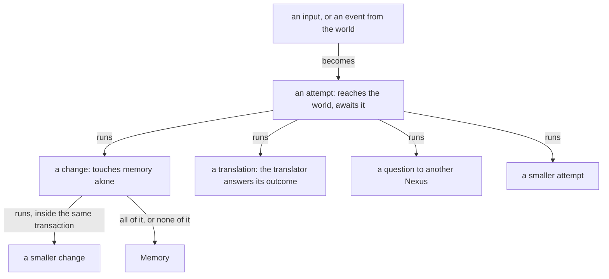
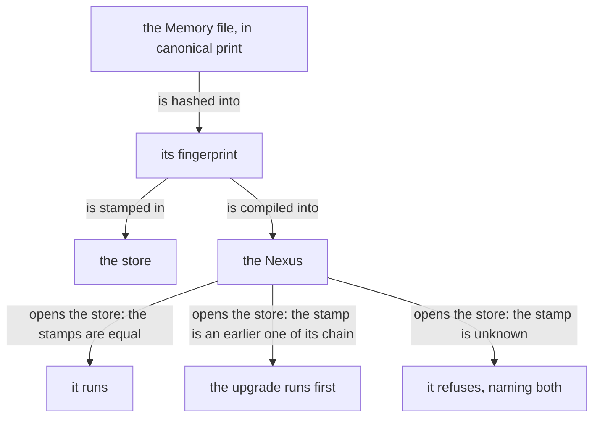
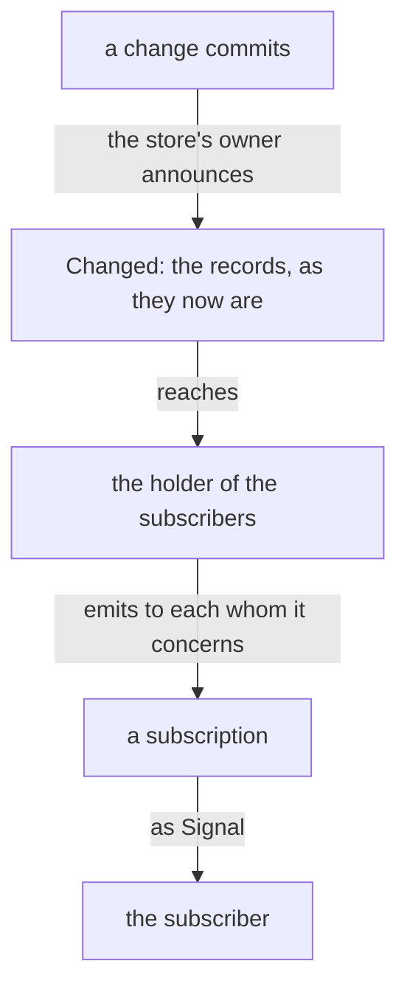

# Concept operation, revision 2: changes and attempts

Pass 2 of 3, by Psyche Fable, 19 November 2026. Replaces revision 1 whole. A design to be tried, not vision; every name is tentative. It answers what pass 1 found: a transfer that left its withdrawal behind, two roots losing an update, an archive read under the wrong type, a trace written as text, an upgrade standing apart from the machine.

## Two kinds of object, by what they touch



A change touches memory and nothing else. Its body is not async and is handed the transaction; it reads and writes there, runs smaller changes there, and when it yields a refusal nothing it did remains. One change is one transaction, so it is whole and no other change runs between its reading and its writing.

An attempt reaches the world. Its body is async and is handed the Scope. It runs changes, translations, questions and smaller attempts, and is not whole: the world is not rolled back. What an attempt must not lose if the Nexus stops, it keeps as a record, by a change, before it reaches out.

The body cannot mix them: a change has no Scope to await, and that is the compiler's doing.

## Where each is declared

Changes are declared with what they change, in the Memory file; attempts in the Operation file.

```ethos sketch
Memory
[ ledger:[ Name Amount ] ]
[ Account.{ Name Balance.Integer }
  Reservation.{ ReservationId Name Amount } ]
[ Deposit.{ Name Amount }
  Withdraw.{ Name Amount }
  Transfer.{ From.Name To.Name Amount }
  Reserve.{ ReservationId Name Amount }
  Settle.ReservationId
  Release.ReservationId ]
[ Deposited.Balance
  Withdrawn.Balance
  Transferred
  Reserved
  Settled
  Released
  Refused.[ UnknownAccount.Name Insufficient.Balance UnknownReservation.ReservationId ] ]
[ ReservationId.String ]
```

The sections of a Memory file: imports, records, changes, what a change yields, types.

```ethos sketch
Operation
[ ledger:[ Name Amount ReservationId ] ]
[ Pay.{ ReservationId Name Amount }
  Resume ]
[ Paid
  Unpaid.Integer
  Resumed.Integer ]
[]
```

```ethos sketch
Traits
[ Changeable.{ [] [ Yield Refusal ] [] [ change.{ [ Transaction ] [ Result<Yield Refusal> ] } ] }
  Operable.{ [] [ Outcome ] [] [ operate.{ [ Scope ] [ Outcome ] } ] } ]
```

## What the author writes

```rust
impl Changeable for Transfer {
    type Yield = Transferred;
    type Refusal = Refused;
    fn change(self, memory: &mut Transaction) -> Result<Transferred, Refused> {
        memory.run(Withdraw { name: self.from, amount: self.amount })?;
        memory.run(Deposit { name: self.to, amount: self.amount })?;
        Ok(Transferred)
    }
}

impl Operable for Pay {
    type Outcome = PayOutcome;
    async fn operate(self, scope: &Scope) -> PayOutcome {
        if let Err(refused) = scope.run(Reserve { .. }).await { return refused.into(); }
        match scope.run(Remit { .. }).await {
            Remitted => { scope.run(Settle(self.reservation_id)).await; Paid }
            Unremitted(code) => { scope.run(Release(self.reservation_id)).await; Unpaid(code) }
        }
    }
}
```

Remit is a translation. Resume is the attempt a Nexus runs when it starts: it finds every Reservation still standing and settles or releases each by asking the world what became of it.

## Who runs it

Plain tasks. The store has one owner, a thread of its own, since the store's calls block; a change is sent to it and runs there, whole. Each attempt is a task. No actor library is under this revision. Whether a long-lived holder of state that is not memory, a connection or the set of subscribers, is better an actor is asked once more below, on a case that has one.

## Memory knows which schema it holds



The same stamp, of the Signal file, is what two peers compare when a connection opens.

## The upgrade is a change

The edit chain of pass 1 stands: an edit is a typed value, applied to the Memory file and appended to the manifest in one act, and the earlier types and each conversion are generated from the chain. Now it joins the machine: the upgrade is a change like any other, generated, run by the store's owner as the first change after opening, in its one transaction, and traced.

```ethos sketch
Types
[ Edit.[ AddField.{ Record Field Default }
         RemoveField.{ Record Field }
         RenameField.{ Record From.Field To.Field }
         RenameRecord.{ From.Record To.Record }
         AddVariant.{ Enum Variant }
         RemoveVariant.{ Enum Variant Replacement.Variant }
         Reshape.{ Record Body } ]
  Step.{ Fingerprint Vector<Edit> }
  Manifest.{ Original.Fingerprint Vector<Step> } ]
```

Edit, Step and Manifest are declared in Ethos and generated, not written in Rust. A step holds several edits. A step names the fingerprint it arrives at.

To be widened in this pass: records holding a vector, an option, another record, an enum whose variants carry data; an identity that is not text.

## The trace is Signal

```ethos sketch
Types
[ Root.Integer
  Path.Vector<Integer>
  Trace.{ Root Path Event }
  Event.[ Entered.Object
          Yielded.Outcome
          Emitted.Outcome
          Ended
          Abandoned ] ]
```

Object and Outcome are generated enums over everything this Nexus can run and everything it can yield. Root tells one root from another. Abandoned is an object that was entered and dropped before it yielded. Emitted and Ended are a subscription's: each further item, and its close.

In a tracing build the Nexus sends each Trace as Signal on its trace socket. The debugging translator, a program of its own compiled with that contract and with datom, prints each as datom. An ordinary build holds none of it.

```datom
{ 4 [] Entered.Transfer.{ alice bob 5 } }
{ 4 [ 0 ] Entered.Withdraw.{ alice 5 } }
{ 4 [ 0 ] Yielded.Withdrawn.7 }
{ 4 [ 1 ] Entered.Deposit.{ bob 5 } }
{ 4 [ 1 ] Yielded.Deposited.9 }
{ 4 [] Yielded.Transferred }
```

## An event from the world is an input

The world reaches the Nexus through its translator alone. A timer that fires, a file that changes, a reply that arrives late: the translator sends each as a typed value, as Signal, and it becomes a root attempt as an input does.

## A subscription

When a change commits, the store's owner announces what it changed, as typed values. A subscription is an attempt that yields the state when it is entered, then emits each announced change that concerns it, until its subscriber leaves.



## What pass 2 asks of the trial

1. The ledger rebuilt on changes and attempts: the two lost-update and partial-transfer scenarios of pass 1 must now be impossible, and the tests say so.
2. Pay with a stub translator whose Remit can succeed, fail, or never answer; the Nexus killed between Reserve and Settle; Resume after restart.
3. The fingerprint: a store opened by a Nexus of another schema refuses; the reordered type of the research probe is refused.
4. The upgrade as the first change, traced, on the widened shapes.
5. The trace socket and the debugging translator; the Tester states expected traces from this file alone.
6. A subscription to one account's balance, and a timer event from the stub translator; the holder of the subscribers built once as a plain task and once as an actor, and what each costs said.

## What pass 2 does not know

1. Whether one writer thread, every change in turn, is enough for a Nexus under load, or whether changes on unrelated records must run side by side.
2. Whether Resume is written by hand for each Nexus or can be derived from the records an attempt keeps.
3. What a subscriber is owed when it falls behind: every change, or the latest state.
4. Whether Ethos can generate all of this, the traits, Object and Outcome, the earlier types, or what it lacks to do so.
