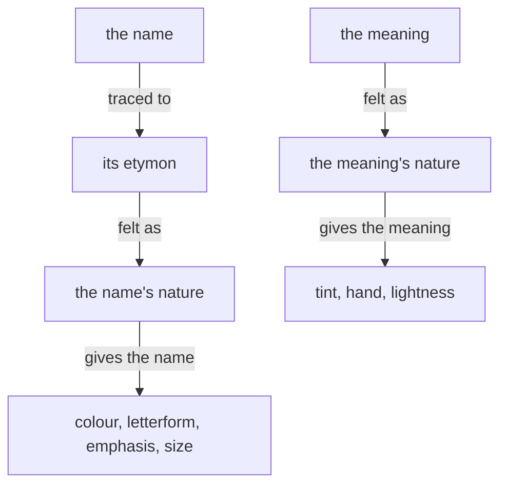

```ethos sketch
DescribedVisualObject.{ Name.String
                        Meaning.String }
```

```datom
DescribedVisualObject.{ centre «what all else turns around» }
```

```ethos sketch
Types
[ Quality.[ Solar Lunar Martial Mercurial Jovian Venusian Saturnian Ascending Descending ]
  Tendency.{ Quality
             Weight.Integer }
  Nature.⟦ Tendency ⟧
  Etymon.{ Root.String
           FirstSense.String }
  NameReading.{ Etymon Nature }
  MeaningReading.Nature
  DescribedReading.{ NameReading MeaningReading } ]
```

```ethos sketch
Traits
[ Etymological.[ etymon.[ Etymon ] ]
  Natured.[ nature.[ Nature ] ] ]
```

```datom
{ { { «Greek kentron» «the sharp point a compass turns on» }
    [ { Solar 6 } { Martial 4 } ] }
  [ { Solar 9 } { Saturnian 1 } ] }
```



```datom
[ DescribedVisualObject.{ Colour «the heaviest quality of the name» }
  DescribedVisualObject.{ Letterform «the same quality: how its strokes are cut, round, sharp, heavy, fine» }
  DescribedVisualObject.{ Edge «the second quality, at the weight it has» }
  DescribedVisualObject.{ Emphasis «how far the heaviest quality outweighs the rest» }
  DescribedVisualObject.{ Size «the size its quality has: a Jovian word large, a Saturnian word small and dense» }
  DescribedVisualObject.{ Meaning «under its name, in its own nature, lighter than the name» } ]
```

```datom
[ DescribedVisualObject.{ Where «only under the head DescribedVisualObject: the head says what it is, the drawer does not guess from the shape» }
  DescribedVisualObject.{ Bare «no braces, no guillemets, no box» }
  DescribedVisualObject.{ Rows «several are a column, their names aligned» } ]
```
