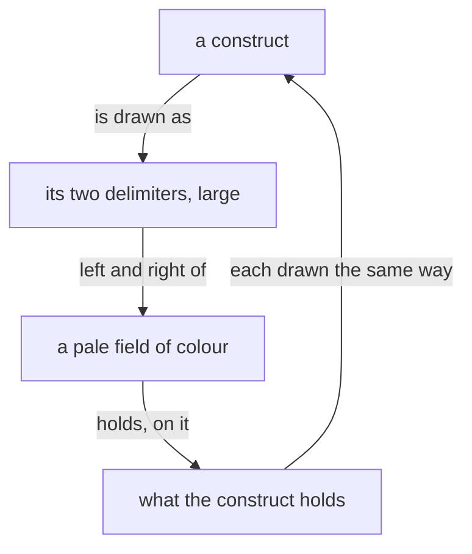

```protos sketch
Struct.{ Field Field Field }
Enum.[ Variant Variant Variant ]
Vector.⟦ Item ⟧
Text.«Text»
Number.#
Variant.Head.Payload
Option.Item?
```

```ethos
Lock.{ LockId.#
       LockName.«»
       ⟦ Holder.«» ⟧
       State.[ Free
               Held.Since.# ] }
```

```datom
{ 7 primary [ ada bo ] Held.1430 }
```



```datom
[ DescribedVisualObject.{ Struct «its two braces around its field; its fields on the field» }
  DescribedVisualObject.{ Enum «its two square brackets around its field; its variants on the field» }
  DescribedVisualObject.{ Vector «the white square brackets around the one type it holds, drawn once» }
  DescribedVisualObject.{ Text «its name between guillemets» }
  DescribedVisualObject.{ Number «its name with the mark #» }
  DescribedVisualObject.{ Variant «its head; a payload follows the head, on the enum's field» }
  DescribedVisualObject.{ Option «the item, then ?» }
  DescribedVisualObject.{ Field «the whole space between the two delimiters, filled; a structure inside another has its own field on top» }
  DescribedVisualObject.{ Bare «delimiters and field alone: no frame, no outline, no line joining a type to its parts, nothing stacked, no fork» }
  DescribedVisualObject.{ Delimiter «the colour of the construct's quality, strong» }
  DescribedVisualObject.{ Tint «the field, pale, in the colour of the quality of what the type names» }
  DescribedVisualObject.{ Once «a type met again keeps its colour, is opened once, and wears a mark where it is only named» }
  DescribedVisualObject.{ Large «a type too large for one picture has its larger inner types in pictures of their own» }
  DescribedVisualObject.{ Value «a real value under a leaf, fainter, when the source has a case» }
  DescribedVisualObject.{ Words «type names, variant names and values alone» }
  DescribedVisualObject.{ Name «said once: a field named as its type is one name, and String and Integer are never written» }
  DescribedVisualObject.{ Carried «a variant that carries a text has its payload between guillemets beside it» }
  DescribedVisualObject.{ Variants «each in the colour of its own nature, none black by default» }
  DescribedVisualObject.{ Balance «the delimiters are seen first and say the construct; the tint alone says the nature: no underline, no second mark» }
  DescribedVisualObject.{ Dense «the space between the delimiters is used; nothing is repeated; taller than wide, every name read on a phone» } ]
```
