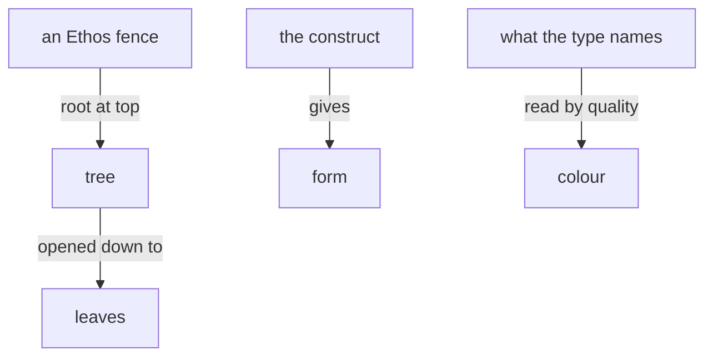

# The picture of Ethos



Form, by construct:

```datom
[ { Struct «a frame with its fields inside it, side by side: all of these» }
  { Enum «a fork from one point, a small diamond at the point, its variants in a row: one of these» }
  { Vector «the same frame stacked, three deep: many of this» }
  { Option «a dashed outline: may be absent» }
  { Leaf «a rounded box, its name alone; a number carries the mark #» } ]
```

Rules:

```datom
[ { OneBox «a variant named as the type it carries is one box, never the name twice» }
  { NoScalar «String and Integer are never drawn: the leaf's name says it» }
  { Colour «each type is read as notion:quality-use:0 reads a thing, and wears that quality's colour; no type is black or grey by default» }
  { Same «a type met again keeps its colour and form, and is opened once only» }
  { Value «a real value stands under a leaf, fainter, when the source has a case» }
  { Roots «types that nothing holds are separate trees, side by side, with no caption» }
  { Words «type names, variant names and values only; all of, one of, many of are said by form» } ]
```
