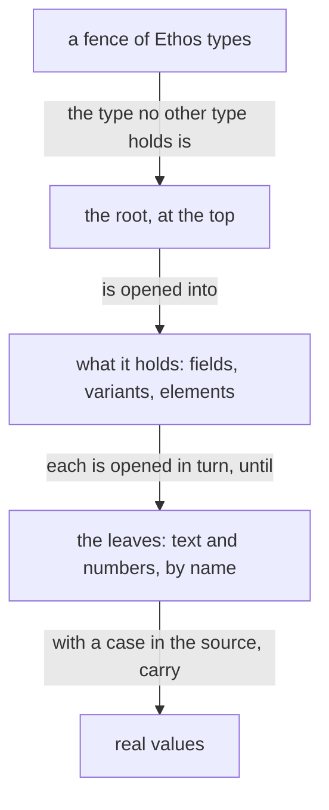

# The picture of Ethos

A fence of types is drawn as a tree: the root type at the top, each type opened into what it holds, down to the leaves. Every type the fence declares is in the tree.

```datom
[ { Struct «a frame holding all its fields, side by side: all of these» }
  { Enum «a fork, its variants in a row under one bar: one of these» }
  { Variant «a variant that carries data is opened below it, as any type» }
  { Vector «a stack of the same frame: many of this» }
  { Option «a dashed outline: may be absent» }
  { Text «a leaf, its name alone: a leaf with no mark is text» }
  { Integer «a leaf, its name with the mark #» }
  { Repeated «a type met again keeps its colour and is shown closed, opened once only» }
  { Value «a real value under a leaf, fainter than the name, when the source has a case» } ]
```


