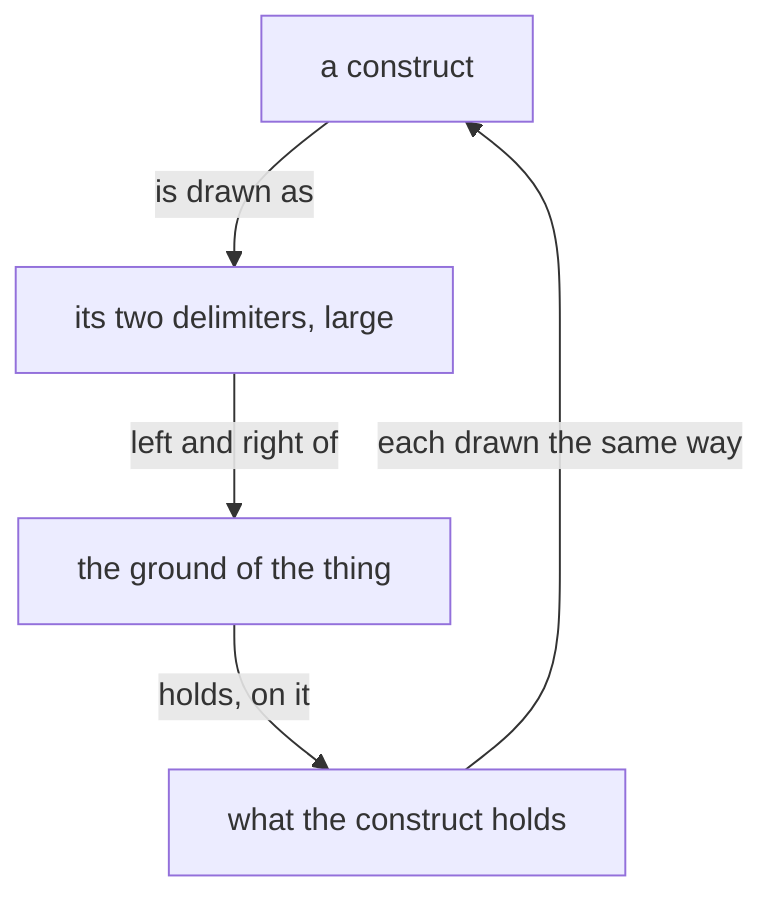

```protos sketch
Struct.{ Field Field Field }
Enum.[ Variant Variant Variant ]
Vector.⟦ Item ⟧
Text.«Text»
Number.#
Variant.Head.Payload
Option.Item?
```

```ethos
Lock.{ LockId.#
       LockName.«»
       ⟦ Holder.«» ⟧
       State.[ Free
               Held.Since.# ] }
```

```datom
{ 7 primary [ ada bo ] Held.1430 }
```



```datom
[ DescribedVisualObject.{ Struct «two large braces in the one ink around its fields; each field wears only the colour of its own nature» }
  DescribedVisualObject.{ Enum «two large single square brackets in the one ink around its variants» }
  DescribedVisualObject.{ Vector «two large double square brackets in the one ink around the one type it holds, drawn once» }
  DescribedVisualObject.{ Text «a string is drawn as the source writes it: bare when it is bare, with no guillemets; in its guillemets only when the source has them» }
  DescribedVisualObject.{ Number «its name with the mark #» }
  DescribedVisualObject.{ Variant «its head, with any dot and body on the same ground as Carried» }
  DescribedVisualObject.{ Option «the item, then ?» }
  DescribedVisualObject.{ Field «the space between the delimiters is the thing's ground; a nested thing has its own ground, neutral unless it has a nature, shown as shares of colour by notion:planetary-visuals:0» }
  DescribedVisualObject.{ Bare «delimiters and field alone: no frame, no outline, no line joining a type to its parts, nothing stacked, no fork» }
  DescribedVisualObject.{ Delimiter «large, in the one ink; its shape says the construct» }
  DescribedVisualObject.{ Tint «the ground wears the pale colour shares of the nature of what the type names, by notion:planetary-visuals:0» }
  DescribedVisualObject.{ Once «a type met again keeps its colour, is opened once, and wears a mark where it is only named» }
  DescribedVisualObject.{ Large «a type too large for one picture has its larger inner types in pictures of their own» }
  DescribedVisualObject.{ Value «a real value under a leaf when the source has a case; its nature alone gives it colour» }
  DescribedVisualObject.{ Words «type names, variant names and values alone» }
  DescribedVisualObject.{ Name «said once: a field named as its type is one name, and String and Integer are never written» }
  DescribedVisualObject.{ Carried «a head, its dot and its body are one whole on one shared ground, with no gap; a text body follows Text; the ground is neutral unless the whole has a nature» }
  DescribedVisualObject.{ Variants «each in the colour of its own nature, none black by default» }
  DescribedVisualObject.{ Balance «the delimiters are seen first and say the construct; the tint alone says the nature: no underline, no second mark» }
  DescribedVisualObject.{ Dense «the space between the delimiters is used; nothing is repeated; taller than wide, every name read on a phone» } ]
```
