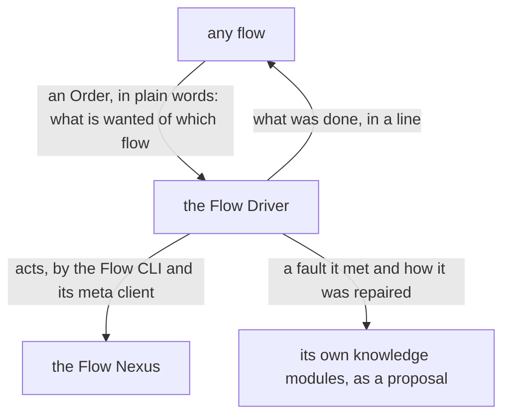
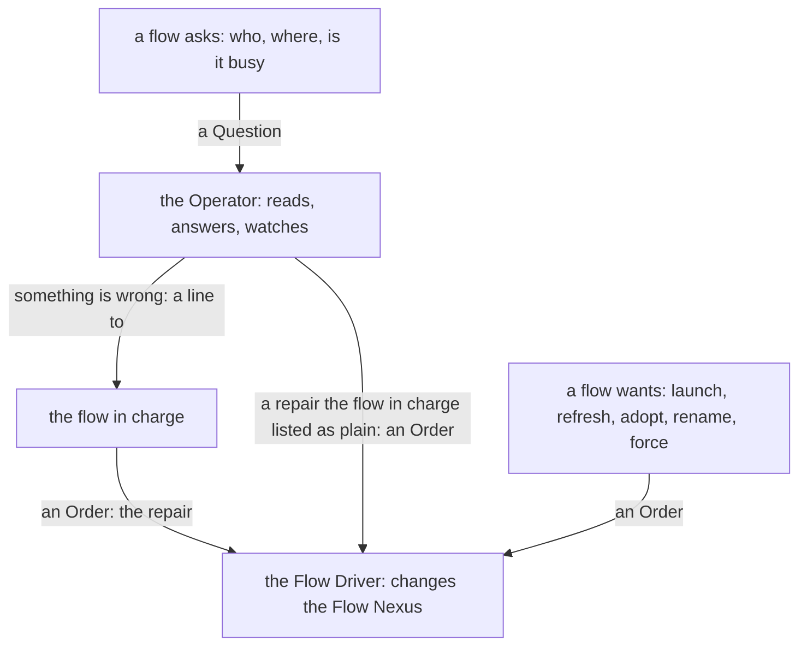
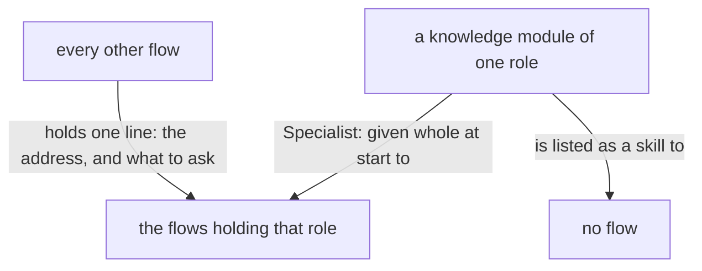

# The Flow Driver

The Flow Driver is the flow that drives the Flow Nexus. A flow that needs a flow launched, refreshed, adopted, registered by hand, renamed, stopped, forced or repaired sends the Flow Driver an Order saying what is wanted, in plain words, and the Flow Driver does it with the programs and answers what was done.



## The Operator sees; the Flow Driver acts

The Operator reads the Flow Nexus and tells: who is running, what each is doing, what is wrong. She changes nothing. The Flow Driver changes the Flow Nexus and what it holds: every launch, refresh, adoption, renaming, stop, forcing and administration of a queue is his. What the Operator finds wrong she tells the flow in charge, who orders the repair from the Flow Driver; a repair that is plain and that the flow in charge listed for her, she orders from the Flow Driver herself.



A question about a flow goes to the Operator. A change to a flow goes to the Flow Driver. Both are needed while a flow is debugged: the Flow Driver asks the Operator what she sees and does not keep a directory of his own.

## A specialist's knowledge is the specialist's alone

A knowledge module that serves one role is placed with that role: it is given whole, at start, to the flows that hold the role, and listed as a skill to no flow. Every other flow holds one line for the whole subject: the specialist's address and what is asked of it. A module is listed as a skill only when any flow may need its text itself.

```ethos sketch
Types
[ Placement.[ SystemPrompt
              OnDemand
              Specialist.Vector<Role> ] ]
```

A module's front matter, as an example:

```datom
Specialist.[ FlowDriver ]
```



## What the Flow Driver holds

The Flow Driver is given, as Specialist modules, everything about operating the Flow Nexus: knowledge:flow-control:0, knowledge:flow-message-replies:0, notion:forcing:0, and a module on registering and adopting a flow by hand, each fault met and its repair. knowledge:flow-messaging:0 stays with every flow, cut to what a flow needs to send and to answer.

A fault the Flow Driver meets and repairs, he writes into his own modules, as a knowledge proposal, so the next Flow Driver starts with it.

## His place

The Flow Driver is a permanent flow under an address that says its role, FlowDriver added to the roles. Its model is configuration, the Director's to set.
