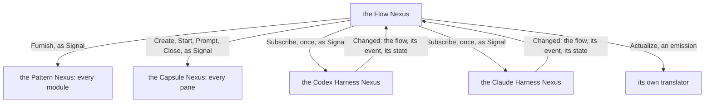
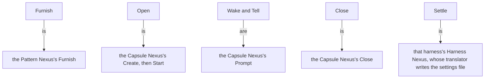
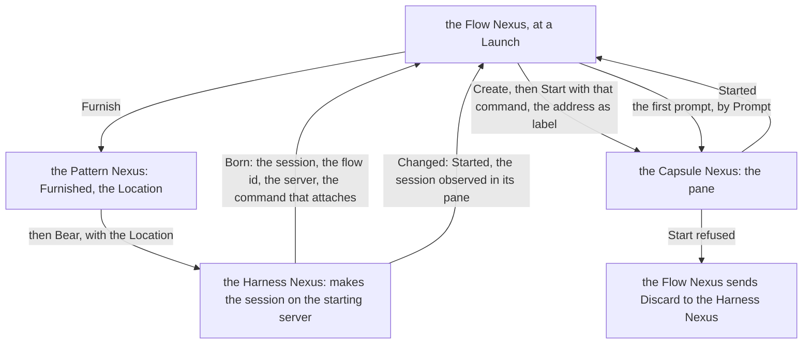
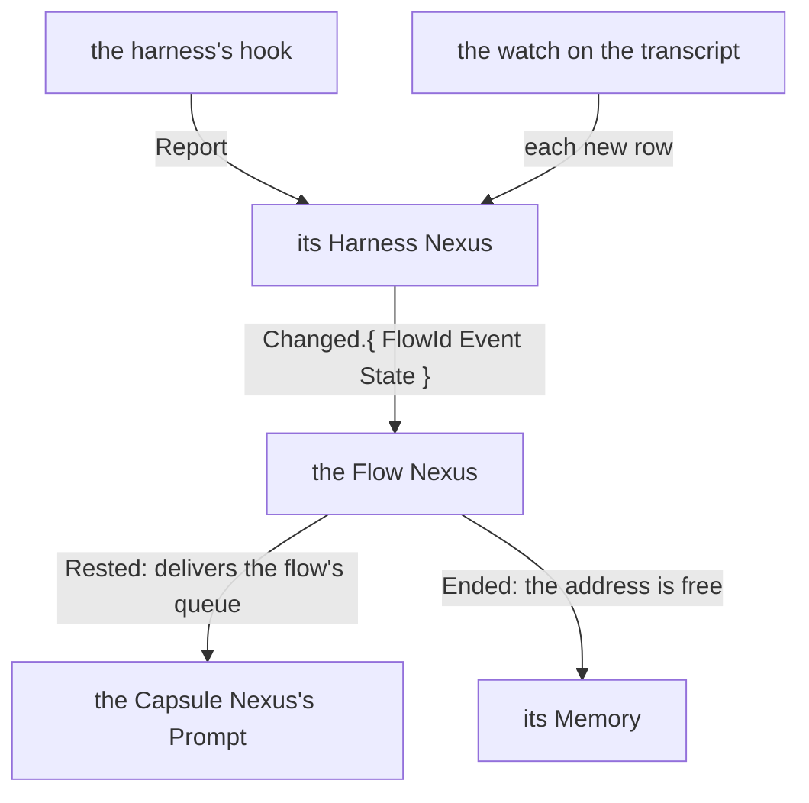
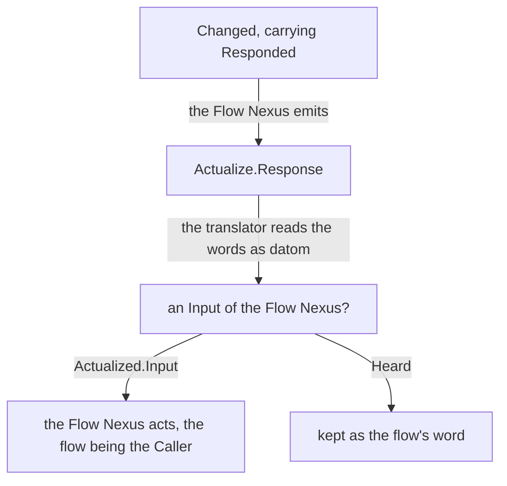
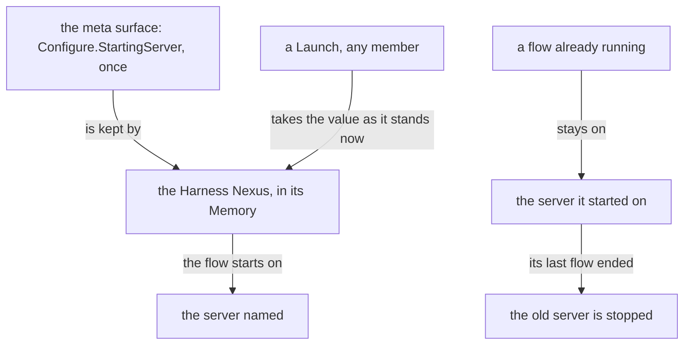
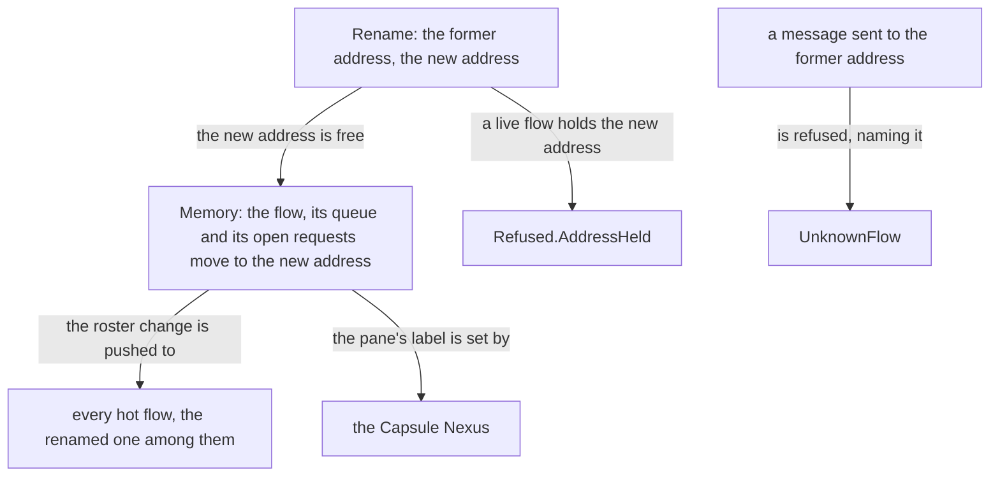

# The Flow Nexus, version 1, is an assembly

The Flow Nexus runs nothing and writes nothing. Each thing it needs done is the work of a Nexus beside it, and it asks that Nexus in Signal, as a peer its meta configuration names.



## Each emission of the vision has its Nexus

The vision's Emission section names six emissions. In version 1 five of them are an Input of a peer, sent as Signal, and the sixth is the work of the harness's own Nexus.



The Command the Capsule Nexus starts comes from the Harness Nexus, in the binding it answers at a flow's birth, below.

## A flow's birth

The Flow Nexus asks the Harness Nexus of the member's harness to bear a session, and that Nexus alone knows how its harness makes one: on the starting server, or by an id the harness is started with. It answers the binding: the session, the flow id that session gives, the server it is on, and the command that attaches a pane to it. The Flow Nexus then asks the Capsule Nexus for the pane and starts that command in it. The Capsule Nexus knows a pane and a command, and nothing of a session.

```ethos
Signal
[ harness:[ SessionId ServerAddress ]
  flow:[ FlowId Workspace ModelName Effort Effect ]
  belief:[ Location ]
  capsule:[ Command ] ]
[ Bear.{ Workspace ModelName Effort
         Location
         Vector<Effect> }
  Discard.SessionId ]
[ Born.Binding
  Discarded.SessionId
  Refused.[ ServerDown.ServerAddress
            Unconfigured
            UnknownSession.SessionId ] ]
[ Birth.[ Existing
          Awaited ]
  Binding.{ SessionId
            FlowId
            Option<ServerAddress>
            Birth
            Attach.Command } ]
```

Bear carries what the session is made with: the workspace, the model and effort, the Location the Pattern Nexus furnished, and the effects of the features the member and its complex name. A Birth is Existing when the harness's server answered that the session is there, and Awaited when the id was made for a harness that creates the session as its program starts; the session is then observed at its Started. Discard ends a session born whose pane could not be started.



The flow is recorded at Born, under its address, with its binding and no pane; the pane is joined to it at Started. Its Identity, composed into the first prompt, carries the flow id the binding gave.

Settle as an Input of a Harness Nexus is tentative:

```ethos
Signal
[ flow:[ Tools ModelName Workspace ] ]
[ Settle.{ Workspace Tools ModelName } ]
[ Settled
  Refused.Unwritable.Workspace ]
[]
```

## What a flow does reaches the Flow Nexus from its Harness Nexus

A harness's hook calls its own Harness Nexus, and so does the watch on its transcript. The Flow Nexus subscribes to each Harness Nexus once and learns every event as Changed. The vision's Report input is that subscription.



## A response is read by the translator

A flow's finished response arrives as Responded, a string the Flow Nexus holds closed. Whether it is an Input is a question of words, so the Flow Nexus asks its translator.

```ethos
Emission
[ signal_flow:signal:[ Input ]
  harness:[ Response ] ]
[ Actualize.Response ]
[ Actualization.[ Actualized.Input
                  Heard ] ]
[]
```



Actualize is the Flow Nexus's one emission. Its translator serves the CLI's text and this.

## A peer that is down

Each peer answers on a connection the Flow Nexus dials. A peer that does not answer is a refusal the Signal already names: CapsuleDown, BeliefDown, and for a Harness Nexus the same shape, tentative:

```ethos
Types
[ Refused.[ HarnessDown.HarnessName ] ]
```

## The server a flow starts on is one value

A harness that runs its sessions on a server has one configured value: the server a flow started now starts on. It is set once, over the meta surface of that harness's Harness Nexus, and every launch takes it from there. A member's definition names no server, and no flow is configured for one.

A flow keeps the server it started on for as long as it runs. The server is upgraded by starting the new one and setting the value: every flow started from then starts on the new server, and the old one is stopped when the last flow on it has ended.

```ethos
Signal
[]
[ Configure.Set ]
[ Configured.Set ]
[ ServerAddress.String
  Set.[ StartingServer.ServerAddress ] ]
```

The address below is plainly an example.

```datom
Configure.StartingServer.«unix:/run/example/codex-2.sock»
Configured.StartingServer.«unix:/run/example/codex-2.sock»
```



## A running flow is renamed

A flow's address is changed while it runs. The flow id stays, the session and its context stay, and everything held under the old address moves to the new one: its queue, its open requests and what is owed to it. A member's name in a definition is changed by Amend, and Rename does so for the flow that is running under it.

```ethos
Signal
[ flow:[ Address FlowId ] ]
[ Rename.{ Former.Address Address } ]
[ Renamed.{ FlowId Address }
  Refused.[ AddressHeld.FlowId
            UnknownFlow.Address ] ]
[]
```

```datom
Rename.{ { psyche core } { psyche designer } }
Renamed.{ b873c3 { psyche designer } }
```



The roster change that tells of it, added to the vision's RosterChange:

```ethos
Types
[ RosterChange.[ Started.Address
                 Stopped.Address
                 Renamed.{ Former.Address Address } ] ]
```

## What version 1 is built in

The Flow Nexus, version 1, is built by vision:nexus:1 and notion:translator-first:0, after the Capsule Nexus's translator is proven, on the version 1 branch. The flows of version 0 keep running under it until each joins by Adopt.
