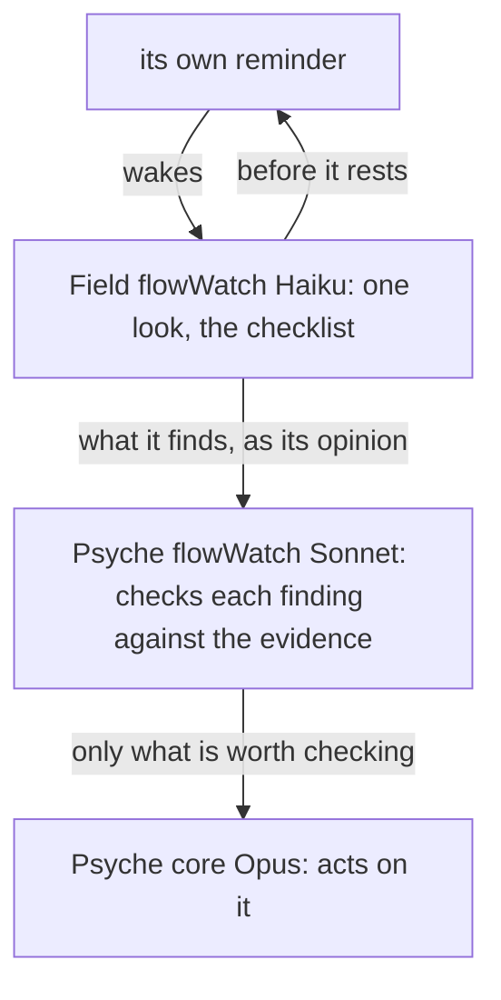

# The flow watch

The flow watch keeps track of how the flows behave, so that a fault is seen while it is small. It is a chain of three, each dearer than the one before, and each passes up only what it judges worth the next one's attention.



The Haiku starts with a minimal context: its role and how to send a message. What it reports is its opinion. The Sonnet reads the evidence each finding names and decides whether it is real and worth Opus's attention.

## The heartbeat slows while all is well

A look that finds nothing lengthens the time to the next look by one step, up to a ceiling; a look that finds something sets it back to the start. The start, the step and the ceiling are configuration.

```ethos
Library
[]
[ Minutes.Integer
  Heartbeat.{ Start.Minutes
              Step.Minutes
              Ceiling.Minutes } ]
[]
[]
```

```datom
Heartbeat.{ 60 60 360 }
```

The figures are the first tried; the record of the looks decides them.

## What it looks for

Beside the checks of its role, the watch looks at three things.

Codex flows that behave as Codex flows have misbehaved before: the list is kept in the role, and grows when the chain confirms a new kind.

Every flow that was refreshed wrote its handover before it went.

Every handover is useful to the flow that follows: that flow acts in its first turn and does not read again what its predecessor had already read.

## Every look is recorded

Each look writes one line: when, what it found, and what the Sonnet and Opus made of it. The record is what the usefulness of the watch is judged by.
