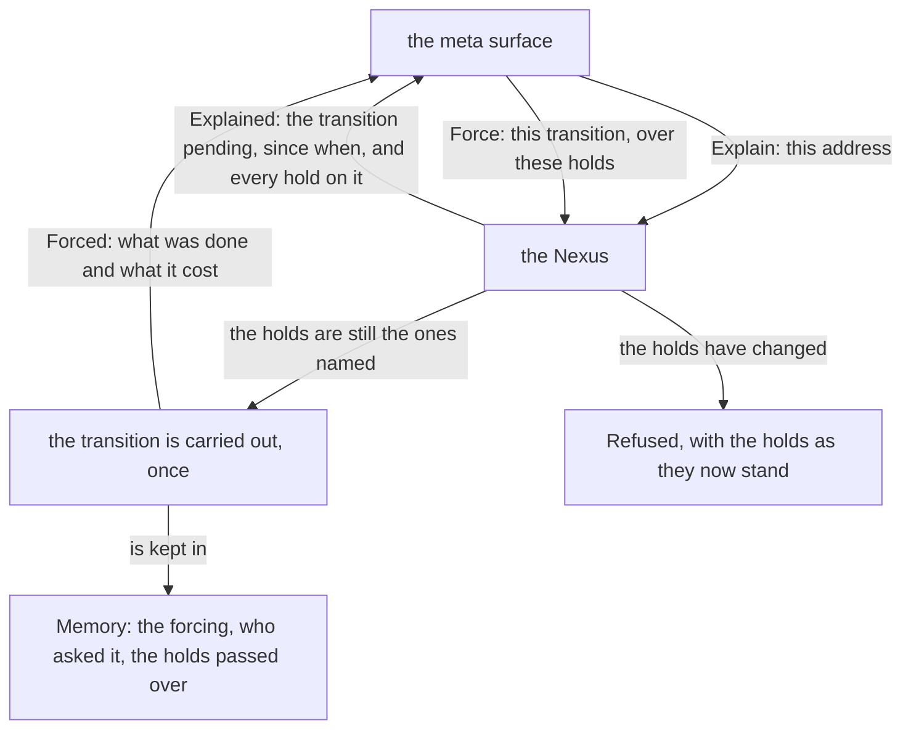
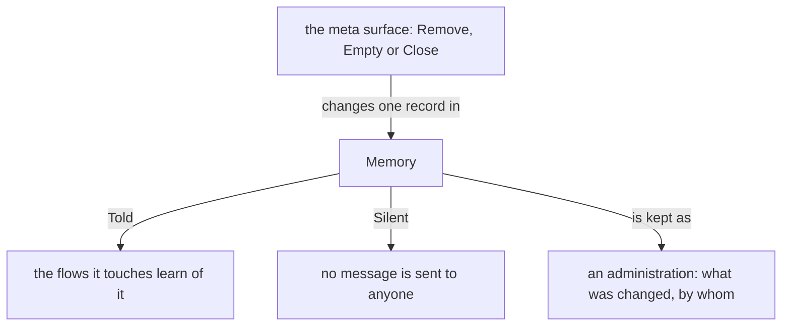

# Explain and Force

A Nexus carries out a transition when its checks allow it. When one stands still, the person at the meta surface needs two things: to be told why, in full, and to make it happen anyway, once. Both are inputs of the meta surface of every Nexus that has transitions; each Nexus declares its own transitions and its own holds.



## A hold is a type

Every check that can keep a transition from happening is a variant of Hold, so an explanation is complete by its type: a transition is stalled by the holds listed and by nothing else. A check added to the Nexus is a variant added to Hold.

Force names the holds it passes over, the very ones Explain listed. It passes over those and no other: a hold that appeared since is not forced, and the answer shows it. A Force changes no configuration and lasts for one transition.

Some holds are facts of the world and no decree passes them: a pane that cannot be reached. Force is refused for such a hold, naming it, and what repairs it is another transition, forced in its turn.

## On the Flow Nexus

```ethos
Signal
[ flow:[ Address FlowId RequestId ]
  energy:[ Instant ] ]
[ Explain.Address
  Force.{ Address Transition Vector<Hold> } ]
[ Explained.{ Address Standing }
  Forced.{ Address Transition Vector<Cost> }
  Refused.[ HoldsChanged.Vector<Hold>
            Unforceable.Hold
            NothingPending.Address
            UnknownFlow.Address ] ]
[ Transition.[ Refresh
               Stop
               Deliver.RequestId
               Release
               Rebind ]
  Hold.[ Locked.FlowId
         Working
         WorkInFlight
         OpenRequest.RequestId
         AttemptUncertain.RequestId
         HarnessSilent
         PaneUnreachable
         Unbound ]
  Standing.[ Clear
             Stalled.{ Transition
                       Since.Instant
                       Vector<Hold> } ]
  Cost.[ WorkEnded
         TurnInterrupted
         RequestLeftOpen.RequestId
         LockTaken.FlowId ] ]
```

A Transition is Refresh, the flow is ended and its successor started from its crystallization; Stop; Deliver, one queued request typed into the pane; Release, the lock a flow holds is let go; Rebind, the flow is joined again to its native session. A Hold is Locked, another flow holds the lock, named; Working, the flow is in a turn; WorkInFlight, background work is running; OpenRequest, a request it owes is open; AttemptUncertain, an earlier attempt may have been made; HarnessSilent, its Harness Nexus has told nothing of it; PaneUnreachable; Unbound, it has no native session. A Cost is what the forcing gave up.

```datom
Explain.{ psyche designer }
Explained.{ { psyche designer } Stalled.{ Refresh 1795600000 [ Locked.ab2769 Working ] } }
Force.{ { psyche designer } Refresh [ Locked.ab2769 Working ] }
Forced.{ { psyche designer } Refresh [ LockTaken.ab2769 TurnInterrupted ] }
```

PaneUnreachable and Unbound are the holds no Force passes: the first is repaired at the Capsule Nexus, the second by a forced Rebind.

## Everything a Nexus keeps is administered over the meta surface

Whatever a Nexus keeps in its Memory, the meta surface reads whole and changes one record at a time, with no check of the ordinary surface in the way: a queued message removed, a request closed without its answer, a queue emptied. Each such input says whether the flows it touches are told: Told, the sender and the receiver learn of it as they would of an ordinary cancelling; Silent, nothing is sent to anyone, and the change is known only to Memory and to the one who made it.

```ethos
Signal
[ flow:[ Address RequestId Message ] ]
[ Queued.Address
  Remove.{ RequestId Telling }
  Empty.{ Address Telling }
  Close.{ RequestId Telling } ]
[ Queued.{ Address Vector<Message> }
  Removed.RequestId
  Emptied.{ Address Vector<RequestId> }
  Closed.RequestId
  Refused.UnknownRequest.RequestId ]
[ Telling.[ Told
            Silent ] ]
```

Queued reads a flow's queue whole; Remove takes one message out of the queue it waits in; Empty takes out every message queued to an address and answers which; Close closes an open request without its Result or its Done.

```datom
Remove.{ 0wzu Silent }
Removed.0wzu
```



A kind of record the Nexus keeps and the meta surface cannot yet read and change is an input missing, and is added.

## What else is forced

The same two inputs serve wherever a Nexus refuses by a check: a delivery that stays queued, a lock never released, a stop that waits on work in flight. A transition found stalled that Explain cannot name is a transition missing from the type, and is added.
