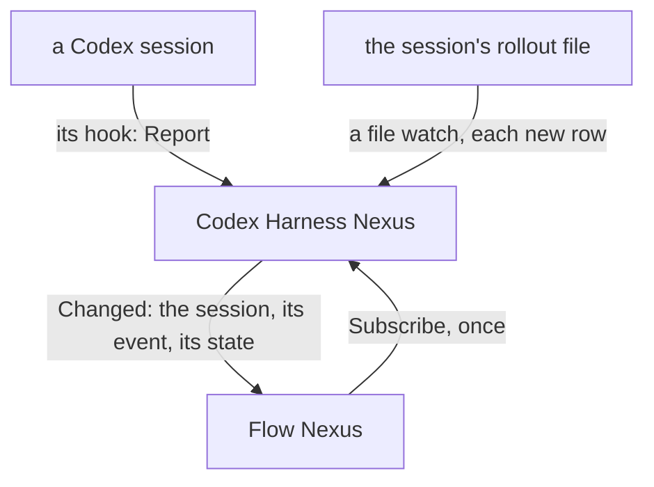
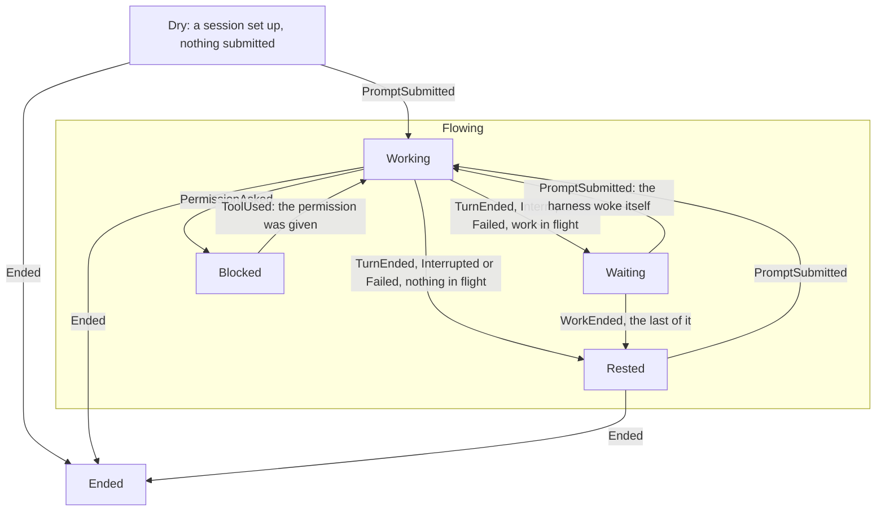
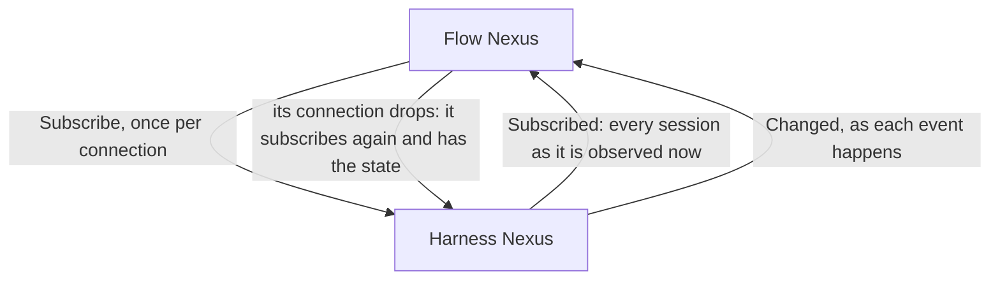
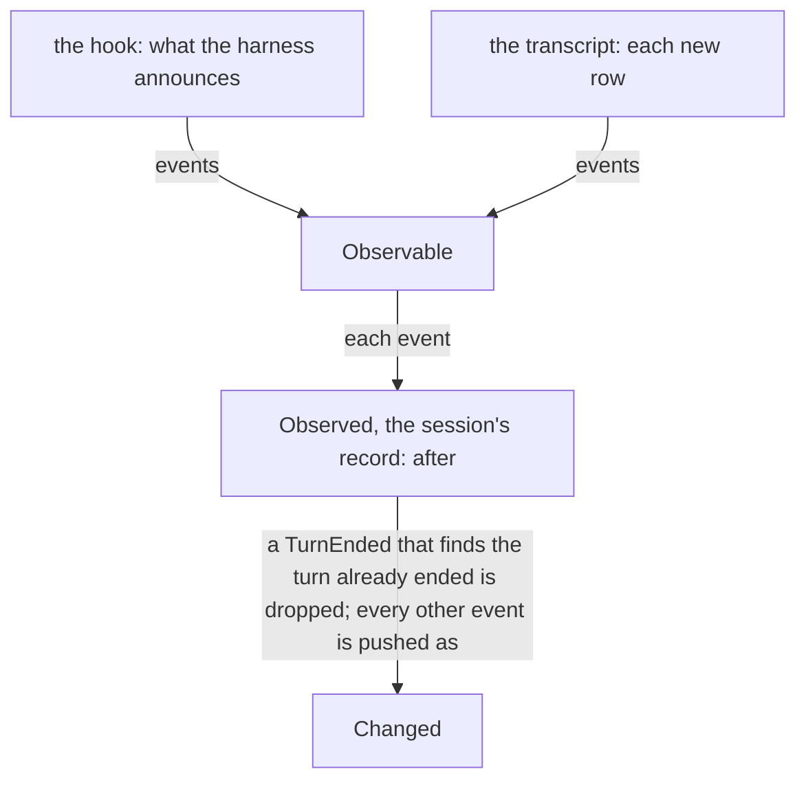
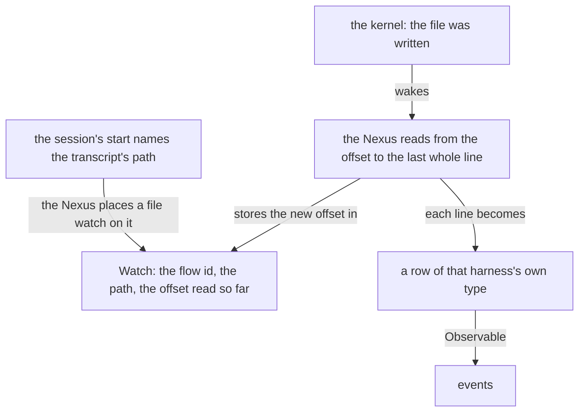
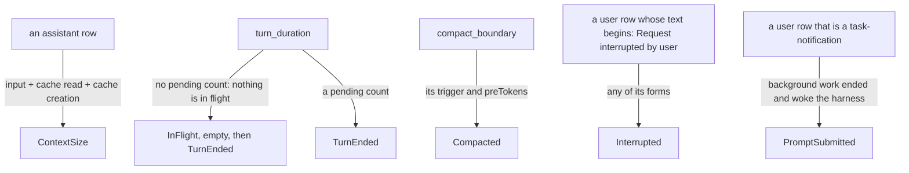

# The Harness Nexus

Each harness has a Nexus of its own, named for it. It watches that harness's sessions and tells what each is doing.



```sh
codex-harness-nexus
codex-harness '<datom>'
codex-harness-meta '<datom>'
```

## The harness library

What the Harness Nexuses and the Flow Nexus share.

```ethos
Library
[ flow:[ FlowId ] ]
[ Session.String
  FilePath.String
  Tokens.Integer
  Response.String
  WorkId.String
  WorkKind.[ Shell Subagent Monitor Workflow ]
  BackgroundWork.{ WorkId WorkKind Description.String }
  Trigger.[ Manual Automatic ]
  Compaction.{ Trigger Option<Tokens> }
  Failure.String
  EndReason.[ Exited Cleared Died ]
  Event.[ Started
          PromptSubmitted
          ToolUsed
          PermissionAsked
          Responded.Response
          InFlight.Vector<BackgroundWork>
          WorkStarted.BackgroundWork
          WorkEnded.WorkId
          TurnEnded
          Interrupted
          Failed.Failure
          ContextSize.Tokens
          Compacted.Compaction
          Ended.EndReason ]
  State.[ Dry Flowing.Flow Ended ]
  Flow.[ Working Rested Waiting Blocked ]
  Observed.{ FlowId State Tokens Vector<BackgroundWork> } ]
[ Observable.[ events.[ Vector<Event> ] ]
  Identifiable.[ flow_id.[ FlowId ] ] ]
[ Session.[ Identifiable ] ]
```

Session is the harness's own long id for a session. Between Nexuses a session is named by its short id, and the flow that runs in it takes that id as its flow id.

```rust
impl Identifiable for Session {
    fn flow_id(&self) -> FlowId { FlowId(self.hash().first_characters(6)) }
}
```

## What the Harness Nexus tells



A session is dry until its first prompt is submitted, and flowing from then.

An event is what a source saw; the state is what the Nexus concludes from it.

```rust
impl Observed {
    fn after(&mut self, event: &Event) {
        match event {
            Event::Started => self.state = State::Dry,
            Event::PromptSubmitted | Event::ToolUsed => self.state = State::Flowing(Flow::Working),
            Event::PermissionAsked => self.state = State::Flowing(Flow::Blocked),
            Event::InFlight(work) => self.background_work_vector = work.clone(),
            Event::WorkStarted(work) => self.background_work_vector.push(work.clone()),
            Event::WorkEnded(work_id) => {
                self.background_work_vector.retain(|work| &work.work_id != work_id);
                if self.state == State::Flowing(Flow::Waiting) && self.background_work_vector.is_empty() {
                    self.state = State::Flowing(Flow::Rested)
                }
            }
            Event::TurnEnded | Event::Interrupted | Event::Failed(_) => {
                self.state = if self.background_work_vector.is_empty() { State::Flowing(Flow::Rested) } else { State::Flowing(Flow::Waiting) }
            }
            Event::ContextSize(tokens) => self.tokens = tokens.clone(),
            Event::Ended(_) => self.state = State::Ended,
            Event::Responded(_) | Event::Compacted(_) => {}
        }
    }
}
```

## Subscription

```ethos
Signal
[ harness:[ Event State Observed ]
  flow:[ FlowId ] ]
[ Subscribe ]
[ Subscribed.Vector<Observed>
  Changed.{ FlowId Event State } ]
[]
```



```datom
Subscribe
Subscribed.[ { 15c0ce Working 181204 [] } ]
Changed.{ 15c0ce ContextSize.183950 Working }
Changed.{ 15c0ce Responded.«Reviewed; green.» Working }
Changed.{ 15c0ce TurnEnded Rested }
```

## Each source bears one trait



A turn's end has two witnesses, the hook and the transcript, so that one failing loses nothing.

## The transcript watch

```ethos
Memory
[ harness:[ FilePath ]
  flow:[ FlowId ] ]
[ Watch.{ FlowId FilePath Offset.Integer } ]
```



## Hooks are configuration

```ethos
Signal
[]
[ Configure.Set ]
[ Configured.Set ]
[ HookName.String
  Set.[ Hooks.Vector<HookName>
        RemoveHook.HookName ] ]
```

```datom
Configure.Hooks.[ SessionStart PermissionRequest PostToolUse PostCompact ]
```

# The Claude Harness Nexus

## The hook

The harness runs the hook with the event as JSON; the hook sends it as one Report.

```json
{ "hook_event_name": "Stop",
  "session_id": "15c0cea2-aa34-508b-8e20-ece1ab7823f4",
  "transcript_path": "/home/example/.claude/projects/-home-example-work/15c0cea2-aa34-508b-8e20-ece1ab7823f4.jsonl",
  "last_assistant_message": "Reviewed; green.",
  "background_tasks": [ { "id": "blwep6njb", "type": "shell", "status": "running", "description": "Search the history" } ] }
```

```ethos
Signal
[ harness:[ Session FilePath Response BackgroundWork Failure ] ]
[ Report.Hook ]
[ Reported ]
[ StartSource.[ Startup Resume Clear Compact Fork ]
  EndCause.[ Clear Resume Logout PromptInputExit Other ]
  Hook.[ SessionStart.{ Session FilePath StartSource }
         UserPromptSubmit.Session
         PostToolUse.Session
         PermissionRequest.Session
         Stop.{ Session Response Vector<BackgroundWork> }
         StopFailure.{ Session Failure }
         SessionEnd.{ Session EndCause } ] ]
```

```datom
Report.Stop.{ 15c0cea2-aa34-508b-8e20-ece1ab7823f4 «Reviewed; green.» [ { blwep6njb Shell «Search the history» } ] }
Reported
```

```rust
impl Observable for Hook {
    fn events(&self) -> Vec<Event> {
        match self {
            Hook::SessionStart(start) => match start.start_source {
                StartSource::Compact => vec![],
                _ => vec![Event::Started],
            },
            Hook::UserPromptSubmit(_) => vec![Event::PromptSubmitted],
            Hook::PostToolUse(_) => vec![Event::ToolUsed],
            Hook::PermissionRequest(_) => vec![Event::PermissionAsked],
            Hook::Stop(stop) => vec![
                Event::InFlight(stop.background_work_vector.clone()),
                Event::Responded(stop.response.clone()),
                Event::TurnEnded,
            ],
            Hook::StopFailure(failure) => vec![Event::Failed(failure.failure.clone())],
            Hook::SessionEnd(end) => match end.end_cause {
                EndCause::Clear => vec![Event::Ended(EndReason::Cleared)],
                _ => vec![Event::Ended(EndReason::Exited)],
            },
        }
    }
}
```

## The transcript

The transcript carries what these hooks do not: the context size, an interruption, a compaction, the harness waking itself, and the second witness of a turn's end. A turn_duration row with nothing in flight has no pending count at all.

```json
{"type":"assistant","message":{"stop_reason":"end_turn","usage":{"input_tokens":2,"cache_read_input_tokens":250599,"cache_creation_input_tokens":305}}}
{"type":"system","subtype":"turn_duration","durationMs":2005}
{"type":"system","subtype":"turn_duration","durationMs":101065,"pendingBackgroundAgentCount":1}
{"type":"system","subtype":"compact_boundary","compactMetadata":{"trigger":"manual","preTokens":291543,"postTokens":5808}}
{"type":"user","message":{"role":"user","content":[{"type":"text","text":"[Request interrupted by user]"}]}}
{"type":"user","message":{"role":"user","content":[{"type":"text","text":"[Request interrupted by user for tool use]"}]}}
```

```ethos
Library
[ harness:[ Tokens Compaction ] ]
[ Pending.Integer
  Row.[ Answer.Tokens
        TurnDuration.Option<Pending>
        CompactBoundary.Compaction
        Interruption
        TaskNotification
        Other ] ]
[]
[]
```

```rust
impl Observable for Row {
    fn events(&self) -> Vec<Event> {
        match self {
            Row::Answer(tokens) => vec![Event::ContextSize(tokens.clone())],
            Row::TurnDuration(None) => vec![Event::InFlight(vec![]), Event::TurnEnded],
            Row::TurnDuration(Some(_)) => vec![Event::TurnEnded],
            Row::CompactBoundary(compaction) => vec![Event::Compacted(compaction.clone())],
            Row::Interruption => vec![Event::Interrupted],
            Row::TaskNotification => vec![Event::PromptSubmitted],
            Row::Other => vec![],
        }
    }
}
```


