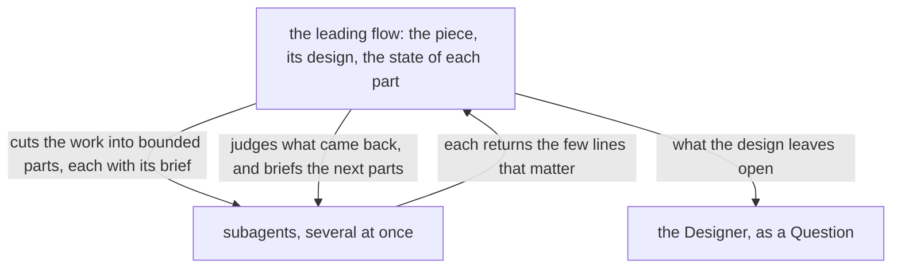
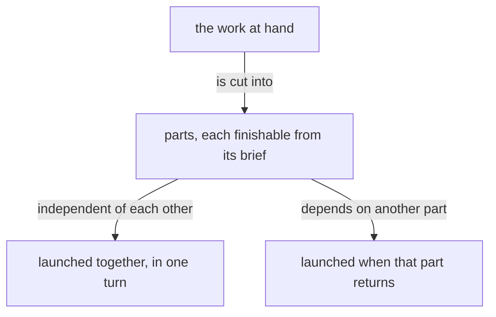
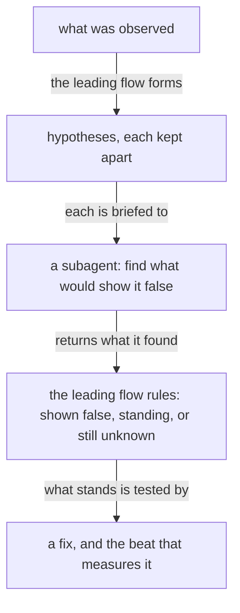

# A flow that leads holds the judgment, and subagents do the work

A flow that leads holds three things in its own context: what the piece is for, the design it is built from, and the state of each part. Everything else it gives away: reading code, searching, writing a body, building, testing, committing. Its context is kept for judgment, so it lasts as long as the piece does.

## Work is cut so that it runs side by side

A part is bounded when a subagent can finish it from its brief alone: what is wanted, the files it stands on, what is already ruled out, and the form of what comes back. Parts that do not depend on each other are launched together, in one turn. A part that depends on another waits for that one alone.

## The subagent fits the part

A part that has a role is given to that role: the committer, the code mapper, the pattern weaver, the pattern finder, and each role made after them. A part with no role goes to a plain subagent; when the same kind of part returns a third time, it becomes a role.

## What the leading flow does itself

It reads what its subagents return, decides, and briefs. It reads a file itself only when its judgment needs the lines and a subagent's account of them is not enough. When it finds itself doing a part by hand, that part is the next brief.

## An investigation is led the same way

A flow hunting a fault holds the observations, the hypotheses and the unknowns, kept apart. Each hypothesis is one part: a subagent is briefed to find what would show it false, and several hypotheses are tried side by side. The flow rules on what came back, and the cause stays unknown until one is shown.

