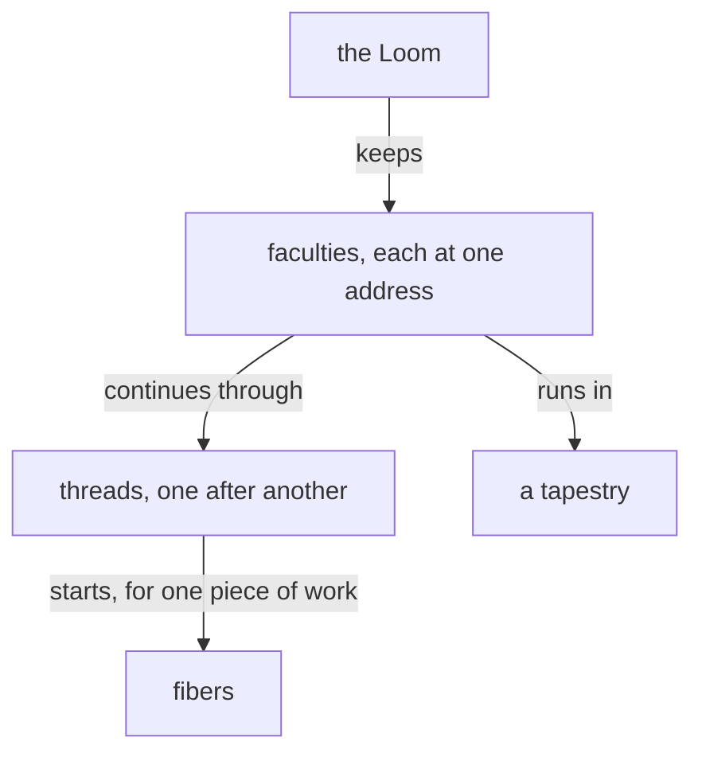
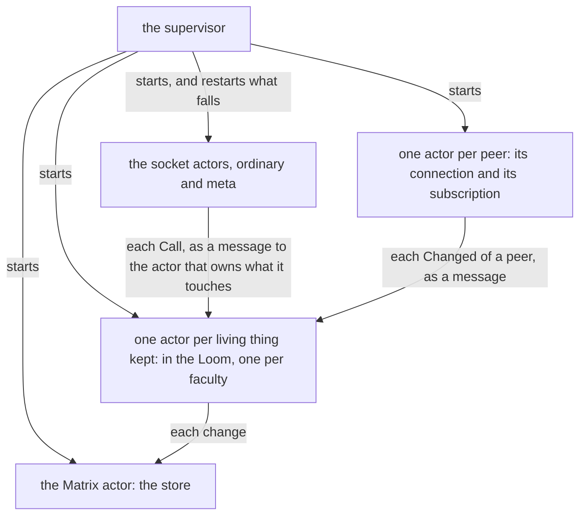
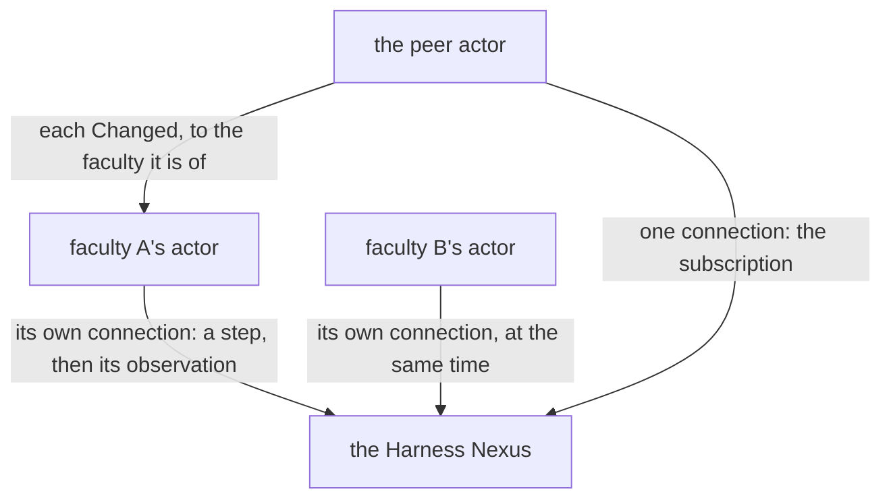
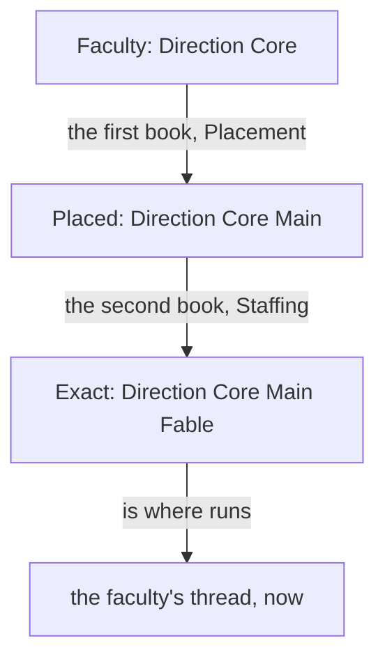
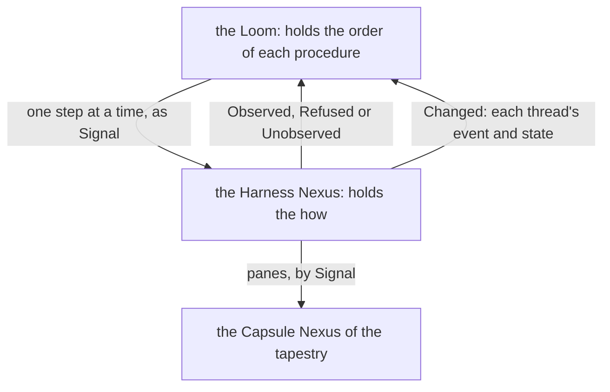

# The Loom

The Flow Nexus is not continued as version 1. Its successor is the Loom, Loom Nexus version 0, with the command `loom`. The serving Flow Nexus stays as it is until the Loom works.

## The words

A faculty is one power of the thinking machine, at one address. A thread is one run of a faculty, a main session; the faculty continues through its threads, each ending in a crystallization that starts the next. A fiber is what a thread starts for one piece of its work, in place of subagent; it has no address. A MetaFaculty is several faculties defined together, in place of metaflow. A tapestry is one environment and everything running in it.

The faculty is the unit of thought and of speech. A thread is named only when that thread in particular is the matter.



## A Nexus version 1 has three parts in Ethos

Signal, Matrix and Emission are written in Ethos. There is no Operation root and no Process root: the logic of a Nexus is hand-written Rust, as methods on the types the three generate, until Ethos can express a process.

## The actors

A Nexus version 1 is built of Kameo actors. An actor is the one owner of a thing that changes over time: nothing else touches it, it is reached only by typed messages, and it takes them one at a time. A Nexus holds no lock and no shared state.



An input is a message and its Output the reply. A clock is a message an actor sends itself. The faculty's actor owns its one current record, its queue and its clock; every decision about a faculty is made there, from that record alone.

A faculty's actor waits only for itself. Each exchange with a peer is a connection of its own, dialed by the actor that needs the answer, so while one faculty waits on the Harness Nexus every other faculty goes on, and many messages go out at once. The peer actor owns the subscription to that peer and nothing else; no request to a peer passes through one mailbox.



## What an audit checks

Each piece is audited when it first works, before the next is built on it:

- every value a person might set otherwise is configuration taken over the meta surface, and none is in the code;
- everything that changes over time has one owning actor, and the code holds no lock and no shared state;
- every type that crosses a socket, is stored, or is emitted is generated from the Nexus's ethos files, and the hand-written code declares none of its own;
- the Nexus crate depends on nothing that reads or writes words;
- nothing happens on a timer that asks again: every action answers an event.

## An address has three layers

A thread sends to the most abstract address it can. The Loom resolves it through two books, each one entry set at a time over the meta surface, so a faculty moves tapestry or changes model and no sender learns of it.

```ethos
Signal
[]
[ Send.{ Address Request }
  Resolve.Address
  Threads.Faculty
  Open ]
[ Sent.RequestId
  Resolved.Exact
  Listed.Vector<Thread>
  Opened.Vector<Owed>
  Refused.[ Unplaced.Faculty
            Unstaffed.Placed ] ]
[ Role.String
  Domain.String
  TapestryName.String
  Model.String
  Faculty.{ Role Domain }
  Placed.{ Role Domain TapestryName }
  Exact.{ Role Domain TapestryName Model }
  Address.[ Faculty Placed Exact ]
  ThreadId.String
  Thread.{ ThreadId Exact }
  RequestId.String
  Request.[ Order.String Question.String Notice.String ]
  Owed.{ RequestId Holder.Faculty Sender.Faculty } ]
```

Role is the activity, Direction or Design; Domain is what it is exercised on; TapestryName the tapestry it runs in; Model the model that runs it. The four are Strings now and become open enumerators when Ethos has them. Open reads every open Task and Question with the faculty that holds it.

```ethos
Signal
[ loom:[ Faculty Placed TapestryName Model ] ]
[ Configure.Set ]
[ Configured.Set ]
[ Placement.{ Faculty TapestryName }
  Staffing.{ Placed Model }
  Set.[ Placement Staffing ] ]
```

```datom
Configure.Placement.{ { Direction Core } Main }
Configure.Staffing.{ { Direction Core Main } Fable }
Send.{ Faculty.{ Direction Core } Question.«Which piece is next?» }
Sent.k7ph
Resolve.Faculty.{ Direction Core }
Resolved.{ Direction Core Main Fable }
Threads.{ Direction Core }
Listed.[ { 5441e0 { Direction Core Main Fable } } ]
```



## A tapestry is where a faculty runs

A tapestry is one environment and everything running in it, and the third field of an address. In version 0 a tapestry is a name: every thread of one tapestry runs in one Herdr instance, so there is one Capsule Nexus per tapestry.

The three levels of a tapestry are for version 1 of the Loom, which needs a Nexus that makes containers: Root, the real machine with its hardware; System, the major container, which sees almost everything but the hardware and can destroy only itself; Inner, a container inside a System tapestry, which holds none of its own.

```ethos sketch
Types
[ Tapestry.{ TapestryName Level }
  Level.[ Root
          System
          Inner.TapestryName ] ]
```

## A thread's state comes from its Harness Nexus

The Loom learns a thread's state from the Harness Nexus of its harness, by subscription, and from nothing else; what Herdr says of a pane is not a state. A thread waiting on its own fibers is working.

The Loom speaks to the Harness Nexus alone for everything of a session. The Harness Nexus holds the binding of session to pane and reaches the Capsule Nexus itself. The steps of a Harness Nexus, their observations and the procedures the Loom keeps are in the Operations proposal, `flows/e7c69b/flow-operations-steps.md`, with the changes of the ruling on it: every step ends Observed, Refused or Unobserved; Show, Label and the reading Whose are added.



## What is built, in order

The translator library, proven on the Energy Nexus; the Capsule Nexus on it, every Herdr call a typed command line; a Harness Nexus per harness, on the Capsule; then the Loom, starting from the Signal above. Each is a Nexus version 1: three ethos files, Kameo actors, hand-written bodies, no string logic outside its translator.
