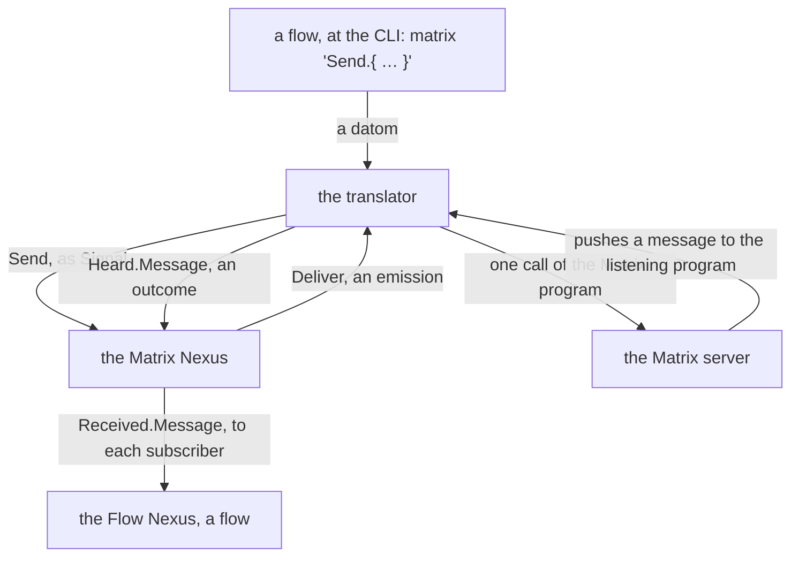
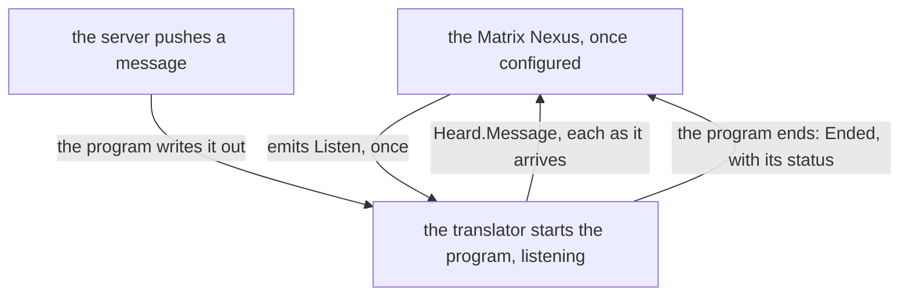

# The Matrix Nexus

The Matrix Nexus is the machine's voice on Matrix: a datom interface to it. It sends a message, and it tells its subscribers each message as the server pushes it. Every word of Matrix and of the program that speaks it is in the translator.



```sh
matrix-nexus
matrix '<datom>'
matrix-meta '<datom>'
```

## Library

A Recipient is a room or a person, each by its Matrix address; a Body is the text of a message; an Instant is Unix seconds. A Program is the path of the program that speaks Matrix and a Store is the directory holding its login; both are values the meta surface sets.

```ethos
Library
[]
[ RoomId.String
  UserId.String
  Recipient.[ RoomId UserId ]
  Body.String
  Instant.Integer
  Message.{ Sender.UserId
            RoomId
            Body
            At.Instant }
  Program.String
  Store.String ]
[]
[]
```

## Signal

Send answers Sent once the server has taken the message. Subscribe gives each message as it arrives, as notion:subscription:0 says.

```ethos
Signal
[ matrix:[ Recipient Body Message ] ]
[ Send.{ Recipient Body }
  Subscribe ]
[ Sent
  Subscribed
  Received.Message
  Refused.[ Undelivered.Integer
            NotReady ] ]
[]
```

The addresses below are plainly examples.

```datom
Send.{ UserId.«@someone:example.org» «The build is green.» }
Sent
Subscribe
Subscribed
Received.{ «@someone:example.org» «!room:example.org» «Good. Land it.» 1795000000 }
```

## Meta

```ethos
Signal
[ matrix:[ Program Store ] ]
[ Configure.Set ]
[ Configured.Set ]
[ Set.[ Program Store ] ]
```

NotReady refuses a Send while either value is unset.

## Emission

Deliver is one call that sends one message. Listen is one call that lasts: the program stays connected to the server, and each message the server pushes is one outcome on the same connection, so nothing is asked twice. The emissions are named for what is done, and the program is a value; another program that speaks Matrix changes the bodies alone.

```ethos
Emission
[ matrix:[ Recipient Body Message Program Store ] ]
[ Deliver.{ Program Store Recipient Body }
  Listen.{ Program Store } ]
[ Delivery.[ Delivered
             Undelivered.Integer ]
  Listening.[ Heard.Message
              Ended.Integer ] ]
[]
```



The first program is Matrix Commander; the implementer may bring a better one, and says why. A Listen that carries many outcomes on one connection is new to the translator library and is added there, once. What starts a Listen again after Ended is open, and is brought to the Designer as a question.

## Memory

The configuration, and each message received, kept in the State directory.

```ethos
Memory
[ matrix:[ Program Store Message ] ]
[ Configuration.{ Option<Program> Option<Store> }
  Inbox.Vector<Message>
  Answer.[ Succeeded Failed ] ]
```

## The account

The login in the Store is made once, by hand or by a flow driving a browser, outside this Nexus. The Nexus is given the Store and knows nothing of how it was made.
