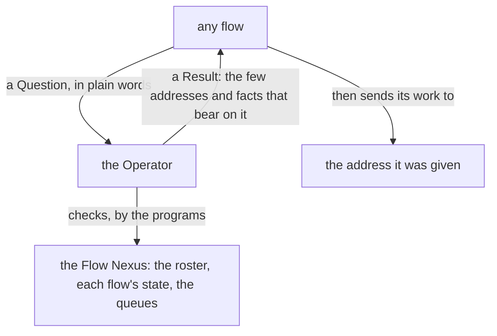
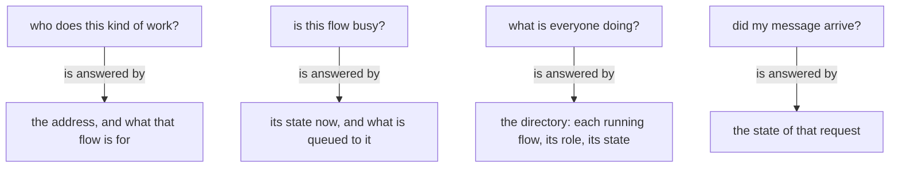
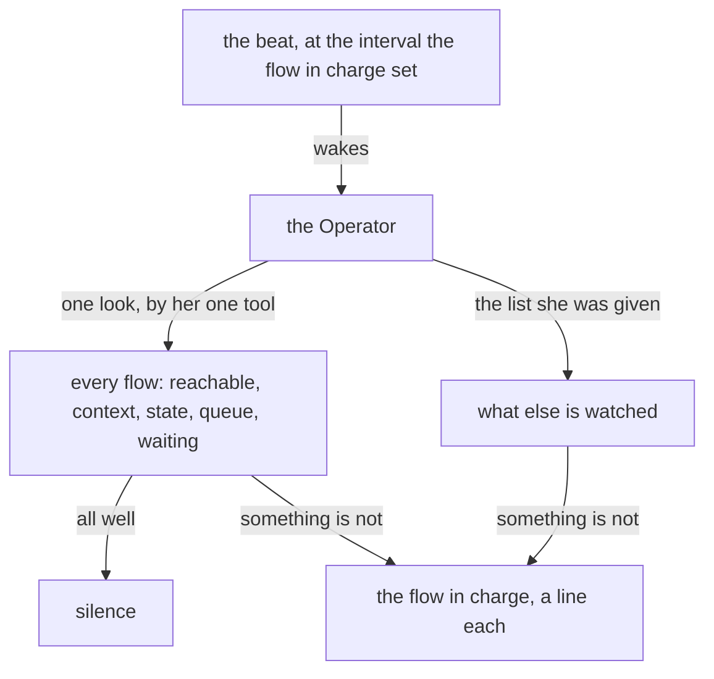

# The Operator

The Operator is the telephone operator of the machine. A flow that needs to know who is there asks the Operator a Question, in plain words, and is answered with the few addresses and facts that bear on it. The Operator knows the programs that tell this and uses them; the flow that asks does not.



## What the Operator answers



An answer is a few lines. The whole directory is given only when it is asked for, and then as a file, with its path.

## What the Operator keeps

The Operator keeps the directory: each running flow, its address, what it is for in a line, and its state. It learns of a flow started, stopped or renamed as the Flow Nexus pushes the change, and reads the rest from the programs at the moment it is asked, so its answer is of now.

What the Operator finds wrong while it looks, a flow stopped with work queued to it, a message that never arrived, a prompt left unsent in a pane, it tells the flow in charge, in a line, and goes on.

```ethos sketch
Types
[ Entry.{ Address
          Purpose.String
          State } ]
```

## The heartbeat is the Operator's

The heartbeat is the Operator's regular job. At each beat she looks at every flow: whether it can be reached, how full its context is, what it is doing, what is queued to it and how long it has waited; and at what the flow in charge listed for her to watch. What is well she passes over in silence. What is not she tells the flow in charge, in a line each.



## Her one tool

The Operator does her job with one command, which takes one datom and answers one datom: every question she has is a variant of it, and several are asked at once. When she finds herself running a second program for something, she tells the flow in charge, and whoever keeps the tool adds a variant. The tool is a small program of its own, written in what suits it; the form below is tentative.

```ethos sketch
Signal
[ flow:[ Address ] ]
[ Look.Vector<Aspect> ]
[ Seen.Vector<Sight> ]
[ Aspect.[ Directory
           Reachable
           Contexts
           Queues
           Waiting
           One.Address ]
  Sight.{ Address
          Purpose.String
          State
          Reachable.Boolean
          Tokens.Integer
          Queued.Integer
          WaitingMinutes.Integer } ]
```

```datom
Look.[ Reachable Contexts Queues ]
```

## Its place

The Operator is a cheap model at high effort, a permanent flow under an address that says its role. The flow that held the heartbeat becomes it.
