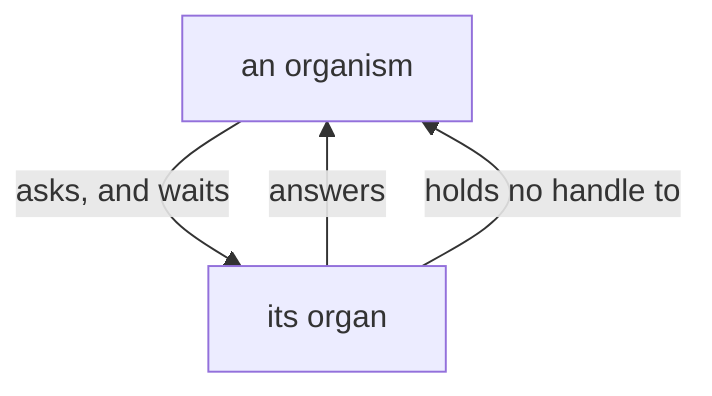
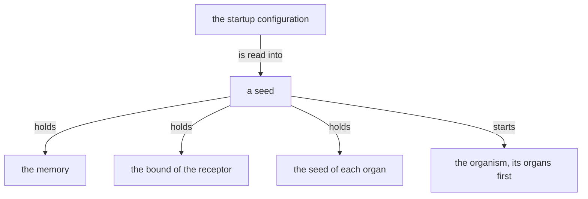
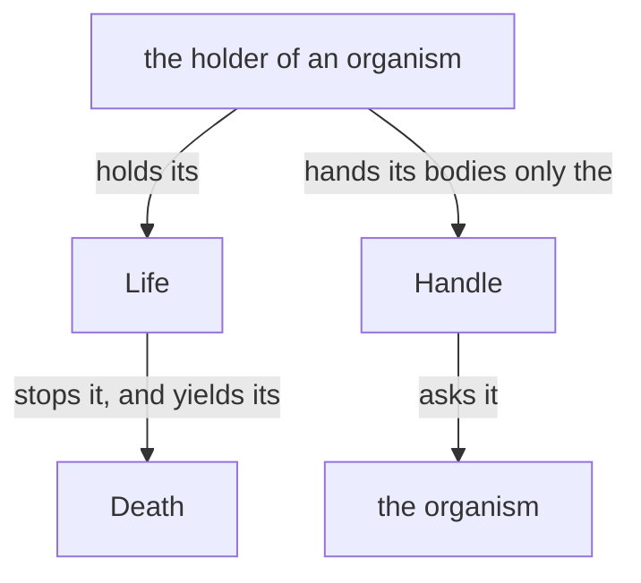
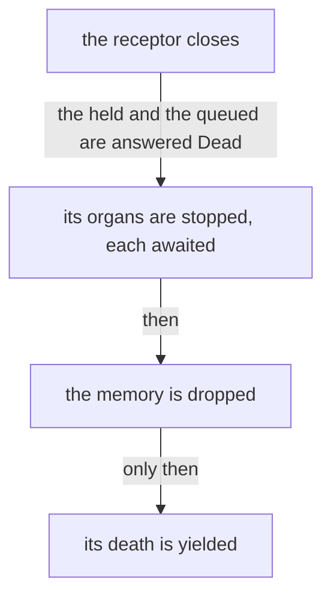
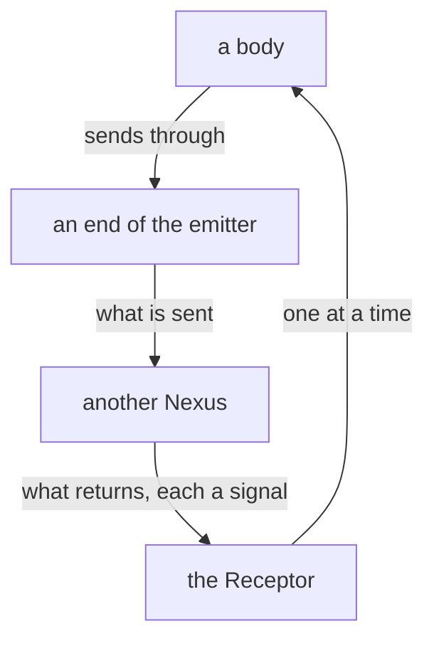
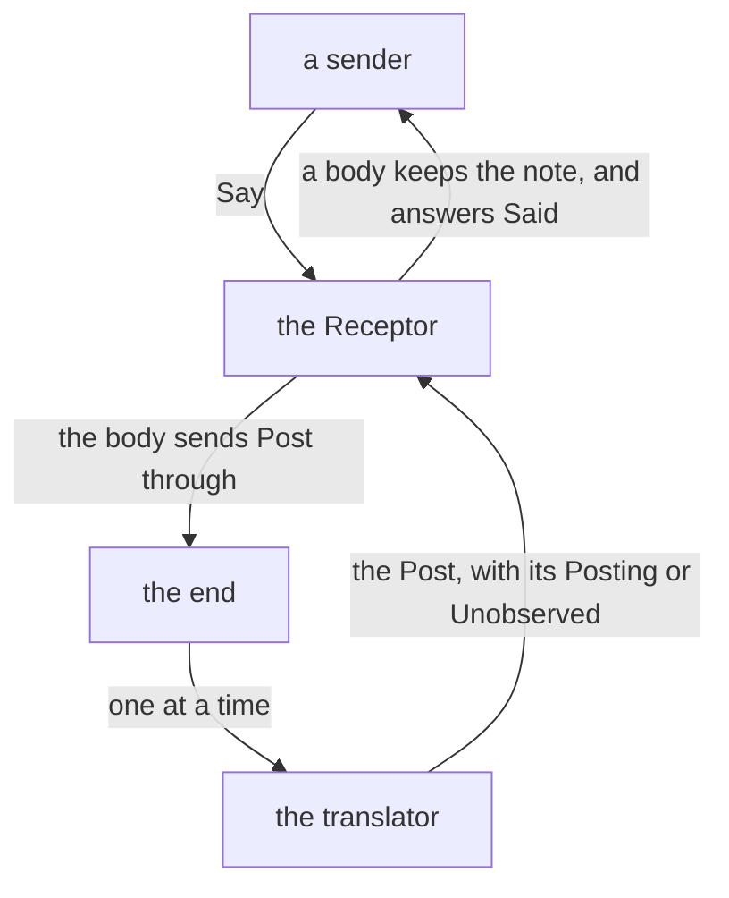
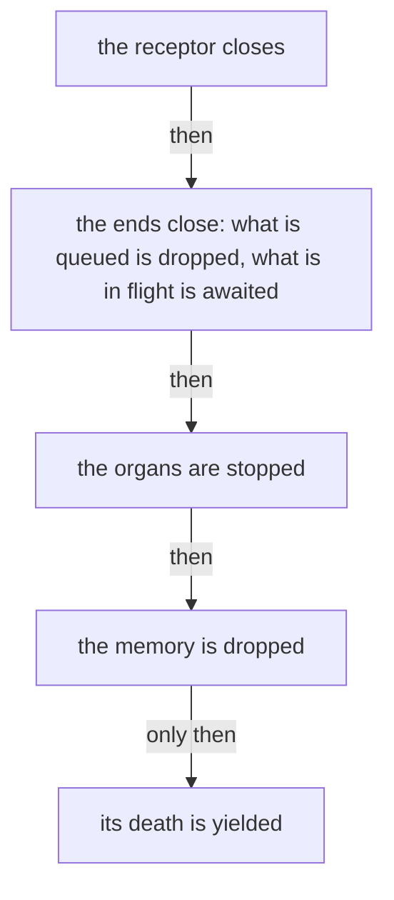
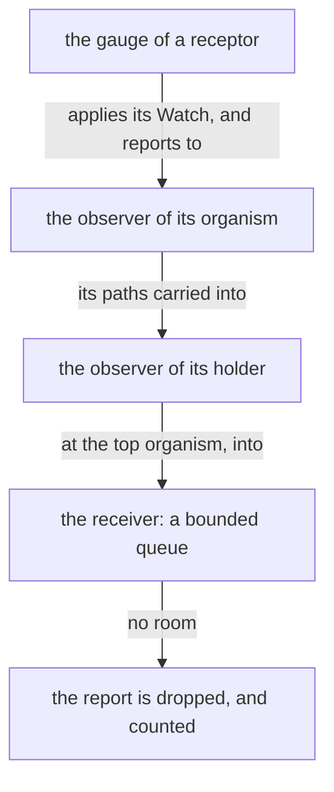

# The organism

Written by Fable from what the living has said and from a prototype that ran; he has reviewed none of it. The prototype is ~/Code/organic-runtime-prototype: every fence of Rust here is its text, compiled and run, its doc comments taken out, but that of the section “The emitter, filled”, an end toward another Nexus, which is not built. The sections before “The emitter, filled” are its text as it stood before Probes were given at start; the last two are its text at b893b85.

## The organism file

Each file of an organism is its own namespace, named for the file. The Organism file declares nothing: it points at the files behind its organs.

```ethos sketch
Organism
[]
[ :lock:signal ]
[]
[ :lock:matrix ]
[]
```

| position | holds |
|---|---|
| 1 | imports: here none |
| 2 | the receptor: the Signal it takes and answers |
| 3 | the emitter: here nothing |
| 4 | the memory: its Matrix |
| 5 | the organs: here none |

## A wait points down



The three files of an organism that holds the lock organism:

```ethos
Signal
[]
[ Open.FlowName
  Close.FlowName ]
[ Opened.FlowName
  Closed.FlowName
  Refused.FlowName ]
[ FlowName.String ]
```

```ethos sketch
Matrix
[ :flow:signal:[ FlowName ]
  :lock:signal:[ LockId ] ]
[ Flow.{ FlowName LockId }
  Flows.⟦Flow⟧ ]
```

```ethos sketch
Organism
[]
[ :flow:signal ]
[]
[ :flow:matrix ]
[ :lock:organism ]
```

The Rust generated from them holds a handle to its organ:

```rust
pub struct Flow {
    pub flow_name: FlowName,
    pub lock_id: LockId,
}

pub struct Flows(pub Vec<Flow>);

pub struct Memory {
    pub flows: Flows,
}

pub struct Organs {
    pub lock: lock::organism::Handle,
}
```

The Rust generated from the lock organism's files holds none to its holder:

```rust
pub struct Reception {
    input: Input,
    answer: oneshot::Sender<Output>,
}

#[derive(Clone)]
pub struct Handle {
    sender: mpsc::Sender<Reception>,
}

pub struct Dead;

impl Handle {
    pub async fn ask(&self, input: Input) -> Result<Output, Dead> {
        let (answer, answered) = oneshot::channel();
        self.sender
            .send(Reception { input, answer })
            .await
            .map_err(|_| Dead)?;
        answered.await.map_err(|_| Dead)
    }
}
```

The Rust written by hand, two waits downward:

```rust
impl Receptive for Memory {
    async fn open(&mut self, organs: &Organs, flow_name: FlowName) -> Output {
        let lock_name = LockName(flow_name.0.clone());
        match organs.lock.ask(lock::signal::Input::Lock(lock_name)).await {
            Ok(lock::signal::Output::Locked(lock_id)) => {
                self.flows.0.push(Flow {
                    flow_name: FlowName(flow_name.0.clone()),
                    lock_id,
                });
                Output::Opened(flow_name)
            }
            _ => Output::Refused(flow_name),
        }
    }

    async fn close(&mut self, organs: &Organs, flow_name: FlowName) -> Output {
        let Some(position) = self
            .flows
            .0
            .iter()
            .position(|flow| flow.flow_name.0 == flow_name.0)
        else {
            return Output::Refused(flow_name);
        };
        let flow = self.flows.0.remove(position);
        match organs
            .lock
            .ask(lock::signal::Input::Release(flow.lock_id))
            .await
        {
            Ok(lock::signal::Output::Released(_)) => Output::Closed(flow_name),
            _ => Output::Refused(flow_name),
        }
    }
}
```

Organism files that point at each other in a ring are refused when the Ethos is read.

## The seed



```ethos
Types
[ Bound.Integer
  Refusal.[ BelowOne.Integer
            AboveQueue.Integer ] ]
```

The Rust of the runtime, written once for every organism:

```rust
pub struct Bound(i64);

pub enum Refusal {
    BelowOne(i64),
    AboveQueue(i64),
}

impl Bound {
    pub fn new(integer: i64) -> Result<Self, Refusal> {
        match usize::try_from(integer) {
            Err(_) | Ok(0) => Err(Refusal::BelowOne(integer)),
            Ok(room) if room > tokio::sync::Semaphore::MAX_PERMITS => {
                Err(Refusal::AboveQueue(integer))
            }
            Ok(_) => Ok(Self(integer)),
        }
    }

    pub fn room(&self) -> usize {
        self.0 as usize
    }
}
```

The Rust generated from the organism file of an organism that holds the lock organism:

```rust
pub struct Seed {
    pub memory: Memory,
    pub bound: Bound,
    pub lock: lock::organism::Seed,
}

pub struct Organs {
    pub lock: lock::organism::Handle,
}

struct Lives {
    lock: lock::organism::Life,
}

pub struct Organism {
    receptor: mpsc::Receiver<Reception>,
    stopped: oneshot::Receiver<()>,
    organs: Organs,
    lives: Lives,
    memory: Memory,
}

impl Organism {
    pub fn start(seed: Seed) -> (Handle, Life) {
        let (lock, lock_life) = lock::organism::Organism::start(seed.lock);
        let (sender, receptor) = mpsc::channel(seed.bound.room());
        let (stop, stopped) = oneshot::channel();
        let organism = Self {
            receptor,
            stopped,
            organs: Organs { lock },
            lives: Lives { lock: lock_life },
            memory: seed.memory,
        };
        let task = tokio::spawn(organism.live());
        (Handle { sender }, Life { stop: Some(stop), task, death: None })
    }
}
```

A seed: no flow open and a bound of 64; in its organ no lock held, the next id 0, and a bound of 64:

```datom
{ { [] }
  64
  { { { [] 0 } } 64 } }
```

## The life



```ethos
Types
[ Death.[ Stopped Failed ] ]
```

| it dies | when | as |
|---|---|---|
| told | its holder stops its life, or drops it | Stopped |
| unreachable | every handle to it is dropped | Stopped |
| with its organ | an organ of its own dies | Failed |
| by a body | a body fails | Failed |



The Rust generated from the organism file:

```rust
pub struct Life {
    stop: Option<oneshot::Sender<()>>,
    task: JoinHandle<Death>,
    death: Option<Death>,
}

impl Life {
    pub async fn dead(&mut self) {
        if self.death.is_none() {
            self.death = Some((&mut self.task).await.unwrap_or(Death::Failed));
        }
    }

    pub async fn stop(mut self) -> Death {
        if let Some(stop) = self.stop.take() {
            let _ = stop.send(());
        }
        self.dead().await;
        self.death.take().unwrap_or(Death::Failed)
    }
}

pub trait Receptive {
    fn open(&mut self, organs: &Organs, flow_name: FlowName) -> impl Future<Output = Output> + Send;
    fn close(&mut self, organs: &Organs, flow_name: FlowName) -> impl Future<Output = Output> + Send;
}

impl Organism {
    async fn live(mut self) -> Death {
        let death = loop {
            tokio::select! {
                biased;
                _ = &mut self.stopped => break Death::Stopped,
                _ = self.lives.lock.dead() => break Death::Failed,
                reception = self.receptor.recv() => match reception {
                    None => break Death::Stopped,
                    Some(Reception { input, answer }) => {
                        let output = match input {
                            Input::Open(flow_name) => Body::new(self.memory.open(&self.organs, flow_name)).run().await,
                            Input::Close(flow_name) => Body::new(self.memory.close(&self.organs, flow_name)).run().await,
                        };
                        match output {
                            Ok(output) => {
                                let _ = answer.send(output);
                            }
                            Err(death) => break death,
                        }
                    }
                },
            }
        };
        self.receptor.close();
        while self.receptor.try_recv().is_ok() {}
        self.lives.lock.stop().await;
        drop(self.memory);
        death
    }
}
```

The Rust of the runtime, written once for every organism:

```rust
pub enum Death {
    Stopped,
    Failed,
}

pub struct Body<F> {
    future: F,
}

impl<F: Future> Body<F> {
    pub fn new(future: F) -> Self {
        Self { future }
    }

    pub async fn run(self) -> Result<F::Output, Death> {
        let mut future = std::pin::pin!(self.future);
        std::future::poll_fn(move |context| {
            match std::panic::catch_unwind(std::panic::AssertUnwindSafe(|| {
                future.as_mut().poll(context)
            })) {
                Ok(Poll::Ready(output)) => Poll::Ready(Ok(output)),
                Ok(Poll::Pending) => Poll::Pending,
                Err(_) => Poll::Ready(Err(Death::Failed)),
            }
        })
        .await
    }
}
```

## The emitter, filled



The Signal of the Harness Nexus, as it stands in vision:harness-nexus:0:

```ethos
Signal
[ harness:[ Event State Observed ]
  flow:[ FlowId ] ]
[ Subscribe ]
[ Subscribed.Vector<Observed>
  Changed.{ FlowId Event State } ]
[]
```

An organism that holds the lock organism, its emitter holding one end:

```ethos sketch
Organism
[]
[ :flow:signal ]
[ :harness:signal ]
[ :flow:matrix ]
[ :lock:organism ]
```

An end sends the inputs of the Signal it points at, and its outputs return through it.

The Rust generated from it, tentative:

```rust
pub struct End<Sent> {
    sender: mpsc::Sender<Sent>,
}

pub struct Emitter {
    pub harness: End<harness::signal::Input>,
}

pub enum Reception {
    Asked { input: Input, answer: oneshot::Sender<Output> },
    Harness(harness::signal::Output),
}

pub trait Receptive {
    async fn open(&mut self, organs: &Organs, emitter: &Emitter, flow_name: FlowName) -> Output;
    async fn close(&mut self, organs: &Organs, emitter: &Emitter, flow_name: FlowName) -> Output;
    async fn harness_subscribed(&mut self, organs: &Organs, emitter: &Emitter, observed_vector: Vec<Observed>);
    async fn harness_changed(&mut self, organs: &Organs, emitter: &Emitter, changed: harness::signal::Changed_Data);
}
```

No body waits on another Nexus.

## An end toward the translator



The four files of an organism that posts notes:

```ethos
Signal
[ :nexus:[ Unobserved ] ]
[ Say.Text
  Show.NoteId ]
[ Said.NoteId
  Shown.Note
  Unknown.NoteId ]
[ NoteId.Integer
  Text.String
  State.[ Waiting Flying Posted Refused Unobserved ]
  Note.{ NoteId Text State } ]
```

```ethos
Signal
[ :note:signal:[ NoteId Text ] ]
[ Post.{ NoteId Text } ]
[ Posting.[ Posted.NoteId
            Refused.NoteId ] ]
[]
```

```ethos sketch
Matrix
[ :note:signal:[ NoteId Note ] ]
[ Notes.{ ⟦Note⟧ NoteId } ]
```

```ethos sketch
Organism
[]
[ :note:signal ]
[ :note:emission ]
[ :note:matrix ]
[]
```

The second file is `emission.ethos`, written as a Signal today.

The Rust of the runtime, written once for every organism:

```rust
pub enum Rejection {
    Unadmitted,
    Undecodable,
}

pub enum Unobserved {
    Unsubmitted,
    Rejected(Rejection),
    Unanswered,
}

pub enum Translated<Outcome> {
    Observed(Outcome),
    Rejected(Rejection),
    Unanswered,
}

pub trait Translating<Sent> {
    type Outcome;
    fn translate(&self, sent: &Sent) -> Translated<Self::Outcome>;
}

pub trait Deliverable<Sent, Outcome> {
    fn observed(sent: Sent, outcome: Outcome) -> Self;
    fn unobserved(sent: Sent, unobserved: Unobserved) -> Self;
}

pub struct End<Sent> {
    sender: mpsc::Sender<Sent>,
}

pub enum Unsent<Sent> {
    Saturated(Sent),
    Dead(Sent),
}

impl<Sent> End<Sent> {
    pub fn send(&self, sent: Sent) -> Result<(), Unsent<Sent>> {
        self.sender.try_send(sent).map_err(|error| match error {
            mpsc::error::TrySendError::Full(sent) => Unsent::Saturated(sent),
            mpsc::error::TrySendError::Closed(sent) => Unsent::Dead(sent),
        })
    }
}

pub struct Carrier {
    close: Option<oneshot::Sender<()>>,
    task: JoinHandle<()>,
    ended: bool,
}

struct Carrying<Sent, Translator, Reception>
where
    Translator: Translating<Sent>,
    Reception: Deliverable<Sent, Translator::Outcome>,
{
    queue: mpsc::Receiver<Sent>,
    translator: Arc<Translator>,
    closing: oneshot::Receiver<()>,
    receptor: mpsc::WeakSender<Reception>,
}

impl<Sent, Translator, Reception> Carrying<Sent, Translator, Reception>
where
    Sent: Send + 'static,
    Translator: Translating<Sent> + Send + Sync + 'static,
    Translator::Outcome: Send + 'static,
    Reception: Deliverable<Sent, Translator::Outcome> + Send + 'static,
{
    async fn carry(mut self) {
        loop {
            tokio::select! {
                biased;
                _ = &mut self.closing => break,
                sent = self.queue.recv() => match sent {
                    None => break,
                    Some(sent) => {
                        if self.deliver(sent).await.is_err() {
                            break;
                        }
                    }
                },
            }
        }
    }

    async fn deliver(&mut self, sent: Sent) -> Result<(), tokio::task::JoinError> {
        let translator = Arc::clone(&self.translator);
        let (sent, translated) = tokio::task::spawn_blocking(move || {
            let translated =
                std::panic::catch_unwind(AssertUnwindSafe(|| translator.translate(&sent)))
                    .unwrap_or(Translated::Unanswered);
            (sent, translated)
        })
        .await?;
        let reception = match translated {
            Translated::Observed(outcome) => Reception::observed(sent, outcome),
            Translated::Rejected(rejection) => {
                Reception::unobserved(sent, Unobserved::Rejected(rejection))
            }
            Translated::Unanswered => Reception::unobserved(sent, Unobserved::Unanswered),
        };
        if let Some(receptor) = self.receptor.upgrade() {
            let _ = receptor.send(reception).await;
        }
        Ok(())
    }
}
```

The Rust generated from the organism file:

```rust
pub struct Seed {
    pub memory: Memory,
    pub bound: Bound,
    pub emission: Bound,
}

pub struct Translators<Emission> {
    pub emission: Emission,
}

pub struct Emitter {
    pub emission: End<emission::Input>,
}

struct Carriers {
    emission: Carrier,
}

pub enum Reception {
    Asked {
        input: Input,
        answer: oneshot::Sender<Output>,
    },
    Emission(emission::Input, emission::Output),
    EmissionUnobserved(emission::Input, Unobserved),
}

impl Deliverable<emission::Input, emission::Output> for Reception {
    fn observed(sent: emission::Input, outcome: emission::Output) -> Self {
        Reception::Emission(sent, outcome)
    }

    fn unobserved(sent: emission::Input, unobserved: Unobserved) -> Self {
        Reception::EmissionUnobserved(sent, unobserved)
    }
}

pub trait Receptive {
    fn say(
        &mut self,
        emitter: &Emitter,
        text: Text,
    ) -> impl std::future::Future<Output = Output> + Send;
    fn show(
        &mut self,
        emitter: &Emitter,
        note_id: NoteId,
    ) -> impl std::future::Future<Output = Output> + Send;
    fn emission_posting(
        &mut self,
        emitter: &Emitter,
        post: emission::Input,
        posting: emission::Posting_Data,
    ) -> impl std::future::Future<Output = ()> + Send;
    fn emission_unobserved(
        &mut self,
        emitter: &Emitter,
        post: emission::Input,
        unobserved: Unobserved,
    ) -> impl std::future::Future<Output = ()> + Send;
}
```

The Rust written by hand, the body a Post returns to:

```rust
impl Receptive for Memory {
    async fn emission_posting(&mut self, emitter: &Emitter, post: Emission, posting: Posting_Data) {
        let Emission::Post(post) = post;
        let state = match posting {
            Posting_Data::Posted(_) => State::Posted,
            Posting_Data::Refused(_) => State::Refused,
        };
        self.notes.land(&post.note_id, state);
        self.notes.fly_next(emitter);
    }
}
```

A translator is live, not data: it is no part of the seed, and is given beside it when the organism starts.

| a send through an end | yields |
|---|---|
| there is room | the emission is taken; it will enter by the receptor with what came of it |
| the end is saturated | the emission back, at once; the body keeps it in the memory |
| the organism is dying | the emission back, at once |



## The introspective build



```ethos
Types
[ Filled.Integer
  Milliseconds.Integer
  Asker.[ Organ Holder Outside ]
  Wait.{ Asker Organ }
  Observation.[ Saturated.Organ
                Filling.{ Organ Filled }
                Surging.{ Organ Filled Milliseconds }
                Held.Wait
                HeldLong.{ Wait Milliseconds } ]
  Share.{ Integer Integer }
  Level.Share
  Rise.Share
  Surge.{ Rise Milliseconds }
  Watch.{ ⟦Level⟧ Surge Milliseconds }
  Signals.Integer ]
```

| observation | is reported when |
|---|---|
| Filling | the queue reaches a watched level, each time anew |
| Surging | the queue rises by the Rise within the Surge's time |
| Saturated | the queue reaches its bound |
| Held | a sender finds no room |
| HeldLong | a sender has been held past the watched time |

A Watch: Filling at half and at three quarters of the bound; Surging at a quarter of it more within 100 milliseconds; HeldLong at 500 milliseconds.

```datom
{ [ { 1 2 } { 3 4 } ] { { 1 4 } 100 } 500 }
```

The Watch is data, in the seed. The observer is live, given at start beside the seed.

The Rust generated from the organism file of an organism that holds the lock organism:

```rust
#[cfg(any(feature = "trace", feature = "introspective"))]
pub enum Organ {
    Flow,
    Lock(lock::organism::Organ),
}

pub struct Seed {
    pub memory: Memory,
    pub bound: Bound,
    pub lock: lock::organism::Seed,
    #[cfg(feature = "introspective")]
    pub watch: Watch,
}

pub struct Probes {
    #[cfg(feature = "trace")]
    pub trace: Trace<Organ>,
    #[cfg(feature = "introspective")]
    pub observer: Arc<Observer<Organ>>,
}

pub fn start(seed: Seed, probes: Probes) -> (Handle, Life) {
    let Probes {
        #[cfg(feature = "trace")]
        trace,
        #[cfg(feature = "introspective")]
        observer,
    } = probes;
    let (lock, lock_life) = lock::organism::Organism::start(
        seed.lock,
        lock::organism::Probes {
            #[cfg(feature = "trace")]
            trace: trace.within(Organ::Lock),
            #[cfg(feature = "introspective")]
            observer: observer.within(Organ::Flow, Organ::Lock),
        },
    );
    #[cfg(feature = "introspective")]
    let lock = lock.held_by(Asker::Holder);
```

The Rust of the runtime, written once for every organism, compiled only under `introspective`:

```rust
pub struct Share {
    part: i64,
    whole: i64,
}

pub enum ShareRefusal {
    WholeBelowOne(i64),
    PartBelowOne(i64),
    PartAboveWhole(i64),
}

impl Share {
    pub fn new(part: i64, whole: i64) -> Result<Self, ShareRefusal> {
        if whole < 1 {
            Err(ShareRefusal::WholeBelowOne(whole))
        } else if part < 1 {
            Err(ShareRefusal::PartBelowOne(part))
        } else if part > whole {
            Err(ShareRefusal::PartAboveWhole(part))
        } else {
            Ok(Self { part, whole })
        }
    }

    pub fn signals(&self, bound: Bound) -> Signals {
        let (room, part, whole) = (bound.room() as u128, self.part as u128, self.whole as u128);
        Signals((room * part).div_ceil(whole) as i64)
    }
}

pub struct Observer<Organ> {
    reporting: Box<dyn Fn(Observation<Organ>) + Send + Sync>,
    dropped: Arc<AtomicU64>,
}

pub struct Gauge<Organ> {
    organ: Organ,
    watch: Watch,
    filling: Vec<Signals>,
    surging: Signals,
    observer: Arc<Observer<Organ>>,
    reading: Mutex<Reading>,
}

impl<Organ: Path> Gauge<Organ> {
    async fn held<'sender, Sent>(
        &self,
        sender: &'sender mpsc::Sender<Sent>,
        wait: Wait<Organ>,
    ) -> Option<mpsc::Permit<'sender, Sent>> {
        self.observer.report(Observation::Held(wait));
        let held = Instant::now();
        let reserved = sender.reserve();
        tokio::pin!(reserved);
        match tokio::time::timeout(self.watch.milliseconds.duration(), &mut reserved).await {
            Ok(reserved) => reserved.ok(),
            Err(_) => {
                self.observer.report(Observation::HeldLong(HeldLong_Data {
                    wait,
                    milliseconds: Milliseconds::of(held.elapsed()),
                }));
                reserved.await.ok()
            }
        }
    }

    fn rose(&self, room: usize) {
        let now = Instant::now();
        let mut reading = self.reading.lock().expect("a reading is never poisoned");
        reading.filled.0 += 1;
        reading.record(now, self.watch.surge.milliseconds.duration());
        let filled = reading.filled;
        if self.filling.iter().any(|signals| signals.0 == filled.0) {
            self.observer.report(Observation::Filling(Filling_Data {
                organ: self.organ,
                filled,
            }));
        }
        if let Some(began) = reading.surged(self.surging) {
            self.observer.report(Observation::Surging(Surging_Data {
                organ: self.organ,
                filled,
                milliseconds: Milliseconds::of(now - began),
            }));
            reading.restart(now);
        }
        if usize::try_from(filled.0) == Ok(room) {
            self.observer.report(Observation::Saturated(self.organ));
        }
    }
}
```

An organism names only what is below it: its holder is Holder, made the holder itself by the holder's observer.

## Not settled

- Whether a stop may cut a body short: a stop is noticed only between two signals.
- A send whose sender waits for its one outcome, as Resolve in vision:nexus:1: under this notion its answer is given when the input is taken, and the outcome is learned by the body it reaches.
- An integer of Ethos that refuses, so that Bound is generated and not written by hand.
- The organism file: vision:organism:0 imports types in its first position and names them in the others; here the first position is empty and the others point at files.
- An end toward another Nexus, as an end toward the translator is: behind it a connection generated whole from that Signal, under the trait the translator is under. For one end toward many Nexuses of one Signal, one call in flight for each destination.
- At death the receptor closes before the ends: an emission queued in an end is dropped without Unsubmitted.
- Where the translator stands: in the process, held by the carrier, as here, or a program beside the Nexus over a wire.
