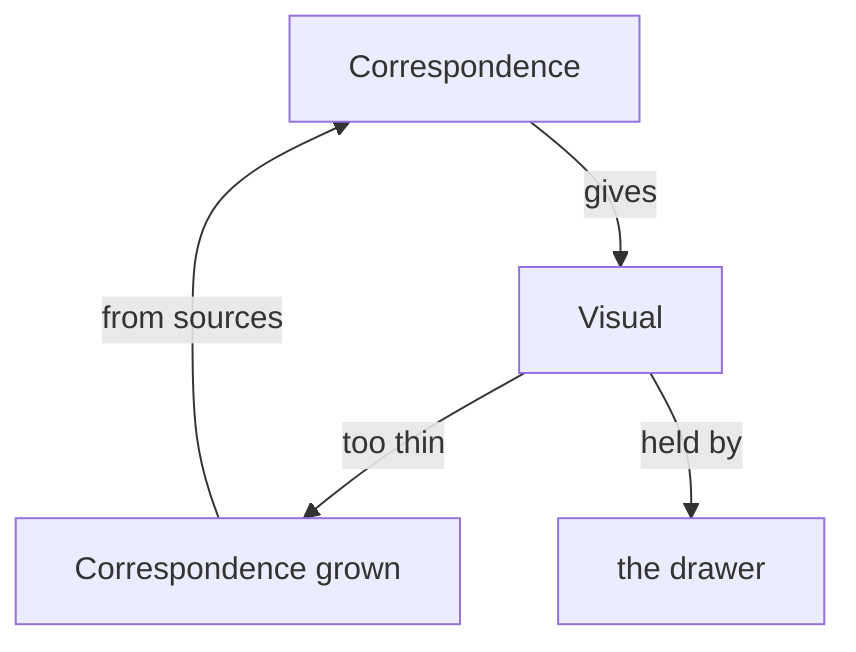
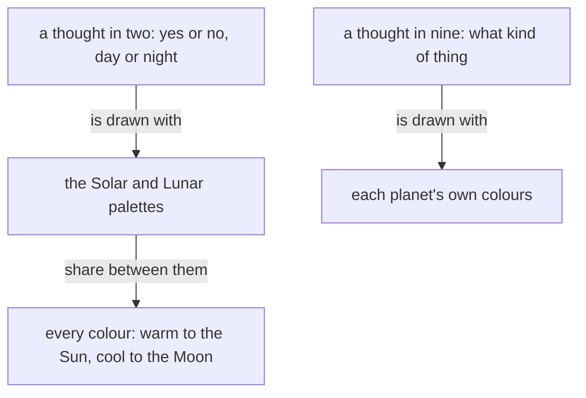

```ethos sketch
Types
[ Quality.[ Solar Lunar Martial Mercurial Jovian Venusian Saturnian Ascending Descending ]
  Feeling.String
  Colour.{ Name.String
           Red.Integer
           Green.Integer
           Blue.Integer }
  Shape.String
  DescribedVisualObject.{ Name.String
                          Meaning.String }
  Visual.{ Quality
           ⟦ Feeling ⟧
           ⟦ Colour ⟧
           ⟦ Shape ⟧
           ⟦ DescribedVisualObject ⟧ } ]
```



```datom
{ Solar
  [ central radiant clear commanding proud generous one ]
  [ { gold 239 186 46 } { orange 230 111 33 } { amber 193 128 38 } ]
  [ circle «circle with a dot at its centre» disc ray wheel ]
  [ DescribedVisualObject.{ centre «what all else turns around» }
    DescribedVisualObject.{ highlight «what the picture is about» }
    DescribedVisualObject.{ largest «the first thing seen» }
    DescribedVisualObject.{ rays «it gives to all around it» } ] }
```

```datom
{ Lunar
  [ receptive soft gentle changing reflecting holding ]
  [ { white 243 241 232 } { silver 191 196 203 } { «pale blue» 194 217 233 } ]
  [ crescent «wide oval» bowl wave ]
  [ DescribedVisualObject.{ ghost «the same thing twice, the earlier one faded: it moved» }
    DescribedVisualObject.{ reflection «a thing shown again, paler: a copy of it» }
    DescribedVisualObject.{ fullness «how much it holds, as a level» }
    DescribedVisualObject.{ «soft edge» «still changing» } ] }
```

```datom
{ Martial
  [ forceful sharp hot quick plain cutting ]
  [ { scarlet 229 46 36 } { red 201 47 49 } { «venetian red» 164 62 55 } ]
  [ triangle arrowhead diagonal blade spark ]
  [ DescribedVisualObject.{ thick «the main path» }
    DescribedVisualObject.{ strike «cut, removed» }
    DescribedVisualObject.{ bolt «interrupts» } ] }
```

```datom
{ Mercurial
  [ quick exact light clever many between ]
  [ { emerald 32 133 86 } { grey 128 128 135 } ]
  [ «thin line» «small tile» node tick ]
  [ DescribedVisualObject.{ label «the name of what travels» }
    DescribedVisualObject.{ number «steps, in their order» }
    DescribedVisualObject.{ row «alike things in a line: one kind» }
    DescribedVisualObject.{ callout «a short word joined to its thing» }
    DescribedVisualObject.{ branch «a choice, each branch named by its case» }
    DescribedVisualObject.{ «real values» «an actual case stands in the boxes» } ] }
```

```datom
{ Jovian
  [ large generous steady just complete holding ]
  [ { yellow 226 179 62 } { blue 46 88 166 } { violet 119 77 181 } ]
  [ «broad rectangle» pyramid column arch dome ]
  [ DescribedVisualObject.{ enclosure «these are one thing» }
    DescribedVisualObject.{ merge «gathered into one» }
    DescribedVisualObject.{ lane «a column for each actor» }
    DescribedVisualObject.{ legend «what each mark means» }
    DescribedVisualObject.{ order «top to bottom is first to last» } ] }
```

```datom
{ Venusian
  [ graceful pleasing harmonious playful refined joining ]
  [ { rose 212 62 115 } { «sky blue» 122 174 211 } { «spring green» 133 172 85 } ]
  [ «upright oval» «long curve» petal pentagon knot ]
  [ DescribedVisualObject.{ curve «joins two that fit» }
    DescribedVisualObject.{ pair «side by side: before and after, or two that agree» }
    DescribedVisualObject.{ nearness «close together belongs together» }
    DescribedVisualObject.{ symmetry «balanced, at rest» }
    DescribedVisualObject.{ «rounded corner» «made to please» } ] }
```

```datom
{ Saturnian
  [ grave spare slow exacting enduring bounding ]
  [ { black 23 20 22 } { indigo 60 51 122 } { «dark brown» 66 44 39 } { grey 139 129 136 } ]
  [ square cross bar «tall narrow rectangle» «right angle» ]
  [ DescribedVisualObject.{ box «a bound: what is inside is fixed» }
    DescribedVisualObject.{ gate «a check across a path» }
    DescribedVisualObject.{ track «the limit, every bar on one scale» }
    DescribedVisualObject.{ tick «what was expected by now» }
    DescribedVisualObject.{ grid «every thing in its place» }
    DescribedVisualObject.{ baseline «what remains, at the bottom» } ] }
```

```datom
{ Ascending
  [ hungry reaching obscure foreign taking ]
  [ { «smoke blue» 54 78 128 } { «grey green» 115 132 119 } ]
  [ cloud «open mouth» funnel «inward spiral» ]
  [ DescribedVisualObject.{ «from the edge» «comes in from outside» }
    DescribedVisualObject.{ dashed «may happen, or is not yet built» }
    DescribedVisualObject.{ blur «unknown: no outline» }
    DescribedVisualObject.{ magnifier «a part taken in, drawn larger» } ] }
```

```datom
{ Descending
  [ finished thinning scattering releasing ]
  [ { «smoke grey» 116 111 107 } { «cloud black» 46 48 54 } ]
  [ tail comet «scattered dots» «outward spiral» ]
  [ DescribedVisualObject.{ fade «past, or leaving» }
    DescribedVisualObject.{ «to the edge» «leaves the picture» }
    DescribedVisualObject.{ «trailing dots» «and so on» }
    DescribedVisualObject.{ scatter «given away, no longer held» } ] }
```

```ethos sketch
Types
[ Arrow.{ Act.String
          Quality } ]
```

```datom
[ { felt Lunar }
  { sorted Saturnian }
  { given Jovian }
  { drawn Venusian }
  { judged Solar }
  { forced Martial } ]
```

## Nature on the ground

A thing shows its nature through colour alone. Use bright, saturated quality colours, visibly distinct from one another and the ground. Choose lettering that stays legible against each colour. The palette records correspondences; for a drawing use a bright rendering of each quality's hue. A delimiter wears its type's nature colours, or ink when the type has no nature. The ground wears its value's nature colours, or stays neutral when the value has no nature. For one quality of a value, its colour fills the ground. For weighted qualities, the first, heavier quality fills the core; each lesser quality forms a border around it, in order from the core out. Each colour occupies its weight divided by the sum of the weights, measured as a share of the whole ground's area. For `{ Saturnian 2 } { Martial 1 }`, the Saturnian core takes two-thirds of the area and the Martial border one-third.

Shapes and symbols in the correspondences are reference material. Delimiter shape tells the syntax. A Glyph value is drawn as its sign, including the Sun and Moon: the mark there is the value itself.

## Scope

```ethos sketch
Types
[ Scope.[ Two Nine ]
  Share.{ Quality
          ⟦ Name ⟧ }
  ScopedPalette.{ Scope
                  ⟦ Share ⟧ } ]
```

```datom
{ Two
  [ { Solar [ red orange yellow gold ] }
    { Lunar [ blue green violet silver ] } ] }
```



```datom
[ { yes Solar }
  { no Lunar } ]
```
