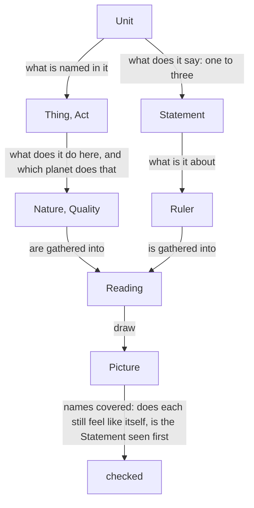
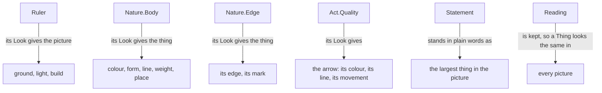

# Using the qualities

```ethos sketch
Types
[ Quality.[ Sun Moon Mars Mercury Jupiter Venus Saturn Rahu Ketu ]
  Name.String
  Statement.String
  Nature.{ Body.Quality
           Edge.Option<Quality> }
  Thing.{ Name Nature }
  Act.{ Name Quality
        From.Name
        To.Name }
  Reading.{ Vector<Statement>
            Ruler.Quality
            Vector<Thing>
            Vector<Act> }
  Look.{ Colour Form Line Weight Place Movement } ]
```

```ethos sketch
Traits
[ Readable.[ read.[ Reading ] ]
  Drawable.[ draw.[ Picture ] ]
  Lookable.[ look.[ Look ] ] ]
[ Unit.[ Readable ]
  Reading.[ Drawable ]
  Quality.[ Lookable ] ]
```





```datom
{ [ «A datom is checked against its type.» ]
  Saturn
  [ { datom { Mercury Some.Saturn } }
    { type { Saturn None } } ]
  [ { checks Saturn type datom } ] }
```

```datom
{ [ «The living approves a proposal, and it lands.» ]
  Sun
  [ { living { Sun None } }
    { proposal { Jupiter None } }
    { module { Saturn None } } ]
  [ { approves Sun living proposal }
    { lands Saturn proposal module } ] }
```

```datom
{ [ «An order interrupts a working flow, and the flow hands on what it held.» ]
  Mars
  [ { order { Mars None } }
    { context { Moon None } }
    { handover { Ketu None } } ]
  [ { interrupts Mars order context }
    { handsOn Ketu context handover } ] }
```
