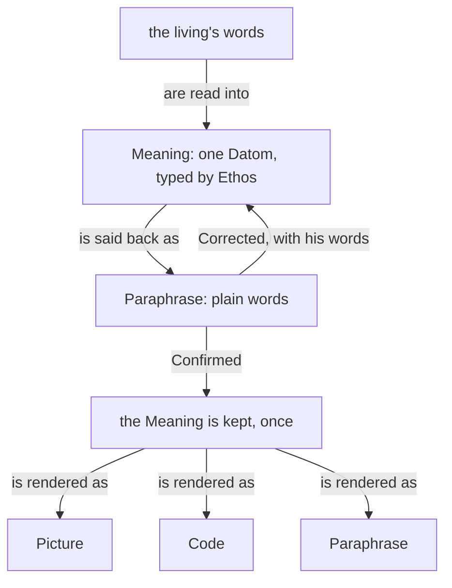

# Rendering

```ethos sketch
Types
[ Meaning.Datom
  Paraphrase.String
  Rendering.[ Picture
              Paraphrase
              Code ]
  Hearing.[ Confirmed
            Corrected.String ] ]
```


