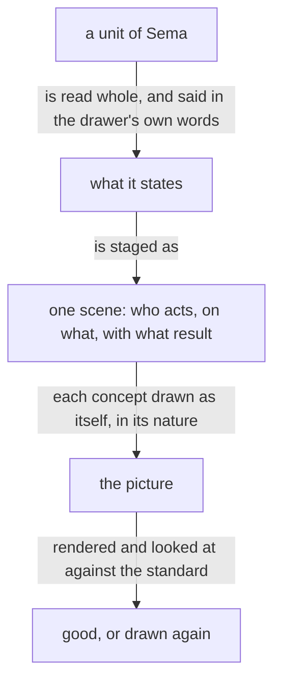

# A Sema unit is drawn as a scene

A unit of Sema states something. The picture is that statement happening: one scene, composed as an illustration is, in which he sees what is stated before he reads a word.

## What a scene is

A scene has a place, light, depth and a centre. The concepts stand in it as objects with body: drawn, shaded, lit, casting a shadow, each in the colours and forms of its nature. The action passes between them as motion with character. One thing is the centre and the eye goes to it first; the rest is arranged around it, unevenly, as a composition.

A picture is a chart, and is drawn again, when any of these is true of it: its concepts are rectangles or tiles holding their names; its parts sit in rows, columns or equal panels; several cases are shown as the same layout repeated; a word stands as a caption where an object should be; nothing in it has light or depth.

The standard, to be looked at before the first picture is drawn: flows/ab2769/the-syntax-of-sema-w030-d746-09/pictures/1.png. A picture that is less a scene than that one is drawn again.

## A general statement is drawn in one instance

A unit that speaks in general names, a preceding concept, an action, a framed story, has nothing to be seen in it. It is drawn through one real instance: a small story with real concepts, a designer and a page, a voice and a word, in which the rule is seen at work. Where the unit gives its own example story, that story is the instance; where it gives none, the drawer chooses one and keeps it for the units beside it. The general names may stand small beside what plays them.

Several cases of one rule are one scene in which the instance is seen to change, each case a moment of it; they are never the same panel repeated.

## What is and is not in the picture

No syntax of the line is drawn: no bracket, brace, dot, arrow sigil, diamond, hash or glyph as written. A written sign appears only in a unit that is about that sign, and then as an object at work in the instance. The words of a picture are the names of its concepts and the verb of an action whose arrow would not be read without it.

No human figure is drawn. What acts is nearly always an aspect, drawn as the sign of what it does: the reading aspect an eye, the writing aspect a pen point, the designing aspect a compass; these are examples. A thinking machine is never a person. A person as such is a plain silhouette, the pictogram of a public sign. The living psyche is the Sun's glyph.

A simple, common action is an arrow made for it, with no word: the arrow of reading carries an eye, the arrow of writing ends in a pen point laying a line; these are examples. One arrow for one action through every picture.

A nature is felt and never labelled: it is in the colour, the form, the weight, the light and the bearing of the concept that carries it, as notion:planetary-visuals:0 gives them. A concept keeps its nature, colours and form in every picture.

## One at a time

One picture is drawn, rendered, looked at beside the standard and made good before the next is begun. Every word is read on a phone.
