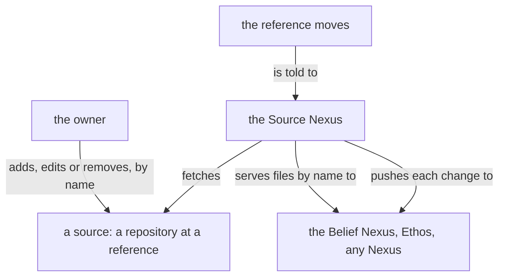

# The Source Nexus, version 0

Written by Psyche core Fable on 13 November 2026 from the living's words of that evening; a notion, not reviewed by him. The Ethos is the design and is tentative in its names; an implementer brings what it leaves open as a question to Psyche core Opus.

## What it is

The Source Nexus manages sources for every other Nexus. A source is a repository at a reference, given a name. The Source Nexus fetches it, keeps it resident, serves its files by signal, and tells its subscribers when it changes. Every other Nexus names a source by its name alone and knows nothing of hosts, Git or fetching. Git is where the content is versioned and backed up; past the Source Nexus everything is typed data.

It serves what must change live without a rebuild, belief modules first. Build inputs stay with Nix. A local directory is not a source: a Nexus that wants one reads it itself.



## Library

A repository is one of the hosts most used, each with its own fields, or a custom one: any other server, by its host and path.

```ethos
Library
[]                                         ; imports
[ Owner.String                             ; types: the user or namespace
  Name.String
  Host.String                              ;   a server's domain
  Path.String                              ;   a repository's path on a custom host
  Repository.[ GitHub.{ Owner Name }
               GitLab.{ Owner Name }
               Codeberg.{ Owner Name }
               SourceHut.{ Owner Name }
               Bitbucket.{ Owner Name }
               Custom.{ Host Path } ]      ;   any other server
  Reference.String                         ;   a branch or a tag
  SourceName.String
  Source.{ SourceName Repository Reference }
  Revision.String                          ;   the commit a reference stood at when fetched
  FilePath.String                          ;   a file's path inside a source
  Hash.String                              ;   the hash of a file's content
  Text.String ]
[]                                         ; traits
[]                                         ; associations
```

## Signal

What any Nexus asks. A source that is named and fetched answers from what the Source Nexus holds; nothing is fetched to answer a request.

```ethos
Signal
[ source:[ SourceName Revision FilePath Hash Text ] ]   ; imports
[ Read.{ SourceName FilePath }             ; inputs: one file
  List.SourceName                          ;   every file of a source
  Subscribe.SourceName ]                   ;   its state now, then each change
[ Read.{ Revision Hash Text }              ; outputs
  Listed.{ Revision Vector<FilePath> }
  Subscribed.{ SourceName Revision }
  Changed.{ SourceName Revision            ;   pushed: the new revision,
            Vector<FilePath> }             ;     and the files that differ from the last
  Refused.[ UnknownSource.SourceName
            UnknownFile.{ SourceName FilePath }
            Unfetched.SourceName ] ]       ;   named, and never yet fetched
[]
```

The owner's signal, on the meta socket. Each action is its own input: an Add of a taken name and an Edit of an unknown one are refused, so a mistyped name is never a new source.

```ethos
Signal
[ source:[ SourceName Source Revision ] ]  ; imports
[ AddSource.Source                         ; inputs
  EditSource.Source                        ;   its repository or its reference, replaced
  RemoveSource.SourceName
  Moved.SourceName ]                       ;   the event: that source's reference moved; fetch it
[ SourceAdded.SourceName                   ; outputs
  SourceEdited.SourceName
  SourceRemoved.SourceName
  Fetched.{ SourceName Revision }
  Refused.[ NameTaken.SourceName
            UnknownSource.SourceName
            Unreachable.SourceName ] ]     ;   the fetch failed; the last good state is kept
[]
```

```datom
AddSource.{ psyche-belief GitHub.{ example-owner psyche-belief } main }
SourceAdded.psyche-belief
Moved.psyche-belief
Fetched.{ psyche-belief 65bd154 }
Read.{ psyche-belief «modules.datom» }
Read.{ 65bd154 9f3a «[ { Spirit core [ 0 ] … } ]» }
```

`Moved` is how a change reaches the Source Nexus: whatever sees the reference move sends it, a push hook on the pushing machine or the Git server's own receive hook. The Source Nexus fetches on Add, on Edit and on Moved, and at no other time. A source that cannot be fetched keeps its last good state and answers from it.

## Operation, Memory and Emission

Operation: Adding, Editing, Removing, Resolving, Fetching and Serving, one for each effect. Memory holds the sources and, for each, the revision last resolved and the hash of every file at it.

There are two emissions, and they are apart because they fail apart. Resolving asks the repository which revision a reference stands at; it is the only question that needs the repository, and it is asked on Add, on Edit and on Moved alone. Fetching brings the content of one revision, and goes through Nix: a revision the Nix store already holds, because a build pinned it or an earlier fetch brought it, is reused and nothing is downloaded. Nix is assumed installed. The content the Source Nexus serves is kept in the store under a root of its own, so no collection removes it.

A repository that cannot be asked leaves the source at its last resolved revision, served from the store.

```ethos
Emission
[ source:[ Repository Reference Revision ] ]   ; imports
[ Resolve.{ Repository Reference }             ; emissions: which revision the reference stands at
  Fetch.{ Repository Revision } ]              ;   that revision's content, through Nix
[ Resolved.Revision                            ; outcomes
  Fetched.StorePath                            ;   where the content is, reused when already held
  Unreachable ]
[ StorePath.String ]
```

## What it leaves to others

It writes nothing back to a repository. What a file means is its reader's: the Belief Nexus reads `modules.datom` and the modules it names, and the Source Nexus knows them only as files.

## How it is built

From an empty tree, as a Nexus by vision:nexus:0: its four parts in Ethos, the Rust generated from them, the bodies hand-written, built and tested with Nix. It is small. Its first consumer is the Belief Nexus; Curriculum is not adapted to it. Until the Belief Nexus runs on it, it runs beside everything and changes nothing.
