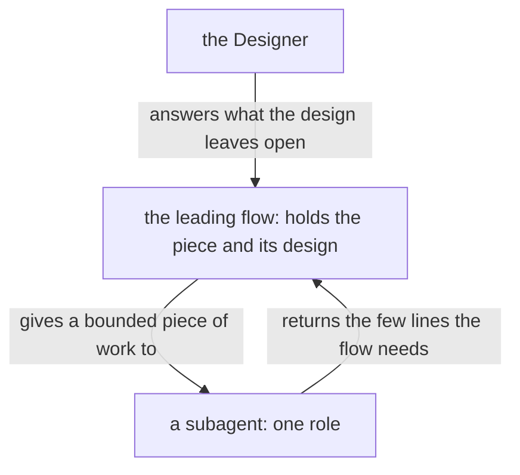
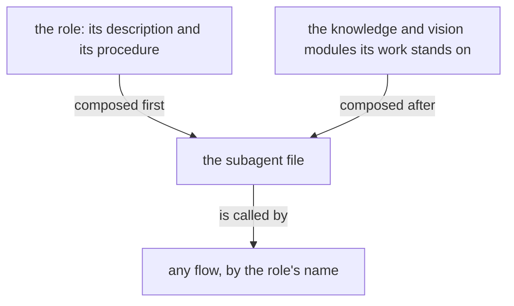
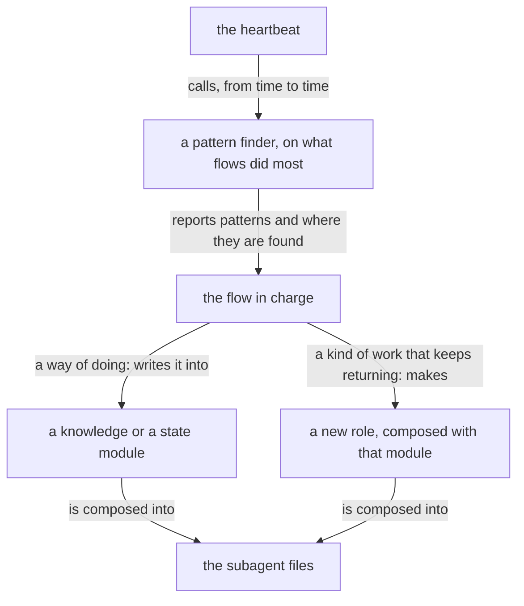

# Subagent roles

A flow that leads a piece of work keeps the design of its piece in its own context and gives each bounded piece of work to a subagent whose role fits it. A subagent is one role, on the cheapest model that does the job.



## A subagent is composed, never written

A subagent file is built from pattern modules: its role's two modules, the description that selects it and the procedure it follows, and after them the knowledge and vision modules its work stands on. What a role needs to know that no module holds is written into a knowledge module first, and the role is composed with it.

```ethos sketch
Types
[ Subagent.{ Name.String
             ModelName
             Effort
             Vector<ModuleName> } ]
```



## The four roles

The models and the modules below are a first composition; whoever builds the files sets them, and the model of each is the cheapest that returns good work.

```datom
[ { committer Terra Low
    [ { Role committer-description 0 } { Role committer 0 }
      { Vision committing 0 } ] }
  { codeMapper Sol Medium
    [ { Role code-mapper-description 0 } { Role code-mapper 0 }
      { Vision code 0 } { Vision ethos 0 } { Knowledge search 0 } ] }
  { patternWeaver Sol High
    [ { Role pattern-weaver-description 0 } { Role pattern-weaver 0 }
      { Vision code 0 } { Vision ethos 0 } { Intent design 0 } ] }
  { patternFinder Sol Medium
    [ { Role pattern-finder-description 0 } { Role pattern-finder 0 }
      { Vision code 0 } { Intent design 0 } { Knowledge search 0 } ] } ]
```

Each role's description and procedure, as the lines its two modules hold:

The committer. Description: commits what is in a given path and pushes it. Procedure: you are given a path. Read what changed under it, write a message that says what the change does, commit that path alone, push, and return the revision.

The code mapper. Description: maps the code of a repository or a directory, or hunts one named thing in it. Procedure: you are given a repository or a directory. When a thing to find is named, find it and return where it is and the lines that bear on it. Otherwise return the high-level map: the parts, what each can do, the traits they share, and where each lives.

The pattern weaver. Description: applies a given pattern, shown by a few examples, to code. Procedure: you are given a pattern, a few examples of it, and either a repository or the places it is wanted. Make the code at each place follow the pattern, build it, and return each place changed and each place the pattern did not fit, with why.

The pattern finder. Description: finds the patterns in code or in what flows do, and reports each with where it is found. Procedure: you are given a repository, or the transcripts of flows. Return each pattern you find: what is done the same way in several places, a few examples of it, and every place it is found.

## A pattern found becomes a module

On the heartbeat a pattern finder reads what the flows have done most. What it reports is material: a pattern worth keeping is written into a knowledge module, or a state module where it is a fact of the machines, and a kind of work that keeps returning becomes a role of its own, composed with that module.



The weaver and the finder are one pattern read two ways: what the finder reports, with its examples, is the brief the weaver takes.
