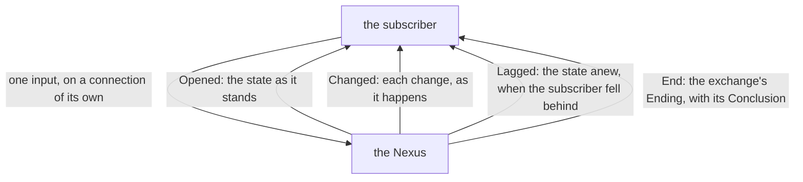
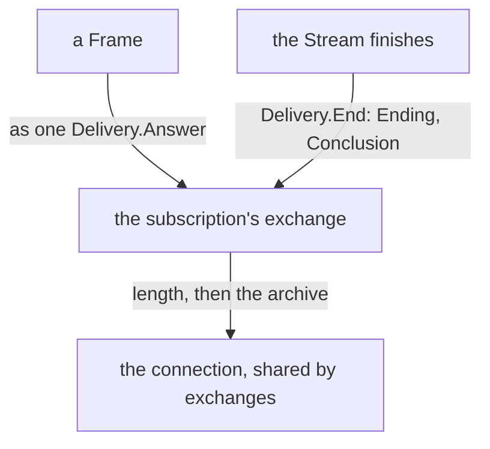
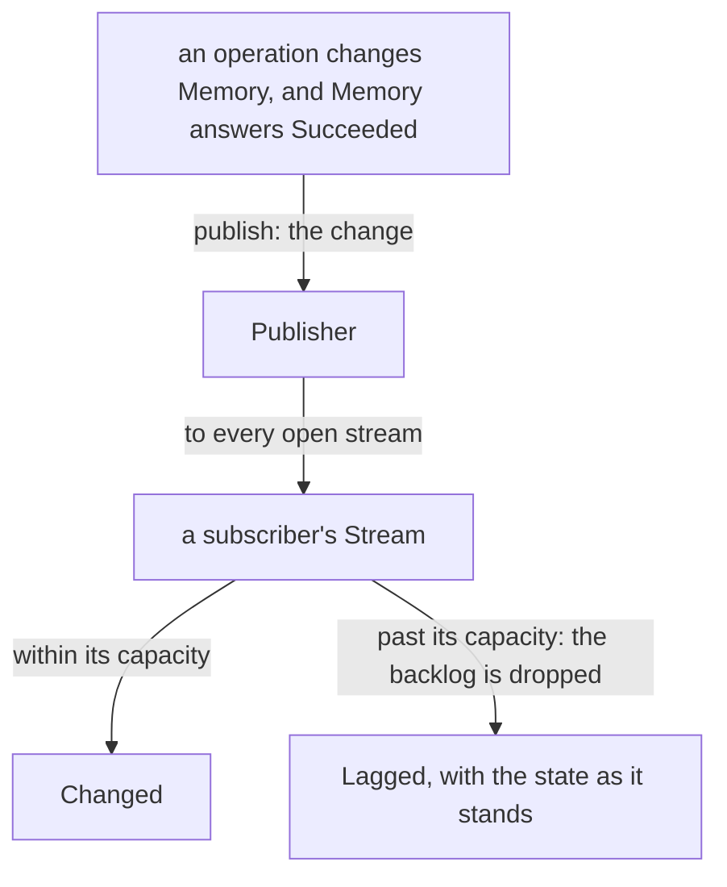

# A subscription

A subscription is one input answered by a stream: the state as it stands when the stream opens, then each change as it happens, then an end. A subscription is one exchange of the signal library's exchange layer. Every Nexus declares, carries and serves it the same way.



## In Ethos

Stream is a type Ethos knows without import, as it knows Vector and Option. It takes two types: the state the stream opens with, and the change it then carries. An output whose payload is a Stream is answered as a stream.

```ethos
Signal
[ harness:[ Observed Event State ]
  flow:[ FlowId ] ]
[ Subscribe ]
[ Subscribed.Stream<Vector<Observed> Changed> ]
[ Changed.{ FlowId Event State } ]
```

Subscribe is answered by Subscribed, a stream that opens with every session as observed now and then carries each Changed.

A Stream stands in two places: as the whole payload of a Signal output, and as the yield of a trait's capability, where Publishing's open yields Stream<State Change>, generated with Self::State and Self::Change. Everywhere else ethos-zero refuses it, with a typed error naming the file and the place: in a declared type, in an input, in a capability's input, in a Memory or an Emission, and nested in another type.

As datom, a subscription reads as its frames, each one output:

```datom
Subscribed.Opened.[ … ]
Subscribed.Changed.{ … }
Subscribed.Lagged.[ … ]
```

## In Rust

A Stream is a futures-core Stream of frames. The frame is the one type that travels, and it says only what an exchange does not already say: the opening, each change and a lag. The end is the exchange's.

On the wire the output carries one frame: Subscribed.Stream<State Change> generates Output::Subscribed(Frame<State, Change>), and every frame is one Output on the opening connection. Frame is archived and datomizable, as every output is. The live Stream is never a wire value and bears no archive or datom derive: it is what the serving capability returns from the Publisher's open, and what the generated client call returns to the subscriber.

Answerable answers once or as a stream, through one associated Answer: the Output for an ordinary input, and Stream<State, Change> for an input whose output's payload is a Stream. There is no second trait. Answerable is generated on the whole Input enum, so its Answer is one type for every input: the Output when the Signal has no stream output; otherwise a generated enum that is never archived, Once carrying the Output, and one variant for each stream output, named as that output and carrying its Stream.

```rust
pub enum Output { Subscribed(signal::Frame<Vec<Observed>, Changed>) }
pub trait Answering {
    fn subscribe(&self) -> Result<signal::Stream<Vec<Observed>, Changed>, Output>;
}
pub trait Answerable {
    type Answer;
    fn answer<Nexus: Answering>(&self, nexus: &Nexus) -> Self::Answer;
}
pub enum Answer {
    Once(Output),
    Subscribed(signal::Stream<Vec<Observed>, Changed>),
}
impl Answerable for Input { type Answer = Answer; /* each input answered */ }
```

```rust
pub enum Frame<State, Change> {
    Opened(State),
    Changed(Change),
    Lagged(State),
}
pub struct Stream<State, Change> {
    frames: Pin<Box<dyn futures_core::Stream<Item = Frame<State, Change>> + Send>>,
}
impl<State, Change> futures_core::Stream for Stream<State, Change> {
    type Item = Frame<State, Change>;
    fn poll_next(self: Pin<&mut Self>, context: &mut Context<'_>) -> Poll<Option<Self::Item>> { /* the inner stream's */ }
}
```

Opened is always the first frame and comes once. Lagged carries the whole state again: a subscriber that fell behind lost changes, and the state is what makes it right; it is a recovery, and the subscriber goes on from the state given. When the Stream finishes, its exchange ends.

The subscriber's side, generated with the Signal:

```rust
let mut stream = harness.subscribe()?;
while let Some(frame) = stream.next().await {
    match frame {
        Frame::Opened(observed) | Frame::Lagged(observed) => record.replace(observed),
        Frame::Changed(changed) => record.after(changed),
    }
}
```

## On the socket

A subscription is one exchange. Each frame is sent as one Delivery.Answer of that exchange, signalized and written with the same framing as every reply of the Nexus: a length, then the archive. When the Stream finishes, the Nexus sends Delivery.End, the exchange's Ending with its Conclusion. Several subscriptions share a connection as exchanges do. A subscriber that wants no more abandons its exchange, and the Nexus forgets that subscriber. A subscriber whose connection dropped subscribes again and has the state.



## Serving it

What can be subscribed to is Subscribable: it names its state and its change, and gives its state as it stands. A Publisher holds the subscribers of one Subscribable, inside the Kameo actor that owns the state.

```ethos
Library
[]
[ Capacity.Integer
  Reached.Integer ]
[ Subscribable.{ []
                 [ State Change ]
                 []
                 [ state.[ State ] ] }
  Following.{ []
              [ Change ]
              []
              [ after:{ [ Self Change ] [ Self ] } ] }
  Publishing.{ []
               [ State Change ]
               []
               [ publish.{ [ Change ] [ Reached ] }
                 open.[ Stream<State Change> ] } ] }
[]
```

Capacity, Reached and the three traits are declared in Ethos and generated; Stream and Frame, being generic, are written once in Rust in the library, as Vector is. The Publisher is the type that bears Publishing, its fields the library's own.

```rust
pub struct Publisher<State, Change> {
    current: tokio::sync::watch::Sender<(Position, State)>,
    changes: tokio::sync::broadcast::Sender<(Position, Change)>,
    capacity: Capacity,
}
impl<State: Following<Change = Change>, Change> Publishing for Publisher<State, Change> { type State = State; type Change = Change; /* publish, open */ }
```

The published state is held once, in the Publisher; the owning actor reads it from its Publisher and keeps no second copy. publish folds the change into that state by Following's after, the state moved in and out with no clone per change, and hands the change to every open stream, waiting for none of them, and yields how many it reached. open gives one subscriber its Stream: Opened with the state as it stands, then every change published after it. The Publisher keeps a position beside the state and on each change it broadcasts; after an Opened or a Lagged, the Stream drops every change at or before the position of the state it sent, so the subscriber receives exactly the changes that follow that state, none twice and none missing. The position is the Publisher's own and is not in the Frame. The Capacity is how many changes a subscriber may fall behind, a configuration; a subscriber past it receives Lagged with the state as it then stands and goes on from there. No subscriber slows the Nexus or another subscriber, and none is dropped for being slow.



## Where a change comes from

A change is published by the operation that made it, at the moment Memory answers that it succeeded. Nothing is found by asking again on a timer: a Nexus whose state is another Nexus's subscribes to that Nexus and publishes what the stream brings.

```rust
impl Operable for Record {
    fn operate(&self, nexus: &mut Nexus) -> Recorded {
        let answer = nexus.memory.change(self);
        if let Answer::Succeeded = answer { nexus.publisher.publish(Changed::from(self)) }
        Recorded
    }
}
```
