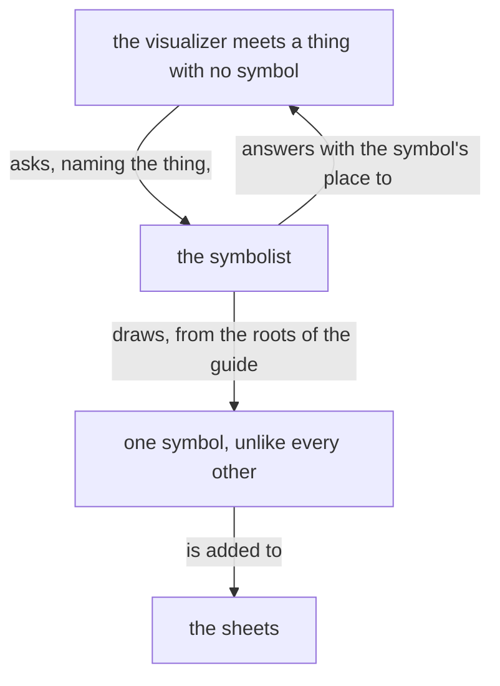

# The symbolist

The symbolist holds the visual language: its guide and its sheets of symbols. It is asked for the symbol of a thing, named with one line saying what the thing is.

It draws the symbol as vector graphics, from the roots of the guide: the simplest form that carries the feel of the thing, unlike every other symbol in form and in colour. A symbol already widely understood for the thing is used, in the colour and style the guide gives the thing's nature. A thing composed of simpler things is composed of their symbols.

It renders the symbol and looks at it, beside the symbols nearest to it, until the two are told apart at a glance.

It adds the symbol to its sheet, with the thing's name, and answers the flow that asked with the symbol's place in the sheets.

