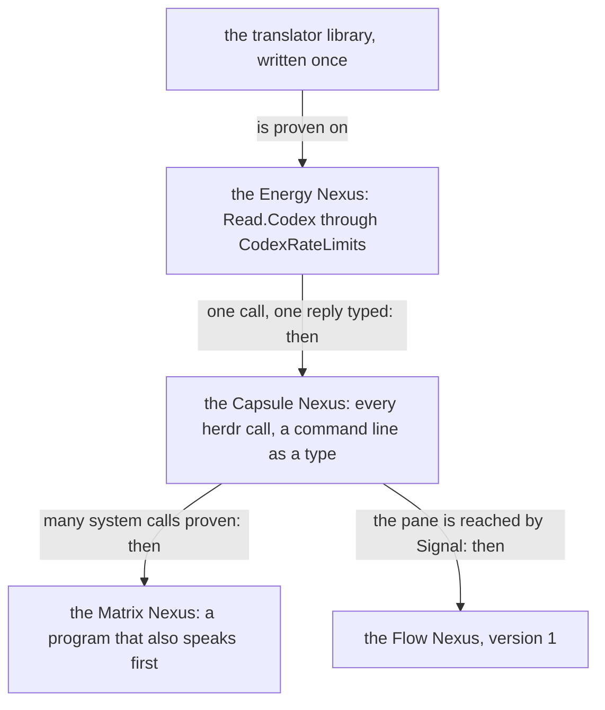
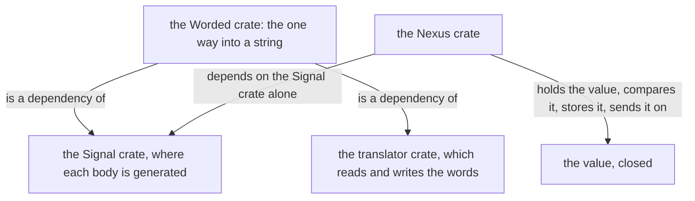

# The translator is built first

Version 1 of every Nexus stands on one thing: the translator. It is built first and made right, and every Nexus after it is a place, four ethos files and the hand-written bodies.



Each proof adds one thing the one before it lacked. The Energy Nexus proves a call and its typed reply. The Capsule Nexus proves a command line with many verbs and arguments, each a type. The Matrix Nexus proves a program outside that speaks without being asked.

A proof is whole when its datom is typed at the CLI, the reply printed is the typed outcome of a real call, and the Nexus crate depends on nothing that reads or writes words.

## A Nexus cannot touch a string

A Nexus carries a string as it carries any value, whole and closed. The words inside it are reached through one trait, Worded, which lives in a crate of its own; the translator depends on that crate and the Nexus does not. The Rust generated from Ethos gives every newtype over String a private field and its Worded body. The rule is kept by the dependency list of the Nexus crate. The names below are tentative.

```ethos
Traits
[ Worded.[ words.[ String ]
           word:{ [ String ] [ Self ] } ] ]
```

```rust
// generated, in the Signal crate
pub struct Repository(String);
impl Worded for Repository {
    fn words(&self) -> String { self.0.clone() }
    fn word(words: String) -> Self { Self(words) }
}
```



A Nexus that needs to decide by what a string says is missing a type: the translator reads the words into an enum, and the Nexus decides by the enum.

## What is generated and what is written

The library gives the sockets, the text and the serving. Ethos generates each emission's type and the handing of each to its body. The implementer writes one body for each emission, and where a body is the same for every Nexus it moves into the library.

While ethos-zero knows no Emission root, an Emission is written as vision:short-ethos:0 says.

## Memory is a database

A version 1 Nexus keeps its Memory in its State directory, and what it knew stands after its process ends and starts again. Each version 1 Nexus is built on the version 1 branch of its repository.
