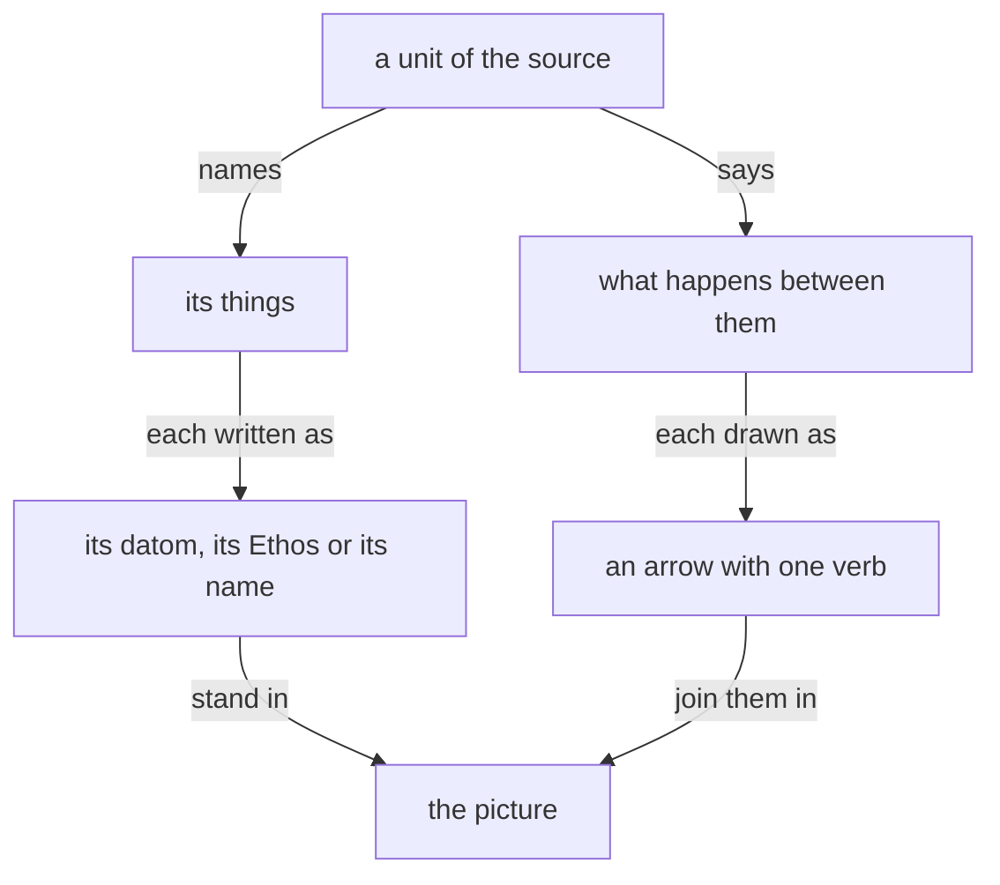
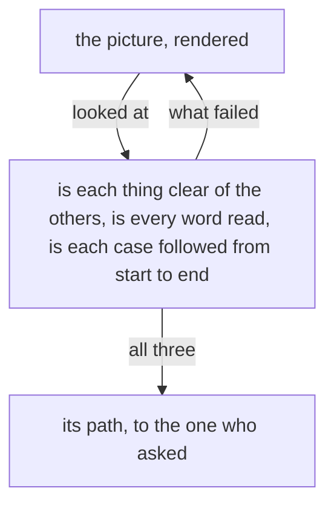

A picture is a flowchart: the things, and one verb on each arrow between them. A thing is shown as what it is in our own writing: a type as its Ethos, a message or a value as its datom, a flow as its address. A source is read for its things and its cases.



## A thing

```datom
[ DescribedVisualObject.{ Datom «a payload, a value or an address is written as its datom, whole, in a calm frame, in a fixed-width face» }
  DescribedVisualObject.{ Ethos «a type is written as its Ethos, the same way» }
  DescribedVisualObject.{ Named «any other thing is its plain name in a frame» }
  DescribedVisualObject.{ Sun «the living is the Sun's glyph, alone, unnamed» }
  DescribedVisualObject.{ Moon «the written psyche, the beliefs, is the Moon's glyph, alone, unnamed» }
  DescribedVisualObject.{ Glyphs «the Sun and the Moon are the glyphs there are; everything else is written» }
  DescribedVisualObject.{ State «a thing in a state is its name with the state: working, resting» } ]
```

## What it does

```datom
[ DescribedVisualObject.{ Arrow «one thing acts on another; one verb on it: sends, receives, waits, accepted, rejected, among others» }
  DescribedVisualObject.{ Order «top to bottom is first to last» }
  DescribedVisualObject.{ Branch «where cases part, one arrow for each, the datom that makes the case standing on its branch» }
  DescribedVisualObject.{ Stopped «what is kept out stops at a bar» }
  DescribedVisualObject.{ Space «every thing stands clear of every other; an arrow meets a frame at its edge» } ]
```

## Colour and words

```datom
[ DescribedVisualObject.{ Ground «quiet and pale» }
  DescribedVisualObject.{ Colour «one colour, one meaning, the same in every picture; each case its own colour, on its branch from the parting to its end» }
  DescribedVisualObject.{ Words «the datom, the names and the verbs are all the words of a picture» }
  DescribedVisualObject.{ Few «few things, large; a crowded picture is two pictures» }
  DescribedVisualObject.{ Phone «every word is read on a phone» } ]
```

## The look


