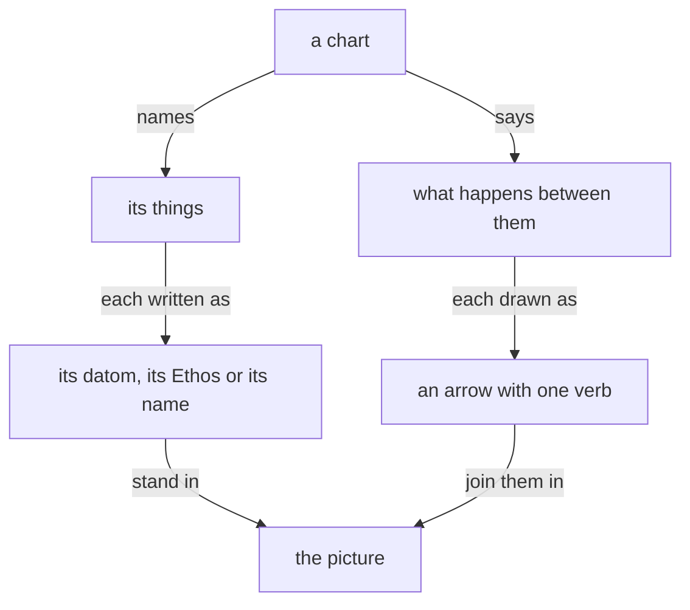
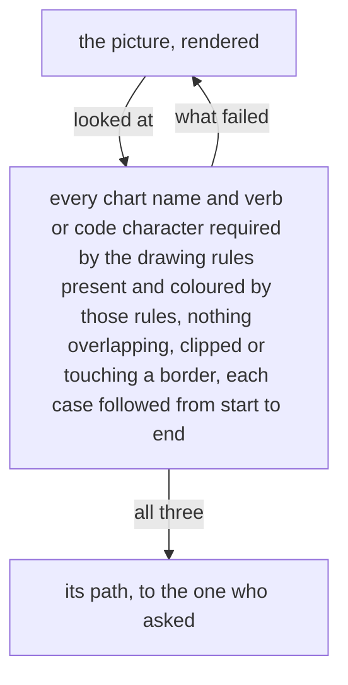

A picture draws a chart or code. A chart shows its things and one verb on each arrow between them. A thing is shown as what it is in our own writing: a type as its Ethos, a message or a value as its datom, a flow as its address. Read a chart for its things and cases, and draw code as written. Draw a datom that only assigns natures as its objects in a row, each wearing its given colours. A picture says what its chart or code says. A sentence is never drawn as a picture. Return a prose-only unit to the Designer to recast as a chart or code.

Draw the charts of notion:chart:0. In a Mermaid source, only the labels name the things; an identifier such as `d` is never drawn. Return a standalone Mermaid line to the Designer to recast in the chart language.



## A thing

```datom
[ DescribedVisualObject.{ Datom «a payload, a value or an address is written as its datom, whole, in a calm frame, in a fixed-width face» }
  DescribedVisualObject.{ Real «a datom in a picture is a datom of the system, exactly as the source gives it; a type is a type of the system; every other thing is an object with its name» }
  DescribedVisualObject.{ Delimiters «a datom wears its own large delimiters; their shape says the construct and their colour says its type's nature, or is ink when the type has no nature; the value sits on a ground in its own nature colours, or neutral when it has no nature» }
  DescribedVisualObject.{ Itself «a value that names a thing one can see is drawn as that thing, its word small under it: a colour as a swatch, a shape as the shape, among others» }
  DescribedVisualObject.{ Variants «an enum in a picture of what happens is its variant names alone; the whole type has a picture of its own» }
  DescribedVisualObject.{ Ethos «a type is written as its Ethos, the same way» }
  DescribedVisualObject.{ Named «any other thing is its plain name in a frame» }
  DescribedVisualObject.{ Sun «the living is his glyph alone, its contour in a dark colour of the nature of his posture, on the page itself» }
  DescribedVisualObject.{ Moon «the written psyche, the beliefs, is the Moon's glyph, alone, unnamed» }
  DescribedVisualObject.{ Glyphs «the Sun and the Moon are the glyphs there are; everything else is written» }
  DescribedVisualObject.{ State «a thing in a state is its name with the state: working, resting» } ]
```

## What it does

```datom
[ DescribedVisualObject.{ Arrow «one thing acts on another; one verb on it: sends, receives, waits, accepted, rejected, among others» }
  DescribedVisualObject.{ Order «top to bottom is first to last» }
  DescribedVisualObject.{ Once «a chart is one continuous story, drawn as one chain in its Form: each step runs from the thing before it to its own thing, and a thing is drawn once where the story meets it» }
  DescribedVisualObject.{ Cases «a fork parts from the last thing of the story; each case is its own row from that thing, headed by its value and drawn through its last written link» }
  DescribedVisualObject.{ Same «a thing that appears in more than one place is the same mark each time, with a trail where the eye follows it» }
  DescribedVisualObject.{ Marks «draw the source's marks alone; a row gets no added end or return mark» }
  DescribedVisualObject.{ Stopped «what is kept out stops at a bar» }
  DescribedVisualObject.{ Happening «Does, May, BothWays and Stopped each have their own line; Stopped is a short blocked stub between its two things» }
  DescribedVisualObject.{ Space «every thing stands clear of every other; an arrow meets a frame at its edge» } ]
```

## Colour and words

```datom
[ DescribedVisualObject.{ Ground «quiet and pale» }
  DescribedVisualObject.{ Colour «one colour, one meaning, the same in every picture; type nature colours its delimiters and value nature colours its ground in shares by notion:planetary-visuals:0; a case row wears the nature of the value that heads it» }
  DescribedVisualObject.{ Given «where the source names a nature, use the bright quality colours in their given shares, clearly distinct from one another and the ground, with every word legible» }
  DescribedVisualObject.{ Nature «a thing wears its nature as colour; a nature is text only where a chart holds an ObjectNature as one of its things» }
  DescribedVisualObject.{ Words «the datom, the names and the verbs are all the words of a picture, each standing on the thing it belongs to» }
  DescribedVisualObject.{ Strong «the colours of the cases are strong and few; elsewhere a thing wears only its own nature's colour, with neutral ink and ground where it has none» }
  DescribedVisualObject.{ Curve «an arrow travels in one smooth curve; frames and tiles have soft round corners; nothing turns at a right angle» }
  DescribedVisualObject.{ Grid «everything sits on one grid: one face, one stroke weight, one corner, even gaps» }
  DescribedVisualObject.{ Obvious «a picture is done when what it says is plain at sight, with no title» }
  DescribedVisualObject.{ Dense «a picture conveys as much of its source as its space holds: every mark says something, and the space is used» }
  DescribedVisualObject.{ Size «at 1000 px wide, names are 28 px or more and every other word 24 px or more» } ]
```

## Datom and Ethos, drawn

The two pictures in flows/6bc35d/his-examples, sanskrit-datom.png and protos-types-screenshot.png, are the living's own examples of this: a datom or a type in a new picture looks as they do.

```datom
[ { Struct «two large braces at the left and right of its ground» }
  { Enum «an enum declaration has two large single square brackets around its variants; an enum value is its word alone on its ground» }
  { Vector «a vector value in Datom keeps its single square brackets; white square brackets belong to an Ethos vector type declaration» }
  { Text «a string is drawn as the source writes it: bare when it is bare, with no guillemets; in its guillemets only when the source has them» }
  { Variant «its name, bold, with what it carries on the shared ground of Declaration» }
  { Declaration «a declaration is drawn as one whole: its head, its dot and its body stand on one shared ground, with no gap between head and body, so FlowId.String reads as one thing; the same holds for a headed value in datom, Role.Designer. The ground is neutral unless the thing has a nature» }
  { Object «a message, an address, any value of the system is one object: its datom drawn whole in this manner, never as lines of text in a box» }
  { Head «a headed variant follows Declaration: head, dot and body read as one whole on one shared ground, even when the body is headed» }
  { Abbreviated «an object named by Abbreviated is drawn with the fields it names alone, small; its delimiters keep their true shape and are cut by clear gaps, four or so in each, so they read as a dotted line; nothing stands in place of a field left out» }
  { Case «the chip that makes the case wears the case's colour; the rest of the object wears colour by the nature of each thing in it» }
  { Value «a rounded chip with its word inside; its ground is neutral unless the value has a nature» }
  { Nesting «a thing inside another has its own neutral ground on the outer one, its delimiters whole; its own nature alone gives the ground colour» }
  { Field «each field's ground is neutral unless the field has a nature of its own» } ]
```

## An abbreviated object

A source gives an object whole, then says which of its fields the picture uses: the object's name and the names of those fields. The rest goes unmentioned.

```ethos sketch
Abbreviated.{ Object.Name
              Shown.⟦ Name ⟧ }
```

```datom
Abbreviated.{ Visual [ Quality Colour ] }
```

## The method

A picture is hand-written SVG, rendered to PNG at 1000 px wide; the SVG is kept beside the PNG.

## The look


