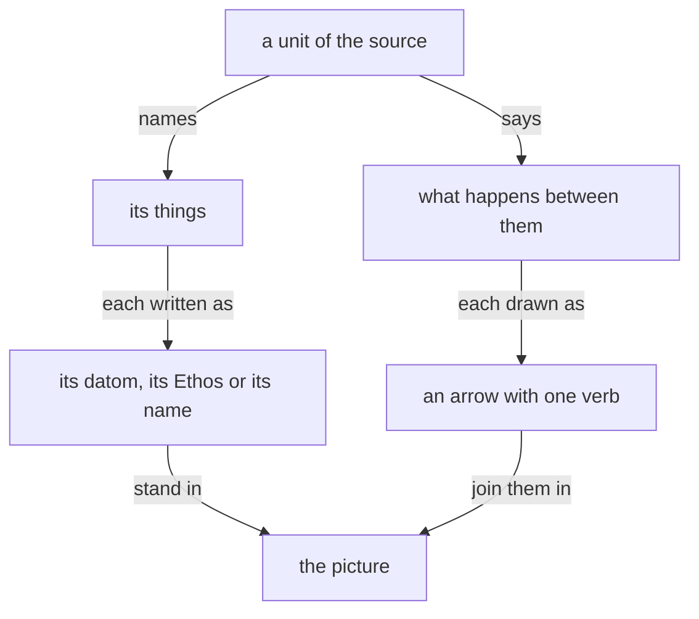
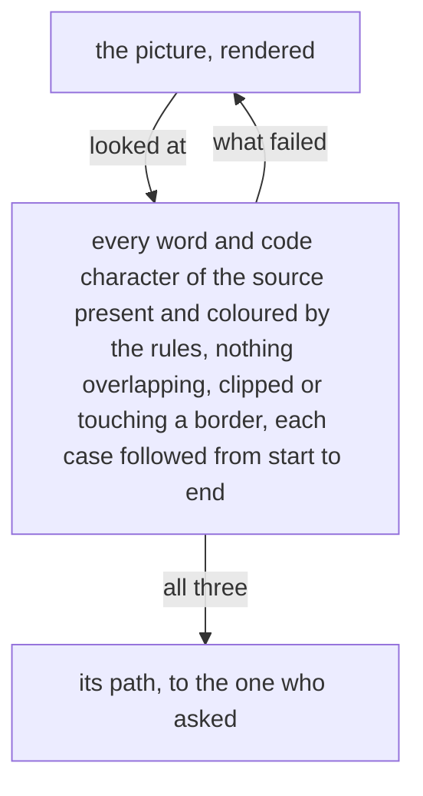

A picture is a flowchart: the things, and one verb on each arrow between them. A thing is shown as what it is in our own writing: a type as its Ethos, a message or a value as its datom, a flow as its address. A source is read for its things and its cases.



## A thing

```datom
[ DescribedVisualObject.{ Datom «a payload, a value or an address is written as its datom, whole, in a calm frame, in a fixed-width face» }
  DescribedVisualObject.{ Delimiters «a datom wears its own delimiters, large, around a pale field; what it holds sits on the field, a datom inside another the same way» }
  DescribedVisualObject.{ Itself «a value that names a thing one can see is drawn as that thing, its word small under it: a colour as a swatch, a shape as the shape, among others» }
  DescribedVisualObject.{ Ethos «a type is written as its Ethos, the same way» }
  DescribedVisualObject.{ Named «any other thing is its plain name in a frame» }
  DescribedVisualObject.{ Sun «the living is the Sun's glyph, alone, unnamed» }
  DescribedVisualObject.{ Moon «the written psyche, the beliefs, is the Moon's glyph, alone, unnamed» }
  DescribedVisualObject.{ Glyphs «the Sun and the Moon are the glyphs there are; everything else is written» }
  DescribedVisualObject.{ State «a thing in a state is its name with the state: working, resting» } ]
```

## What it does

```datom
[ DescribedVisualObject.{ Arrow «one thing acts on another; one verb on it: sends, receives, waits, accepted, rejected, among others» }
  DescribedVisualObject.{ Order «top to bottom is first to last» }
  DescribedVisualObject.{ Once «every thing is drawn once; a word stands once in a picture» }
  DescribedVisualObject.{ Cases «cases share the one drawing of each thing and differ only in their own arrow, each arrow named for its case, landing where that case lands» }
  DescribedVisualObject.{ Same «a thing that appears in more than one place is the same mark each time, with a trail where the eye follows it» }
  DescribedVisualObject.{ Ends «what goes in and what comes out are seen first: large arrows» }
  DescribedVisualObject.{ Stopped «what is kept out stops at a bar» }
  DescribedVisualObject.{ Space «every thing stands clear of every other; an arrow meets a frame at its edge» } ]
```

## Colour and words

```datom
[ DescribedVisualObject.{ Ground «quiet and pale» }
  DescribedVisualObject.{ Colour «one colour, one meaning, the same in every picture; each case its own colour, on its branch from the parting to its end» }
  DescribedVisualObject.{ Given «where the source names a quality for a thing, the thing's field wears that quality's colour, pale: Solar gold, Lunar pale blue, Martial red, Mercurial green, Jovian yellow, Venusian pink, Saturnian grey, Ascending slate blue, Descending smoke» }
  DescribedVisualObject.{ Words «the datom, the names and the verbs are all the words of a picture» }
  DescribedVisualObject.{ Obvious «a picture is done when what it says is plain at sight, with no title» }
  DescribedVisualObject.{ Dense «a picture conveys as much of its source as its space holds: every mark says something, and the space is used» }
  DescribedVisualObject.{ Size «at 1000 px wide, names are 28 px or more and every other word 24 px or more» } ]
```

## The colours of code

```datom
[ { «a declared type name, and its dot» «copper #B4552A, bold» }
  { «a string value» «green #2E8B3D; a guillemet string on a very light green band» }
  { «an integer value» «black-sapphire #1E2F6E» }
  { «struct braces» «gold #C9930A, bold; pale tint #FBF3D6 over their region» }
  { «vector brackets» «silver #7F93A8, bold; pale tint #EEF2F6 over their region» }
  { «a variant name and its dot; an enum's brackets» «red #C81E2B, bold» }
  { «a comment» «smoke #7A7F8C, italic» }
  { «what travels between flows» «violet #6D3FC4» }
  { «names» «ink #1F2430, on paper #FAF7F2» } ]
```

## The method

A picture is hand-written SVG, rendered to PNG at 1000 px wide; the SVG is kept beside the PNG.

## The look


