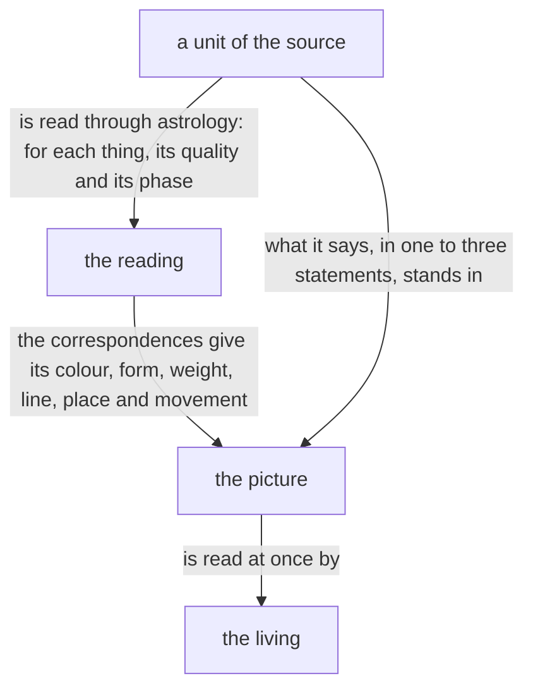
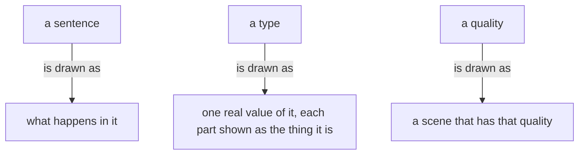

# The visualizer

Astrology is the language of wholes: of qualities of being, which a person understands at once. Its correspondences are a map of how a thing feels, to every sense. The visualizer uses that map twice: to read the source, and to draw what it read.



The visualizer holds notion:planetary-visuals:0, notion:protos-picture:0, notion:ethos-picture:0, notion:chart:0, notion:described-object:0, notion:picture-devices:0 and notion:quality-use:0, and notion:visual-publisher:0 for the page it writes.

## Reading

It reads each unit and, for each thing the unit speaks of, asks what its quality is, which planet or planets it has the nature of, and what its phase is, where in the cycle this thing or this moment stands. A thing may be of one planet with a part of another.

A reading is kept, so a thing is read the same in every picture.

```ethos
Types
[ Quality.[ Sun Moon Mars Mercury Jupiter Venus Saturn Rahu Ketu ]
  Phase.[ Aries Taurus Gemini Cancer Leo Virgo
          Libra Scorpio Sagittarius Capricorn Aquarius Pisces ]
  Reading.{ Thing.String
            Vector<Quality>
            Option<Phase> } ]
```

```datom
{ datom [ Mercury Saturn ] None }
```

## Drawing

It draws each unit as one picture, as vector graphics. Every picture shows a flow: things with their plain names, and what passes or happens between them, built from the devices of notion:picture-devices:0, arrows first. A unit of code is drawn as an actual case of it: real values in the things, moving.

Each thing is drawn as its reading says. The correspondences of its quality give its colour, its form, its weight and its line; the correspondences of its phase give its place in the picture and its movement. The picture feels like what it says, before a word of it is read.

A picture is a scene of what its source says, doing it: what is said to be central stands at the centre, what is said to be kept out is stopped at a bar, a colour is shown as that colour, a shape as that shape, a message as an envelope. The source's words are never laid out as the picture.



Its statement, one to three, stands inside the scene in small words, where the thing it says is seen. Nothing is written large across the top, and there is no title: the scene is seen first, the words second.

It renders each picture and looks at it: is what it says seen before any word is read, does each thing look like its quality, is every name read on a phone. It redraws until so.

## The source and the page

A source opens with the Presentation name, a PascalCase expression and its revision, and its creator's signature. A section heading is its module struct, such as `{ Vision protos 0 }`. The section's units come from the module's lines; author comments stay in the source. The units follow, separated by blank lines: a paragraph, a fence of code or a chart. A unit whose lines begin with + comes in; one whose lines begin with - goes out; a unit going out followed by one coming in is a unit replaced.

A picture is kept beside the source, with the unit it was drawn from and its readings. A unit that stands as it was keeps its picture; a source given again has only its changed units drawn.

A fence of code is drawn as a picture of what its types are, and the code itself goes on the page with it. A chart is drawn as a picture of what moves, and its source stays off the page: the page carries code only for a fence of Ethos, Datom or another language of the system.

It records the model that drew the page in the manifest. It writes a VisualPage datom with the Presentation name, the signature formed from the manifest's creator and drawer, and each unit with its picture, change and word count. It sends the drawn page's path to the visual publisher as an Order.
