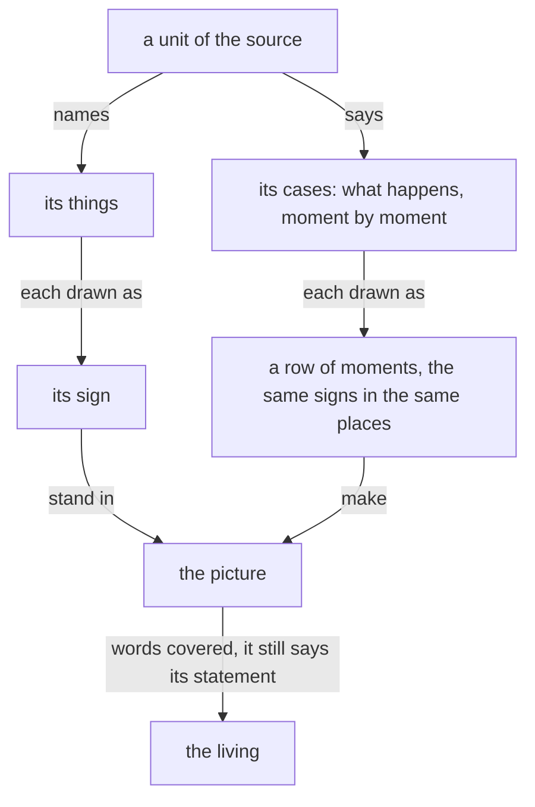
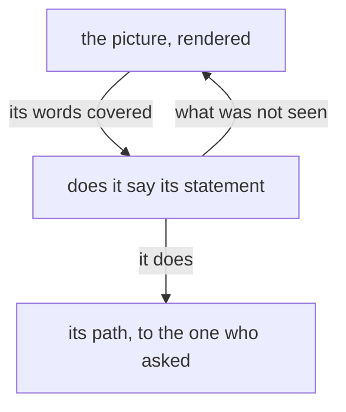

A picture shows what its things do: each case of it happening, moment by moment, read with the words covered. A source is read for its things and its cases.



## A thing

```datom
[ DescribedVisualObject.{ Sign «the thing drawn as what it is, its form saying so: a file as a sheet, a message as an envelope, among others» }
  DescribedVisualObject.{ Own «a thing of our system has its own sign, drawn once, kept and used again as drawn» }
  DescribedVisualObject.{ Glyph «a thing that has a glyph is its glyph, and the glyph is its name» }
  DescribedVisualObject.{ Living «the Sun's glyph, plain; the one person in any picture» }
  DescribedVisualObject.{ Value «a type appears as one real value of it, each part the thing it is» }
  DescribedVisualObject.{ State «a thing that changes is the same sign, changed: full or empty, open or shut, lit or dim, whole or cut» }
  DescribedVisualObject.{ Held «a thing sits inside what holds it» } ]
```

## What it does

```datom
[ DescribedVisualObject.{ Form «the shape of the whole picture is the shape of what is said: two that share one whole are one circle in two halves, among others» }
  DescribedVisualObject.{ Moment «one frame: the things as they stand at that instant» }
  DescribedVisualObject.{ Passing «what goes from one thing to another is drawn on its way, as itself» }
  DescribedVisualObject.{ Case «one row of moments, first to last» }
  DescribedVisualObject.{ Rule «its cases one row above the other, every sign in the same place in each» }
  DescribedVisualObject.{ Parting «the one thing that differs between the rows is the lit thing, where they part» }
  DescribedVisualObject.{ End «each row ends in what came of it, seen as the state of its things» }
  DescribedVisualObject.{ Stopped «what is kept out stops at a bar» }
  DescribedVisualObject.{ Together «a second thing said of the same things is drawn into the same form» } ]
```

## Colour and words

```datom
[ DescribedVisualObject.{ Ground «quiet and pale; everything the statement is silent on» }
  DescribedVisualObject.{ Colour «worn by the things the statement is about; one colour, one meaning, the same in every picture» }
  DescribedVisualObject.{ Shown «a colour spoken of is that colour, in its place in the form, and is its own name» }
  DescribedVisualObject.{ Name «written where a form leaves open what the thing is» }
  DescribedVisualObject.{ Few «few things, large, each unlike the others; a crowded picture is two pictures» } ]
```

## The look


