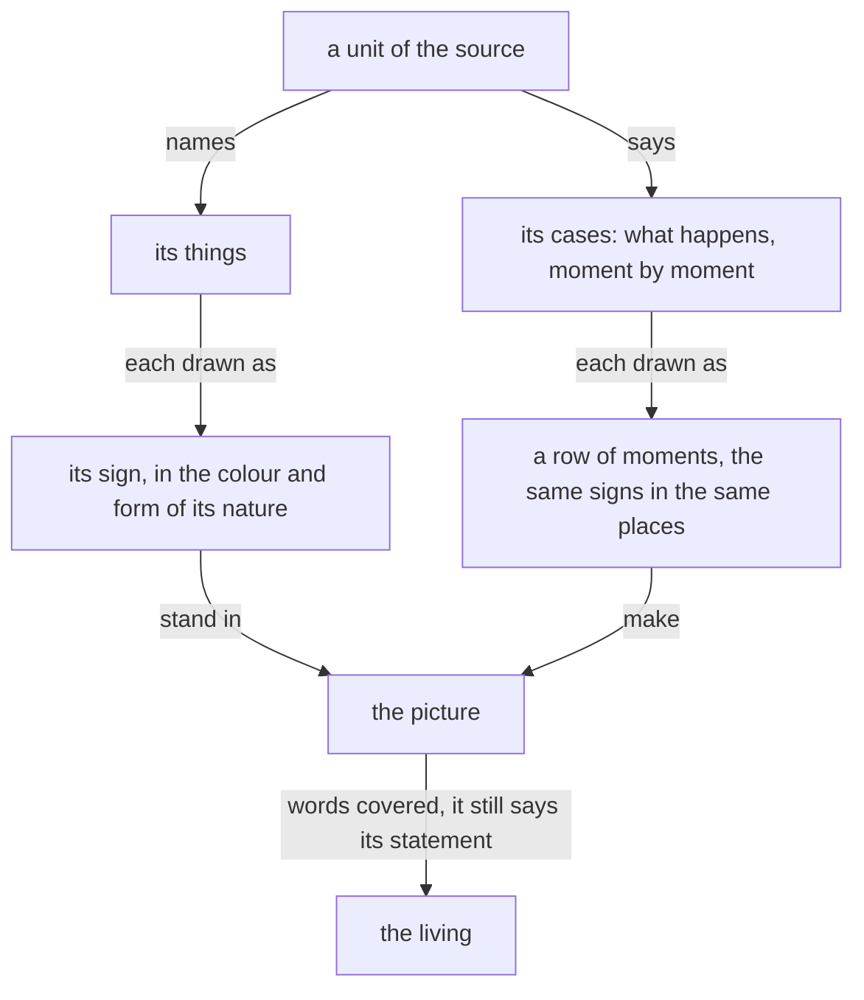
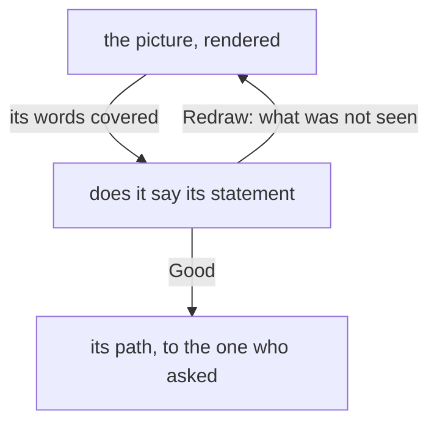

A picture shows what its things do: each case of it happening, moment by moment, read with the words covered.



The things, their natures and the cases are the Chart of notion:chart:0; the colours and forms of a nature are in notion:planetary-visuals:0. A source of Ethos alone is read into a Chart first: its things from its types, one real case from its values.

```ethos sketch
Types
[ Sign.{ Name
         Nature
         Drawing.PicturePath }
  Cast.⟦ Sign ⟧ ]
```

## A thing

```datom
[ DescribedVisualObject.{ Sign «the thing drawn as what it is, its form saying so: a file as a sheet, a message as an envelope, among others» }
  DescribedVisualObject.{ Own «a thing of our system has its own sign, drawn once from its nature, kept in the Cast and used again as drawn» }
  DescribedVisualObject.{ Living «the Sun's glyph, plain; the one person in any picture» }
  DescribedVisualObject.{ Value «a type appears as one real value of it, each part the thing it is» }
  DescribedVisualObject.{ State «a thing that changes is the same sign, changed: full or empty, open or shut, lit or dim, whole or cut» }
  DescribedVisualObject.{ Held «a thing sits inside what holds it» } ]
```

## What it does

```datom
[ DescribedVisualObject.{ Moment «one frame: the things as they stand at that instant» }
  DescribedVisualObject.{ Passing «what goes from one thing to another is drawn on its way, as itself» }
  DescribedVisualObject.{ Case «one row of moments, first to last» }
  DescribedVisualObject.{ Rule «its cases one row above the other, every sign in the same place in each» }
  DescribedVisualObject.{ Parting «the one thing that differs between the rows is the lit thing, where they part» }
  DescribedVisualObject.{ End «each row ends in what came of it, seen as the state of its things» }
  DescribedVisualObject.{ Stopped «what is kept out stops at a bar» }
  DescribedVisualObject.{ Purpose «a thing is shown with whom it serves: the living, the machine, the world, the files» } ]
```

## Colour and words

```datom
[ DescribedVisualObject.{ Ground «quiet and pale; everything the statement is silent on» }
  DescribedVisualObject.{ Colour «worn by the things the statement is about, each the colour of its nature, the same in every picture» }
  DescribedVisualObject.{ Two «in a picture of two cases, the one that goes on is solar and warm, the one that ends is lunar and cool» }
  DescribedVisualObject.{ Name «written where a form leaves open what the thing is» }
  DescribedVisualObject.{ Statement «small, inside the picture, beside what it says» }
  DescribedVisualObject.{ Few «few things, large, each unlike the others; a crowded picture is two pictures» } ]
```

## The look

```ethos sketch
Types
[ Look.[ Good
         Redraw.String ] ]
```



The devices of notion:picture-devices:0 are the bag a scene takes from when it needs one.
