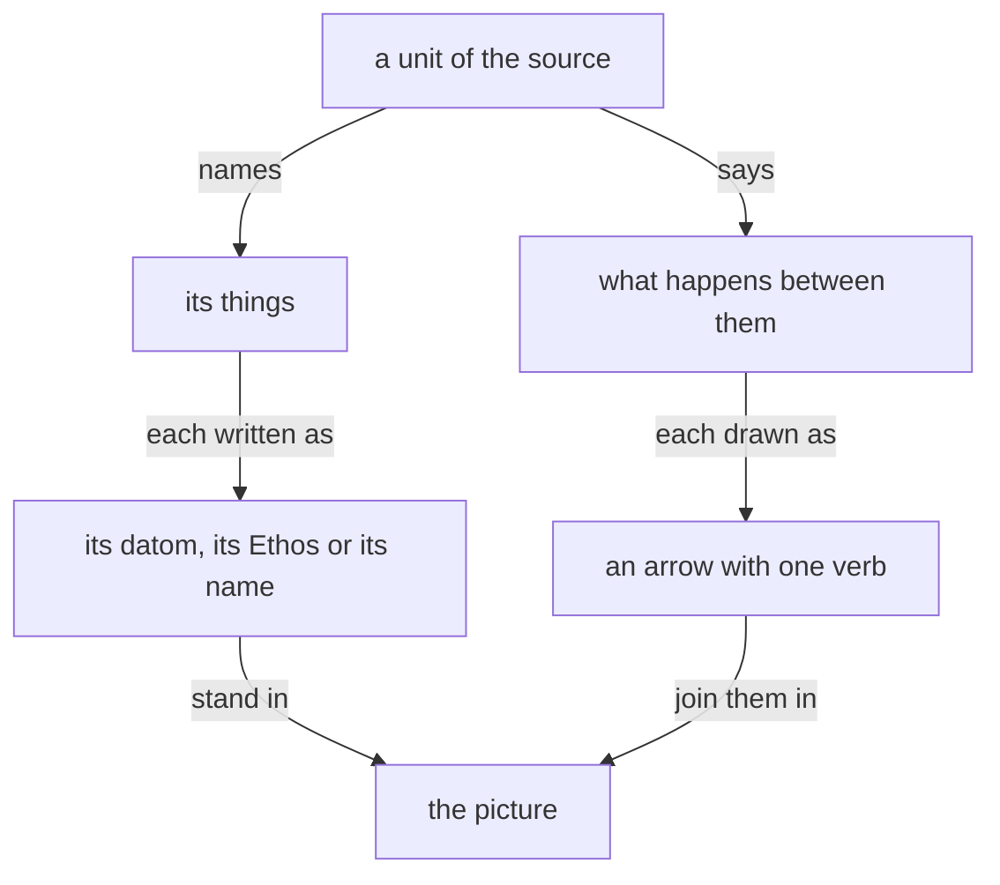
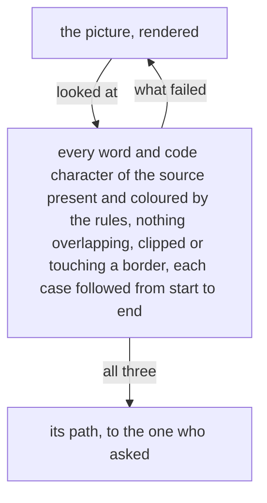

A picture is a flowchart: the things, and one verb on each arrow between them. A thing is shown as what it is in our own writing: a type as its Ethos, a message or a value as its datom, a flow as its address. A source is read for its things and its cases.



## A thing

```datom
[ DescribedVisualObject.{ Datom «a payload, a value or an address is written as its datom, whole, in a calm frame, in a fixed-width face» }
  DescribedVisualObject.{ Real «a datom in a picture is a datom of the system, exactly as the source gives it; a type is a type of the system; every other thing is an object with its name» }
  DescribedVisualObject.{ Delimiters «a datom wears its own delimiters, large, around a pale field; what it holds sits on the field, a datom inside another the same way» }
  DescribedVisualObject.{ Itself «a value that names a thing one can see is drawn as that thing, its word small under it: a colour as a swatch, a shape as the shape, among others» }
  DescribedVisualObject.{ Variants «an enum in a picture of what happens is its variant names alone; the whole type has a picture of its own» }
  DescribedVisualObject.{ Ethos «a type is written as its Ethos, the same way» }
  DescribedVisualObject.{ Named «any other thing is its plain name in a frame» }
  DescribedVisualObject.{ Sun «the living is the Sun's glyph, alone, unnamed» }
  DescribedVisualObject.{ Moon «the written psyche, the beliefs, is the Moon's glyph, alone, unnamed» }
  DescribedVisualObject.{ Glyphs «the Sun and the Moon are the glyphs there are; everything else is written» }
  DescribedVisualObject.{ State «a thing in a state is its name with the state: working, resting» } ]
```

## What it does

```datom
[ DescribedVisualObject.{ Arrow «one thing acts on another; one verb on it: sends, receives, waits, accepted, rejected, among others» }
  DescribedVisualObject.{ Order «top to bottom is first to last» }
  DescribedVisualObject.{ Once «every thing is drawn once; a word stands once in a picture» }
  DescribedVisualObject.{ Cases «cases share the one drawing of each thing and differ only in their own arrow, each arrow named for its case, landing where that case lands» }
  DescribedVisualObject.{ Same «a thing that appears in more than one place is the same mark each time, with a trail where the eye follows it» }
  DescribedVisualObject.{ Ends «what goes in and what comes out are seen first: large arrows» }
  DescribedVisualObject.{ Stopped «what is kept out stops at a bar» }
  DescribedVisualObject.{ Space «every thing stands clear of every other; an arrow meets a frame at its edge» } ]
```

## Colour and words

```datom
[ DescribedVisualObject.{ Ground «quiet and pale» }
  DescribedVisualObject.{ Colour «one colour, one meaning, the same in every picture; each case its own colour, on its branch from the parting to its end» }
  DescribedVisualObject.{ Given «where the source names a quality for a thing, the thing's field wears that quality's colour, pale: Solar gold, Lunar pale blue, Martial red, Mercurial green, Jovian yellow, Venusian pink, Saturnian grey, Ascending slate blue, Descending smoke» }
  DescribedVisualObject.{ Words «the datom, the names and the verbs are all the words of a picture, each standing on the thing it belongs to» }
  DescribedVisualObject.{ Strong «the colours of the cases are strong and few; everything else is ink on the pale ground» }
  DescribedVisualObject.{ Curve «an arrow travels in one smooth curve; frames and tiles have soft round corners; nothing turns at a right angle» }
  DescribedVisualObject.{ Grid «everything sits on one grid: one face, one stroke weight, one corner, even gaps» }
  DescribedVisualObject.{ Obvious «a picture is done when what it says is plain at sight, with no title» }
  DescribedVisualObject.{ Dense «a picture conveys as much of its source as its space holds: every mark says something, and the space is used» }
  DescribedVisualObject.{ Size «at 1000 px wide, names are 28 px or more and every other word 24 px or more» } ]
```

## Datom and Ethos, drawn

The two pictures in flows/6bc35d/his-examples, sanskrit-datom.png and protos-types-screenshot.png, are the living's own examples of this: a datom or a type in a new picture looks as they do.

```datom
[ { Struct «its two braces, blue, large, at the left and right of its pale field» }
  { Enum «its two square brackets, green, one stroke» }
  { Vector «its two white square brackets, green, drawn as a double stroke» }
  { Text «its two guillemets, grey, around the words, in the reading face» }
  { Variant «its name, bold, before what it carries» }
  { Object «a message, an address, any value of the system is one object: its datom drawn whole in this manner, never as lines of text in a box» }
  { Head «a variant's name is a bold chip joined to what it carries; a variant carrying a variant is chip joined to chip» }
  { Abbreviated «an object named by Abbreviated is drawn with the fields it names alone, small; its delimiters keep their true shape and are cut by clear gaps, four or so in each, so they read as a dotted line; nothing stands in place of a field left out» }
  { Case «the chip that makes the case wears the case's colour; the rest of the object keeps the colours of datom» }
  { Value «a rounded chip in a soft colour, its word inside» }
  { Nesting «a structure inside another has its own field on the outer one, its delimiters whole» }
  { Field «pale, a different soft colour for each structure, so each is seen apart» } ]
```

## An abbreviated object

A source gives an object whole, then says which of its fields the picture uses: the object's name and the names of those fields. The rest goes unmentioned.

```ethos sketch
Abbreviated.{ Object.Name
              Shown.⟦ Name ⟧ }
```

```datom
Abbreviated.{ Visual [ Quality Colour ] }
```

## The method

A picture is hand-written SVG, rendered to PNG at 1000 px wide; the SVG is kept beside the PNG.

## The look


