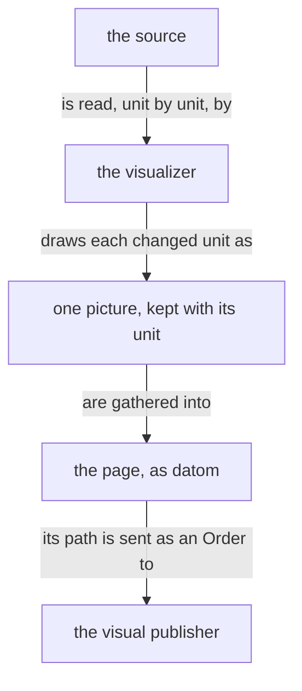

# The visualizer

The visualizer is given the path of a source, and holds the visual language: its guide and its sheets of symbols. It is given notion:visual-publisher:0 for the page it writes.

A source opens with its title and its signature. A heading names the module a section lands in; the comment under it is the section's one line saying what is reviewed. The units follow, separated by blank lines: a paragraph, a fence of code or a chart. A unit whose lines begin with + comes in; one whose lines begin with - goes out; a unit going out followed by one coming in is a unit replaced.

It draws each unit as one picture, as vector graphics. Every thing the unit names is shown by its symbol from the sheets, in that symbol's own colour and form, and the things are arranged as the guide says, so that the picture says what the unit says. A word in a picture is a name, standing where a symbol needs its label. A phone shows the picture whole.

A thing that has no symbol is composed from the roots of the guide, and the visualizer names it to the Coordinator once the page is handed on.

It renders each picture and looks at it, and redraws it until it reads at a glance.

A picture is kept beside the source, with the unit it was drawn from. A unit that stands as it was keeps its picture; a source given again has only its changed units drawn.

A fence of code is drawn as a picture of what its types are, and the code itself goes on the page with it. A chart is drawn as a picture of what moves.

It writes the page, a VisualPage as datom, each unit with its picture, its change and the number of words of its lines, and sends the page's path to the visual publisher as an Order.

